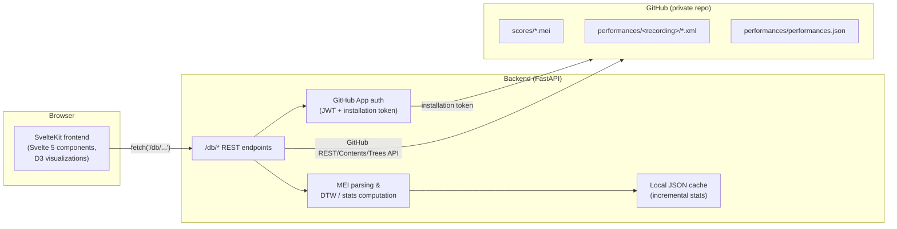
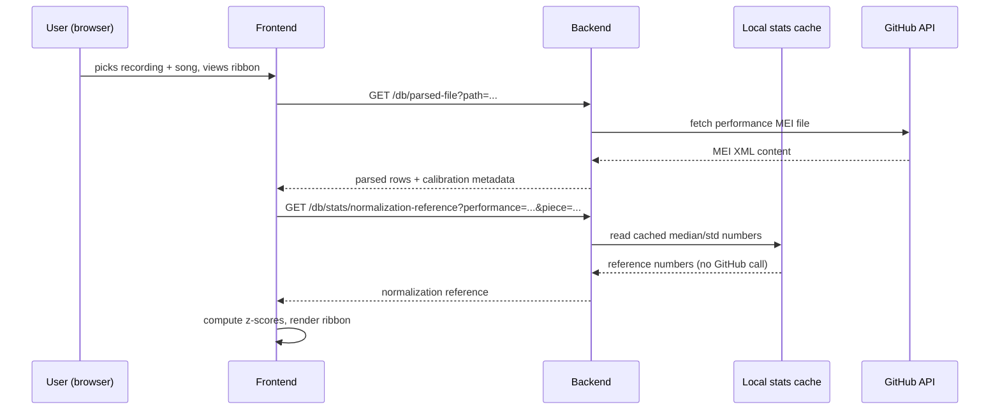

# Winterreise Performance Visualization — Documentation

This document describes what the application does, how it is built, which
technologies it relies on, and which parts of it are specific to the
*Winterreise* recording corpus versus which parts are general-purpose and
could be reused for a different body of performance data. It is written to
be readable both by a future developer picking up the codebase and by a
musicologist who wants to understand what the tool does and why it was
built the way it was, without necessarily reading the source code.

Pseudocode is used throughout to illustrate how something works
conceptually, without reproducing the exact source. Where it's useful to
know the real file, the pseudocode blocks are annotated with the file they
correspond to.

## Table of Contents

1. [What This Application Is](#1-what-this-application-is)
2. [The Underlying Data](#2-the-underlying-data)
3. [System Architecture Overview](#3-system-architecture-overview)
4. [Backend: A Guided Tour](#4-backend-a-guided-tour)
5. [Frontend: A Guided Tour](#5-frontend-a-guided-tour)
6. [The Normalization & Comparison Pipeline](#6-the-normalization--comparison-pipeline)
7. [Feature Walkthrough](#7-feature-walkthrough)
8. [Technology Stack](#8-technology-stack)
9. [Corpus-Specific vs. Generic/Reusable Parts](#9-corpus-specific-vs-genericreusable-parts)
10. [Known Limitations & Notes for Future Work](#10-known-limitations--notes-for-future-work)
11. [Local Development Setup](#11-local-development-setup)
12. [Glossary](#12-glossary)
13. [Appendix: A Complete Request, Traced Through Every Layer](#13-appendix-a-complete-request-traced-through-every-layer)
14. [Frequently Asked Questions](#14-frequently-asked-questions)

---

## 1. What This Application Is

This is a web application for visualizing and comparing many different
*recorded performances* of the same piece of music — specifically, Franz
Schubert's song cycle *Winterreise* (D. 911), a set of 24 songs. The
motivating idea is straightforward: a single printed musical score
under-determines a performance. Two pianists playing from the identical
notation can differ enormously in tempo, dynamics (loudness), and tone
color, and those differences are exactly what a performer's interpretation
consists of. This tool exists to make those interpretive differences
*visible and comparable* across many historical recordings — some dating
back to the late 1940s, others from more recent decades.

Concretely, the application:

- Displays the musical score itself, engraved from a digital music
  notation format (MEI — more on this below), with editorial annotations
  highlighted (for example, places where a specific singer's performance
  diverges from the printed notation).
- Displays, for a single performance, how tempo, dynamics, and timbre
  (tone color) evolve beat-by-beat across a piece, as a visual "ribbon."
- Lets you compare several performances of the same piece side by side.
- Computes and displays a *similarity network*: given a set of recordings,
  it calculates how similar they are to one another (using a technique
  called Dynamic Time Warping, explained in detail in
  [section 6](#6-the-normalization--comparison-pipeline)) and draws a graph
  where more similar performances are pulled closer together.

None of this data was manually created for this app — it's the *output* of
a separate research pipeline (outside the scope of this repository) that
takes audio recordings, aligns them to the score, and extracts per-beat
tempo/dynamics/timbre measurements, storing the result as annotated MEI
files. This application is the presentation and analysis layer on top of
that pre-existing dataset.

### 1.1 Who built this and why

The application was built by Clemens von Cramon as part of an M.A. thesis
in Digital Humanities at Johannes Gutenberg University Mainz. The
underlying research project is described in the app's own landing page as
"Creating Schubert's Winterreise in performance with Dietrich
Fischer-Dieskau" — all of the performances in the current dataset feature
baritone Dietrich Fischer-Dieskau, recorded across several decades with
different pianists (Gerald Moore, Alfred Brendel, Daniel Barenboim, and
others), which is itself an unusually rich object of study: the same
singer's evolving interpretive relationship with the same piece across a
performing career, refracted additionally through the choices of different
collaborating pianists.

Why *Winterreise* specifically, and why Fischer-Dieskau specifically, are
choices rooted in the broader musicological research project this
application serves, rather than in this codebase — but it's worth noting
briefly why this repertoire makes an unusually good test case for the
kind of computational performance-comparison this tool enables: Schubert's
*Winterreise* is among the most frequently recorded works in the entire
vocal recital repertoire, meaning a genuinely large and long time-spanning
set of recordings exists to draw on; Fischer-Dieskau himself recorded it
repeatedly across roughly four decades of his career with a number of
different pianist collaborators, offering a rare opportunity to hold the
singer constant while varying both the specific collaborating musician and
the passage of the singer's own artistic development over time — exactly
the kind of controlled-yet-rich comparison a tool like this is built to
surface.

### 1.2 A birds-eye walkthrough

At a high level, using the app looks like this:

```
User opens the app
  → sees a landing page describing the project
  → navigates to "Scores" to browse/read the notated score of any of the 24 songs
  → navigates to "Visualizations" and picks one of:
      - Line graph:       overlay one raw parameter (tempo OR dynamics OR timbre)
                           across several performances of one song, as line plots
      - Multi-parameter:  see tempo + dynamics + timbre together for ONE performance
                           of ONE song, as a "ribbon" (bar width = tempo, bar length =
                           dynamics, bar color = timbre) — then optionally select a
                           range of beats and jump to comparing that same range across
                           OTHER performances (still as ribbons, one per performance)
      - DTW network:      pick a scope (one song / half the cycle / the whole cycle /
                           a hand-picked measure range), pick which parameter(s) to
                           include, and get a force-directed graph where performances
                           that behave more similarly are drawn closer together
```

Each of these views is described in detail in
[section 7](#7-feature-walkthrough). The rest of this document builds up
the concepts and implementation needed to understand how they work.

### 1.3 Design philosophy

A few recurring decisions in this codebase are easier to make sense of if
you know the priorities that shaped them:

- **The backend proxies GitHub rather than owning a database.** There is
  no PostgreSQL/SQLite/MongoDB anywhere in this stack. The dataset already
  lives, and is version-controlled, in a GitHub repository — every file
  edit, addition, or correction to the underlying research data is a git
  commit with full history, which matters a great deal for a research
  project where data provenance and the ability to audit "what changed and
  when" are part of the scholarly record. Rather than duplicating that
  data into a second, separate storage system that would need to be kept
  in sync, the backend treats GitHub itself as the system of record and
  fetches from it directly. The one exception — the statistics cache
  (section 4.6) — is explicitly *not* a database either; it's a disposable,
  rebuildable-from-source local cache, not a second copy of the truth.
- **Prefer recomputing over storing, except where recomputing is
  genuinely too expensive.** The application's default posture is to
  fetch and parse data fresh on every request — this keeps the system
  simple (no cache-invalidation bugs, because there's usually no cache to
  invalidate) and guarantees you're always looking at current data. Caching
  was introduced in exactly one place (the corpus-wide statistics needed
  for normalization), and even there, it's designed to do as little
  storage as it can get away with — see the discussion in section 4.6 of
  why only tempo's raw values are cached, and everything else is
  reconstructed from small running-total summaries.
- **Minimal, incremental feature growth driven by direct conversation with
  the maintainer.** The DTW-normalization pipeline, the incremental stats
  cache, the state-persistence pattern, and the recording disambiguation
  logic were all added incrementally, each triggered by a specific,
  concretely-described need (a bug noticed in practice, a question about
  how to compare two parameters fairly, two recordings that turned out to
  be indistinguishable under the existing logic) rather than speculative
  up-front design. This is visible in the codebase as a series of small,
  focused modules rather than one large, all-encompassing framework.
- **Backward compatibility is preserved deliberately at API boundaries.**
  For example, `/db/analysis` still accepts the original single-parameter
  `parameter=...` query alongside the newer `parameters=...`
  (multi-parameter) mode, so that adding the combined-analysis capability
  didn't require touching or breaking anything already depending on the
  simpler mode.

### 1.4 The corpus, by the numbers

To give a concrete sense of scale: the corpus, as of this writing, spans
roughly two dozen distinct recordings, ranging from a 1948 studio
recording (pianist Klaus Billing) through to a 1990 recording with Murray
Perahia, with a particular concentration of recordings from Gerald Moore
and Alfred Brendel — reflecting each pianist's long-running collaboration
with Fischer-Dieskau across multiple points in their careers. Recording
contexts include both studio sessions and live recitals/radio broadcasts,
spanning several countries (Germany, Austria, Italy, the Netherlands,
Switzerland, the UK, and the US, among others represented in the `City`/
`Country` metadata fields). Each recording, in turn, contains up to 24
individual song files (fewer for recordings that are incomplete in the
surviving source material) — meaning a "whole cycle" scope comparison
across even a modest handful of recordings can involve fetching and
parsing several dozen individual MEI files in a single request (this is
precisely the scale that motivated the statistics-caching work described
in [section 4.6](#46-statscalcpy-the-incremental-stats-cache) — without
it, the corpus-wide numbers needed for normalization would require
re-fetching this same volume of data on every single comparison, rather
than once).

---

## 2. The Underlying Data

### 2.1 MEI: Music Encoding Initiative

MEI is an XML-based standard for encoding music notation — think of it as
analogous to what HTML is for documents, but for scores: it can represent
noteheads, beams, ties, dynamics markings, tempo indications, and much more
in a structured, machine-readable way, and there is an existing ecosystem
of tools that can render MEI into engraved sheet music (this app uses one
such tool, Verovio — see [section 5](#5-frontend-a-guided-tour)).

Readers familiar with digital music notation may also know MusicXML, a
different (and more widely deployed, especially in commercial notation
software) XML-based music-encoding format. The two serve overlapping but
distinct communities: MusicXML prioritizes interchange between notation
software packages (Finale, Sibelius, MuseScore, and similar), while MEI —
developed and maintained by a scholarly/academic community — was designed
from the outset with musicological and philological use cases in mind:
representing not just "what the final engraved score looks like" but
editorial layers, variant readings, uncertainty markup, and — as this
project demonstrates directly — arbitrary additional annotation layers
like extracted performance-analysis data, without needing to abuse or
extend the format outside its intended design. This is precisely why MEI,
rather than MusicXML, was the natural choice for a project whose core
need is exactly this kind of extensible, scholarly annotation layer on top
of a score.

Two *kinds* of MEI files exist in this project's dataset:

1. **Score files** (in the repo's `scores/` folder) — one file per song,
   containing the notation itself: notes, rests, measures, and — uniquely
   for this project — editorial annotations marking places where a
   specific historical edition (the "Fischer-Dieskau" markings) added
   performance directives (dynamics, tempo changes, slurs, fermatas, etc.)
   not present in Schubert's original notation. These are rendered with
   distinct visual styling in the score viewer.

2. **Performance files** (in the repo's `performances/<recording>/` folders)
   — one file *per song per recording*, structurally similar to a score
   file but with an additional layer of data: for every beat of music, a
   set of extracted performance measurements.

### 2.2 What a "beat" of performance data looks like

Within a performance file, each beat carries up to three measured
parameters, expressed as MEI elements attached to that beat's location in
the score:

- **Tempo** (`<tempo>` element, `mm` attribute) — the beat's tempo in beats
  per minute, derived from the audio.
- **Dynamics** (`<dynam>` element) — the loudness of that beat. This has
  *two* representations on the same element: a numeric attribute (`n`,
  currently always a plain decibel-scale number, e.g. `-14.2`) and a
  human-readable interpreted label (`label`, e.g. `mf+2`, meaning "two
  units louder than mezzo-forte") — the numeric value is what the
  application actually computes with; the label exists for human legibility
  and is *not* used in any calculation.
- **Timbre** (an `<annot>` element labeled `"spectral centroid (Hz)"`) — a
  standard acoustic measure of tone color/brightness, expressed in Hertz.
  Higher values correspond to perceptually "brighter"-sounding tone.

In pseudocode, one beat's row of data looks like:

```
row = {
  measure: "12.3"          # measure 12, beat 3
  tempo: 63.4               # bpm
  dynamics: "-14.2"          # dB, raw signed value
  interpreted_dynamics: "mf+2"   # human-readable label, display-only
  timbre: 812.6              # Hz
}
```

A performance file may have gaps: not every beat necessarily has all three
measurements (a beat might have a measured tempo but no clear dynamics
marking, for instance), so any of these fields can be missing/null for a
given beat, and the application has to handle that gracefully throughout.

### 2.3 The calibration block

Because loudness is measured directly from an audio recording, its
absolute scale is affected by things that have nothing to do with the
performance itself — how the recording was mastered, mic placement,
transfer/digitization gain, and so on. Two recordings that are equally
loud on stage can end up with very different absolute decibel numbers once
digitized. Each performance file therefore carries a small calibration
block (an `<application xml:id="sv_to_mei">` element in the MEI header)
recording, for that specific recording:

- `sampleRate` — the audio sample rate used during analysis.
- `mfValue` (a.k.a. `mf_dB_calibration`) — the measured dB level that was
  judged, for this recording, to correspond to the *mezzo-forte* ("mf")
  dynamic marking.
- `dynamicStep` (a.k.a. `dB_per_dynamic_level`) — how many decibels
  separate one standard dynamic marking from the next for this recording
  (e.g. the gap between "mf" and "f").

This calibration block is what allows dynamics from *different recordings*
to eventually be put on a comparable footing — see
[section 6](#6-the-normalization--comparison-pipeline) for how it's used
(and, importantly, how it is *not* the same thing as the newer statistical
normalization pipeline that largely superseded it).

Not every performance file in the corpus has this calibration block — a
handful were generated by an earlier version of the audio-to-MEI pipeline
that didn't include it. The application detects this and skips
metadata-dependent computations for those specific files rather than
crashing (see [section 4.6](#46-statscalcpy-the-incremental-stats-cache)
and [section 10](#10-known-limitations--notes-for-future-work)).

### 2.4 `performances.json`: recording metadata

Alongside the MEI files, the repository holds one JSON file
(`performances/performances.json`) with catalog-style metadata about each
recording as a *whole* (as opposed to per-beat data): pianist name,
recording year/month/day, city, country, recording context (studio vs.
live), a standardized date field, and some archival/provenance fields
(source URL, GND authority-file number for the pianist, etc.).

This is what lets the application build a human-friendly label like
*"Barenboim 1979, Berlin"* for a folder that's actually named
`1979_Barenboim` on disk — see
[section 4.4](#44-performancespy-listing-recordings) for exactly how that
matching (and, in tricky cases, disambiguation) works.

Concretely, one row of `performances.json` looks like:

```json
{
  "No": 16.0,
  "XML UUID": "dwdfd...",
  "Recording Date": 19,
  "Recording Month": "January",
  "Recording Year": 1979.0,
  "Date - Standardized": "1979-01-19",
  "Pianist": "Barenboim, Daniel",
  "GND number": "118506296",
  "Label": "Deutsche Grammophon",
  "Studio/Institution": "no value",
  "City": "Berlin",
  "Country": "Germany",
  "Recording Context": "Studio",
  "source": "https://...",
  "misc": "no value"
}
```

Two things worth noting about this data as it actually exists: fields that
weren't applicable or known for a given recording are recorded as the
literal string `"no value"` rather than being omitted or left `null` — the
matching/disambiguation logic in `performances.py` treats such fields as
effectively absent (e.g. an empty city string won't spuriously match
anything). And `"Recording Month"` is inconsistently capitalized/spelled
across rows in practice (`"January"` vs. `"dec"` have both been observed)
— which is exactly why the application relies on `"Date - Standardized"`
(a normalized `YYYY-MM-DD` string, reliably sortable and parseable) for any
computation involving dates, rather than trying to parse the free-text
month field.

### 2.4.1 A note on the upstream research pipeline

While the audio-analysis pipeline that produces these MEI files is outside
the scope of this repository (and this document), one detail is visible in
the data itself and worth flagging for anyone extending this project: the
calibration block's element ID, `sv_to_mei`
([section 2.3](#23-the-calibration-block)), strongly suggests the upstream
pipeline uses (or is named after) [Sonic
Visualiser](https://www.sonicvisualiser.org/), a widely-used open-source
tool for audio analysis and annotation, with some conversion step ("sv to
mei") translating its analysis output into the MEI performance-annotation
layer this application consumes. This is an inference from the data,
not something documented in this codebase — but it's a reasonable starting
point if you need to trace how a given measurement was actually derived
from the source audio.

### 2.5 A worked example: what a performance file actually contains

It's worth seeing a (simplified, illustrative) fragment of what one of
these performance MEI files actually looks like on disk, to ground the
abstractions above in something concrete. A single measure with one
performed beat might look like this:

```xml
<measure n="12">
  <staff n="1">
    <layer>
      <note xml:id="n1" pname="d" oct="5" dur="4"/>
    </layer>
  </staff>
  <add xml:id="a1" source="#analysis-layer">
    <tempo xml:id="t1" mm="63.4"/>
    <dynam xml:id="d1" n="-14.2" label="mf+2"/>
    <annot xml:id="an1" label="spectral centroid (Hz)">812.6</annot>
  </add>
</measure>
```

Notice that the performance-analysis data (`<add>`, containing the
`<tempo>`, `<dynam>`, and `<annot>` elements) sits *alongside* the actual
notated content (the `<note>` inside `<staff>`/`<layer>`) rather than
replacing it — the performance file is, structurally, the *same score*,
with a layer of measured performance data added on top. This is what makes
it possible for the backend's row-parsing logic
([section 4.7](#47-meiparserpy-turning-mei-into-rows)) to walk `<measure>`
elements uniformly whether it's looking at a plain score file or a
performance file — it just finds more (or different) data depending on
what's actually inside the `<add>` for a given measure.

The calibration block, elsewhere in the same file's `<meiHead>`, looks
something like:

```xml
<application xml:id="sv_to_mei">
  <annot type="sampleRate" value="44100"/>
  <annot type="mf_dB_calibration" value="-20.5"/>
  <annot type="dB_per_dynamic_level" value="6.0"/>
</application>
```

Given this calibration block, the beat above (`n="-14.2"`) sits `-14.2 -
(-20.5) = 6.3` dB above this recording's own "mf" reference — a little
over one `dynamicStep` (6.0 dB) louder than mf, consistent with its
interpreted label of `mf+2` (the interpreted label and the raw calibration
numbers are produced independently by the upstream analysis pipeline, so
they won't always correspond in perfect arithmetic lock-step, but they
should broadly agree, which is a useful sanity check when looking at new
data).

### 2.6 Where the data actually lives

None of this data lives inside *this* repository. It lives in a **separate,
private GitHub repository** (referred to throughout the code and this
document as "the database repo"), and the backend acts as an authenticated
proxy in front of it — fetching files on demand via GitHub's REST API,
using a GitHub App installation for authentication (never a personal
access token). This design choice, and its consequences, are explained in
[section 3](#3-system-architecture-overview) and
[section 4.1](#41-github-authentication).

---

## 3. System Architecture Overview

The application is a conventional two-tier web app: a SvelteKit frontend
(the browser-facing single-page application) talks to a FastAPI backend
(a Python web server), and the backend is the *only* thing that ever talks
to GitHub.



The diagram above shows the *structural* picture — which pieces exist and
how they're connected. It's also useful to see the *sequence* of a
specific, statistics-dependent request, since it involves more back-and-
forth than the simple pass-through shown above:



Note that the *data itself* (step 2–3) and the *normalization reference*
(step 5–7) are fetched via two entirely separate requests, hitting two
different kinds of backing store (GitHub live, and the local cache
respectively) — the frontend doesn't need to know or care about this
distinction; from its point of view, both are just `fetch()` calls to the
backend's `/db/*` API.

### 3.1 Why a backend proxy at all?

Three reasons converge on this design:

1. **Credentials.** The database repository is private. Reading it
   requires authentication. A browser-side app cannot hold a GitHub App
   private key or any other long-lived secret without exposing it to
   anyone who opens developer tools — so *something* server-side has to
   hold the credential and mint short-lived tokens on the frontend's
   behalf.
2. **Computation.** Some operations (parsing a full performance's worth of
   MEI files, running Dynamic Time Warping across several performances,
   maintaining the incremental statistics cache) are much better suited to
   a server process than to a browser tab — they involve real CPU work and
   benefit from being able to cache results across users/sessions.
2. **A stable internal API.** The frontend talks to a small, purpose-built
   REST API (`/db/...`) rather than directly to GitHub's more general
   Contents/Trees API — which means the shape of the underlying data
   storage (paths, file naming, even *whether* it's GitHub at all) can
   change without the frontend needing to change.

### 3.2 Request flow, in pseudocode

Here's what happens, end to end, when a user picks a piece to view in the
score viewer:

```
# Frontend (SvelteKit, browser)
onUserSelectsFile(file):
    response = fetch("/db/file?path=" + file.path)
    meiContent = await response.text()
    render(meiContent)  # via Verovio

# Backend (FastAPI, Python)
@route("/db/file")
def get_file(path):
    if not is_safe_path(path):           # must be inside scores/ or performances/
        return 400 "Invalid path"
    token = get_installation_token()      # cached ~1hr, refreshed via GitHub App JWT
    content = github_api_get_contents(OWNER, REPO, path, token)
    return decode_base64(content)
```

The important thing to notice: every single "give me data" request from the
frontend results in the backend reaching out to GitHub live (with the
exception of the pre-computed statistics cache described in
[section 4.6](#46-statscalcpy-the-incremental-stats-cache)). There is no
general-purpose database in front of GitHub — GitHub *is* the database.

### 3.3 Local development topology

In local development, the SvelteKit dev server (Vite) proxies any request
to `/db/*` through to the FastAPI backend running on `127.0.0.1:8000` (see
`frontend/vite.config.ts`), so from the browser's point of view the API
appears to live on the same origin as the frontend — no CORS complications
during development. In its current state the backend's CORS policy is
explicitly scoped to `localhost`/`127.0.0.1` on the Vite dev port only —
there is no production deployment yet (see
[section 10](#10-known-limitations--notes-for-future-work)).

### 3.4 Why not just use a conventional database?

It's worth spelling out explicitly why this application doesn't have a
"normal" backing database, since that's an unusual choice by the standards
of most web applications:

- **The data already has a natural home with the right properties.** A
  git repository gives free version history, free diffing (you can see
  exactly what changed between two commits to a performance file), free
  branching (a researcher could prepare a batch of corrections on a branch
  before merging), and a existing, free hosting/access-control layer
  (GitHub's own permissions model) — all properties a research dataset
  benefits from, and all properties a from-scratch relational database
  would need to be deliberately built to provide.
- **The data is read far more than it's written.** Outside of the
  upstream audio-analysis pipeline occasionally adding or correcting a
  performance file, this dataset changes rarely. A system optimized for
  "serve reads of a rarely-changing dataset, with occasional bulk updates"
  looks a lot like "fetch straight from version control," and doesn't
  obviously benefit from the transactional-write machinery a conventional
  database provides.
- **It avoids a synchronization problem entirely.** If the data lived in
  both a git repository (for provenance/versioning) *and* a separate
  database (for the app to query), someone would need to keep the two in
  sync, and the app would risk serving stale data relative to the "true"
  git history. Treating GitHub as the sole source of truth sidesteps that
  problem by construction.
- **The trade-off, honestly stated:** this design is slower per-request
  than a real database would be (every request either hits GitHub's API
  live, or reads from a locally cached file that itself was built by
  hitting GitHub's API) and doesn't support the kind of ad-hoc querying a
  SQL database would (e.g. "find every beat across the whole corpus where
  dynamics exceeded some threshold" would currently require fetching and
  scanning many files, not a single indexed query). For the scale of this
  project (a few dozen recordings, each a few dozen small XML files) this
  trade-off is comfortably worth it; it might not be at a much larger
  scale.

---

## 4. Backend: A Guided Tour

The backend lives in `backend/` and is a FastAPI application. Its files
break down into three groups: the app entrypoint and config, a set of
"routers" (one per REST resource area), and a set of "services" (the
actual logic, kept separate from the HTTP-handling code in the routers).

```
backend/
├── main.py                  # FastAPI app instance, CORS, router registration
├── config.py                 # OWNER/REPO/BRANCH constants, MEI namespace, piece titles
├── github_auth.py            # GitHub App JWT + installation token (cached)
├── routers/
│   ├── files.py               # raw & parsed MEI file endpoints
│   ├── scores.py               # scores/ folder tree listing
│   ├── performances.py          # recordings list + per-recording piece list
│   ├── analysis.py               # DTW similarity analysis (single & multi-parameter)
│   └── stats.py                   # cached median/corpus-statistics endpoints
└── services/
    ├── githubClient.py         # thin GitHub Contents/Trees API wrapper
    ├── pathSafety.py             # path-traversal / folder-name validation
    ├── meiParser.py               # MEI → row/metadata extraction
    ├── dtwCalc.py                  # DTW distance calculation (single & combined)
    └── statsCalc.py                 # incremental median/std cache computation
```

### 4.1 GitHub authentication

The backend authenticates to GitHub as a **GitHub App**, not as a
personal user. This is a deliberate choice: a GitHub App's credentials can
be scoped to exactly one repository with exactly the permissions needed
(read-only Contents access, in this app's case), and — critically for a
research project — the credential doesn't belong to any one person's
personal account, so it survives that person changing jobs, losing laptop
access, etc.

The mechanics, in pseudocode:

```
# github_auth.py
PRIVATE_KEY = read_file("<app-name>.private-key.pem")   # loaded once, at import time

def generate_jwt():
    payload = { issued_at: now - 60s, expires: now + 10min, issuer: APP_ID }
    return sign(payload, PRIVATE_KEY, algorithm="RS256")

def get_installation_token():
    if cached_token exists and not near expiry:
        return cached_token

    jwt = generate_jwt()
    response = POST "https://api.github.com/app/installations/{id}/access_tokens"
               with Authorization: Bearer {jwt}
    cached_token, cached_expiry = response.token, response.expires_at
    return cached_token
```

Two things are worth calling out about this design:

- **Token caching.** GitHub App installation tokens are valid for about an
  hour. Without caching, *every single API request* the backend makes
  would first mint a brand new token — extra latency, and needlessly
  burning through GitHub's rate limits. The cache is a simple in-memory
  `(token, expires_at)` pair, refreshed only when it's within 60 seconds of
  expiring.
- **The private key file itself never leaves the server filesystem** and
  is explicitly excluded from version control (`.gitignore`) — it's the
  one piece of this whole system that is a genuine secret.

### 4.1.1 Why a two-step token exchange, rather than one credential?

It's worth unpacking *why* GitHub Apps work this way, since it's a
slightly unusual two-layer design: there's a long-lived App identity (the
private key, App ID) and a short-lived, narrowly-scoped credential minted
from it (the installation token) — rather than just using the private key
directly to authenticate every API call.

- **The JWT (signed with the private key) only ever proves "I am App
  #2827092"** — it authenticates the *application's identity* to GitHub,
  and is deliberately short-lived (a 10-minute expiry window in this
  implementation) and used for exactly one purpose: exchanging itself for
  an installation token.
- **The installation token is what actually authorizes API calls** (fetch
  file contents, list a folder, read the tree) — it's scoped to one
  specific installation (i.e., one specific repository, in this app's
  case), lasts about an hour, and is what gets attached as a bearer
  credential to every subsequent GitHub API request.

This separation means the long-lived private key is used as rarely as
possible (only to mint new installation tokens, at most once an hour in
practice, thanks to the caching described above) — reducing how often the
most sensitive credential in the whole system needs to be used at all —
while the token that's actually passed around on every single request is
one that expires quickly and is scoped narrowly, limiting the damage if it
were ever somehow leaked (e.g. via a logging mistake).

### 4.2 `services/githubClient.py`: the GitHub access layer

All actual HTTP calls to GitHub's API go through three small functions:

```
fetch_repo_text(path) -> str
    # GET /repos/{owner}/{repo}/contents/{path}, base64-decode the content
    # used for: MEI files, performances.json

fetch_repo_json(path) -> requests.Response
    # same endpoint, but returns the raw response (caller decides how to
    # interpret it/handle status codes — used where a 404 needs special
    # handling, e.g. "recording not found")

fetch_repo_tree() -> list[dict]
    # GET /repos/{owner}/{repo}/git/trees/{branch}?recursive=1
    # one full listing of every file in the repo, each with its git blob
    # sha — this sha is the basis of the incremental stats cache
    # (section 4.6)
```

Every one of these calls attaches a 10-second timeout and the current
installation token (via `get_github_headers()`), and every router in the
application goes through these three functions rather than calling
`requests` directly — this is what keeps GitHub-specific details (base
URLs, auth headers, base64 decoding) in one place.

### 4.3 `services/pathSafety.py`: keeping requests inside their lane

Two of the REST endpoints accept a file path or a folder name directly
from the client (`/db/file?path=...`, and various `performance=...`/
`paths=...` parameters). Without validation, a malicious or just-buggy
caller could ask for `path=../../some/other/repo/secret.txt` — traversing
outside the two folders (`scores/`, `performances/`) that are supposed to
be the entire public surface of the database repo. Two small validators
guard against this:

```
is_safe_repo_path(path):
    return (
        path does not start with "/"
        and no path segment is ".."
        and (path starts with "scores/" or path starts with "performances/")
    )

is_safe_folder_name(name):
    return name is non-empty and contains no "/" and is not "." or ".."
```

Every router that accepts a path or folder name from the client calls one
of these before doing anything with it, returning `400 Bad Request` on
failure.

### 4.3.1 A concrete attack scenario this prevents

To make the risk concrete rather than abstract: without `is_safe_repo_path`,
`GET /db/file?path=../../etc/passwd` (or, more realistically for this
setup, `path=../backend/config.py` if the database repo and this
application's own repo happened to be laid out predictably relative to
each other, or simply `path=../some-other-private-file-in-the-database-repo`)
would be passed, unexamined, straight into the GitHub Contents API request
URL. Since the backend's job is specifically to be an *open, unauthenticated
proxy* onto an otherwise-private repository (by design — see
[section 3.1](#31-why-a-backend-proxy-at-all)), this isn't a theoretical
concern: without this validation, the `/db/file` endpoint would let anyone
who can reach the backend read *any* file in the private database
repository, not just the `scores/`/`performances/` content the application
is actually meant to expose (including, notably, the file this very
document quotes in [section 2.5](#25-a-worked-example-what-a-performance-file-actually-contains) —
a legitimate file, but the point is that *nothing* would have been
off-limits without this check). `is_safe_repo_path`'s three conditions
each close off a different variant of this: rejecting a leading `/` stops
absolute-path tricks, rejecting any `..` path segment stops directory
traversal, and requiring the path to start with one of the two allowed
prefixes stops requests for anything outside those two folders entirely —
even a technically-relative, non-traversing path like `performances.json`
(the metadata file, which sits at `performances/performances.json`, not
bare `performances.json`) would be rejected by the prefix check, since only
the `scores/` and `performances/` folders are meant to be reachable through
this particular endpoint.

### 4.4 `performances.py`: listing recordings

`GET /db/performances` returns the list of recordings (one entry per
subfolder of `performances/` in the database repo), each with a
human-friendly `label` like `"Barenboim 1979, Berlin"`.

Building that label requires matching a bare folder name (e.g.
`1979_Barenboim`) against a row in `performances.json` (which has
structured fields: pianist, year, city, standardized date). Most of the
time this is unambiguous — but two situations complicate it, and the
disambiguation logic exists specifically to handle them:

1. **Same pianist recorded more than once in the same year, in different
   cities.** Matching narrows first by year + pianist surname, and if that
   still leaves more than one candidate, narrows further by checking
   whether any of those candidates' city name appears in the folder name.
2. **Same pianist, same year, *and* same city** (e.g. two recitals given a
   few weeks apart during the same festival). City-based disambiguation
   can't help here, so folders in this situation are named with a trailing
   `_A`/`_B`/... suffix, and the matching logic falls back to sorting the
   remaining candidates by their standardized recording date and picking
   according to that letter (`A` = earliest). Because two entries this
   close together would otherwise render with an *identical* label in the
   UI (defeating the point of being able to tell them apart), a short date
   qualifier gets appended to the label whenever this path is taken, e.g.
   `"Brendel 1984, Bregenz (Jun 3)"` vs. `"... (Jun 23)"`.

In pseudocode:

```
function disambiguate_performance(folder_name, candidates):
    if len(candidates) <= 1:
        return candidates[0] if any else {}, needs_date_qualifier=False

    city_candidates = [c for c in candidates if normalize(c.city) in normalize(folder_name)]
    remaining = city_candidates if city_candidates else candidates
    if len(remaining) == 1:
        return remaining[0], needs_date_qualifier=False

    letter_suffix = extract_trailing_letter(folder_name)   # "_A" -> "A", or none
    if letter_suffix:
        sorted_by_date = sort(remaining, key=standardized_date)
        index = letter_suffix - "A"                          # A=0, B=1, ...
        if index is valid:
            return sorted_by_date[index], needs_date_qualifier=True

    return remaining[0], needs_date_qualifier=True   # last-resort fallback
```

Note the `normalize(...)` calls in the city-matching step: pianist and city
names can contain accented characters (e.g. German "ö"), and the *same*
visible character can be encoded in Unicode two different ways —
precomposed (one codepoint) or decomposed (a base letter plus a combining
accent mark). A folder renamed on macOS and a name typed into a JSON file
elsewhere can end up using different encodings of a character that looks
identical on screen, silently breaking a plain substring match. Both sides
of every such comparison are normalized to NFC (precomposed form) before
comparing, specifically to avoid this.

`GET /db/performance-files?performance=<folder>` is the companion
endpoint: given one recording folder, list the individual song files
inside it, labeled with the (fixed, corpus-specific — see
[section 9](#9-corpus-specific-vs-genericreusable-parts)) proper German
song titles rather than the raw filename. Its logic, in pseudocode:

```
function list_performance_files(performance_folder):
    if not is_safe_folder_name(performance_folder):
        error 400
    items = fetch_repo_json(f"performances/{performance_folder}")
    if items.status == 404:
        error 404 "Recording not found"

    files = []
    for item in items where item.name ends with ".xml":
        piece_number = extract the digits between underscores in the filename
                       (e.g. "..._12_Audio_Data.xml" -> 12)
        title = PIECE_TITLES[piece_number - 1] if valid else the filename itself
        files.append({ name, path, label: f"{piece_number}. {title}", order: piece_number })

    return sort(files, by=order)     # ensures cycle order regardless of filename sort order
```

Two details here mirror patterns seen elsewhere in the backend: the
explicit `404` re-raise for a missing recording folder (matching the
error-handling convention described in
[section 4.10](#410-error-handling-patterns-across-the-backend)), and the
explicit sort by extracted piece number *after* fetching (since GitHub's
directory listing order isn't guaranteed to match musical/cycle order, and
filenames sorting alphabetically would put song "10" before song "2").

### 4.5 `analysis.py` + `dtwCalc.py`: performance similarity

`GET /db/analysis` is the endpoint behind the "DTW network" visualization.
It supports two distinct modes, both explained conceptually in
[section 6](#6-the-normalization--comparison-pipeline):

- **Single-parameter mode** (`parameter=tempo|dynamics|timbre`) — the
  original, simpler mode: fetch the raw sequence of one parameter for each
  requested performance, and run Dynamic Time Warping (via the
  `dtaidistance` library's optimized implementation) directly on the raw
  values.
- **Combined mode** (`parameters=tempo&parameters=dynamics&...`) —
  normalizes every selected parameter onto a comparable statistical scale
  first (using the cached corpus statistics from
  [section 4.6](#46-statscalcpy-the-incremental-stats-cache)), then runs
  a custom Dynamic Time Warping implementation that can combine multiple
  parameters into one distance, using either a weighted-Euclidean or a
  Mahalanobis distance as the per-beat cost function.

Both modes support four *scopes* — how much of the performance to analyze:

```
scope = "piece"       -> just the one selected song
scope = "measures"     -> a hand-picked measure/beat range within one song
scope = "halfCycle"     -> either the first 12 or the last 12 songs concatenated
scope = "cycle"          -> all 24 songs, concatenated
```

For the multi-song scopes, not every recording in the corpus necessarily
contains every song (some historical recordings are incomplete) — a
missing song for a given recording+scope combination is silently skipped
for that recording rather than failing the whole request.

### 4.5.1 The full request-handling logic, in pseudocode

Putting the pieces together, here's the whole `/db/analysis` handler's
logic, annotated:

```
function calculate_dtw(paths, parameter=None, parameters=None, metric="euclidean",
                        weights=None, scope="piece", piece=None, half=None,
                        start=None, start_beat=None, end=None, end_beat=None):

    if not parameter and not parameters:
        error 400 "parameter or parameters is required"
    if parameters and weights and len(weights) != len(parameters):
        error 400 "weights must match length of parameters"
    for path in paths:
        if not is_safe_folder_name(path):
            error 400 "Invalid performance path"

    # --- validate scope-specific required params ---
    if scope in ("piece", "measures") and piece is None:
        error 400 "piece is required for this scope"
    if scope == "halfCycle" and half not in (1, 2):
        error 400 "half must be 1 or 2 for scope=halfCycle"
    if scope == "measures" and any of (start, start_beat, end, end_beat) is None:
        error 400 "start/start_beat/end/end_beat are required for scope=measures"

    # --- resolve which song numbers this scope actually covers ---
    if scope in ("piece", "measures"):
        pieces_to_fetch = [piece]
    elif scope == "halfCycle":
        pieces_to_fetch = (1..12) if half == 1 else (13..24)
    else:  # "cycle"
        pieces_to_fetch = (1..24)

    skip_missing = scope in ("cycle", "halfCycle")   # incomplete recordings tolerated only here

    # --- fetch + concatenate rows for every performance ---
    performances = []
    for path in paths:
        all_rows = []
        for p in pieces_to_fetch:
            try:
                rows, metadata = rows_for_performance(path, p, start, start_beat, end, end_beat)
            except HTTPError as e:
                if skip_missing and e.status == 404:
                    continue     # this recording just doesn't have this song — skip it
                raise
            all_rows.extend(rows)
        performances.append({ data: all_rows, metadata: metadata })

    # --- branch: combined (normalized, multi-parameter) vs. legacy single-parameter ---
    if parameters:
        sequences = []
        for path, perf in zip(paths, performances):
            reference = get_normalization_reference(path, piece, scope)
            usable_rows = [r for r in perf.data if every selected parameter is present and numeric]
            per_parameter_columns = [
                normalize_series([r[k] for r in usable_rows], k, reference[k])
                for k in parameters
            ]
            sequences.append(stack columns into a (T, len(parameters)) array)
        result = combined_dtw_matrix(sequences, metric, weights)
        result.parameters, result.metric, result.weights = parameters, metric, weights
    else:
        result = calculate_dtw_matrix(parameter, piece, performances)   # legacy path, raw values

    result.scope = scope
    return result
```

A few things worth drawing attention to in this pseudocode: the
scope-resolution step and the row-fetching step are shared between *both*
modes (single- and combined-parameter) — only what happens *after* the
rows are gathered differs. This is why adding the combined-parameter mode
didn't require touching the existing scope-handling or row-fetching logic
at all — it was purely additive, branching only at the very end.

### 4.6 `statsCalc.py`: the incremental stats cache

Combined-mode DTW analysis needs to know, for each performance, "what's
this recording's usual dynamics/timbre level, and how does the *whole
corpus* typically vary around that?" Computing this from scratch on every
single request would mean re-fetching and re-parsing every performance
file in the database on every request — for a corpus of ~20 recordings ×
24 songs each, that's genuinely slow (multiple minutes).

Instead, this data is **pre-computed and cached** in a local JSON file
(`backend/cache/performance_stats.json`, deliberately *not* stored in the
GitHub database repo — see
[section 9](#9-corpus-specific-vs-genericreusable-parts) for why), rebuilt
by an explicit `POST /db/stats/recompute` call rather than automatically
on every request. What makes this efficient is that it's **incremental**:
GitHub's file-tree listing includes a git blob SHA for every file, and that
SHA only changes when a file's content actually changes. The recompute
step compares each piece file's current SHA against the SHA it saw last
time, and only re-fetches and re-parses files whose SHA has changed (or is
new) — untouched files are left alone entirely.

```
function recompute_stats():
    tree = fetch_repo_tree()                     # one API call, gets every file + its sha
    for each performance, for each piece_file in tree:
        if cached_sha_for(piece_file) == piece_file.sha and cache already has this piece's fields:
            skip                                  # nothing changed, don't refetch
        else:
            fetch_and_reparse(piece_file)          # only for changed/new files
            recompute that performance's per-piece and per-performance medians

    recompute_corpus_wide_statistics()             # cheap — combines already-cached numbers,
                                                     # no network calls
    save_cache_to_disk()
```

The one exception to "never store raw values" is **tempo**: computing an
exact *median* (as opposed to mean/standard deviation) fundamentally
requires access to the actual sorted values, not just running totals — so
each piece's raw tempo values are the one thing kept in the cache verbatim
(a small, bounded cost, and only for tempo, since dynamics/timbre only need
sums/counts of *centered residuals* to derive a standard deviation, which
*does* decompose from running totals).

Alongside the cache, `GET /db/stats/performances` exposes the computed
medians for display, `GET /db/stats/corpus` exposes the corpus-wide
statistics, and `GET /db/stats/normalization-reference` exposes exactly the
numbers one specific performance/piece needs to be normalized (this is
what the frontend's ribbon visualizations call — see
[section 5](#5-frontend-a-guided-tour)).

### 4.6.1 The cache schema

The on-disk JSON structure, one level at a time:

```
{
  "performances": {
    "<recording folder name>": {
      "pieces": {
        "<piece number>": {
          "fileSha": "...",                    # this piece's current git blob sha
          "dynamicsMedian": ...,                # abs-valued (legacy display median)
          "dynamicsMedianSigned": ...,            # signed (used for normalization centering)
          "timbreMedian": ...,
          "tempoMedian": ...,
          "tempoValues": [...],                    # RAW values — the one deliberate exception
          "dynamicsResidualVsPiece": {count, sum, sumSq},
          "dynamicsResidualVsPerformance": {count, sum, sumSq},
          "timbreResidualVsPiece": {count, sum, sumSq},
          "timbreResidualVsPerformance": {count, sum, sumSq}
        },
        ...
      },
      "overall": {
        "dynamicsMedian": ...,
        "dynamicsMedianSigned": ...,
        "timbreMedian": ...
      }
    },
    ...
  },
  "corpus": {
    "tempo":    { "logMedian": ..., "logStd": ... },
    "dynamics": { "stdVsPiece": ..., "stdVsPerformance": ... },
    "timbre":   { "stdVsPiece": ..., "stdVsPerformance": ... }
  }
}
```

Two entries need explaining:

- **Why both a "VsPiece" and a "VsPerformance" residual/std for dynamics
  and timbre.** As covered in
  [section 6.2](#62-the-solution-conceptually-center-then-scale), the
  correct centering reference depends on which *scope* a comparison is
  being made at — a song's own median (for `piece`/`measures` scope) or
  the whole recording's overall median (for `cycle`/`halfCycle` scope).
  Since these produce genuinely different residual values, both variants
  are tracked and aggregated separately, so the corpus-wide standard
  deviation is available for whichever scope a given request actually
  needs.
- **Why `{count, sum, sumSq}` rather than just a standard deviation
  directly.** Standard deviation doesn't simply *add* across groups the
  way sums do — but it can be *derived* from three numbers that do add:
  how many values there were, their sum, and the sum of their squares. By
  storing these three running totals per piece rather than a
  ready-computed standard deviation, the corpus-wide figure can be
  assembled by simple addition across every piece's stored triple (no
  need to touch any raw data again), using the identity
  `variance = mean(x²) − mean(x)²`:

```
function std_from_running_totals(list_of_triples):
    total_count = sum(t.count for t in list_of_triples)
    total_sum   = sum(t.sum for t in list_of_triples)
    total_sumSq = sum(t.sumSq for t in list_of_triples)
    mean = total_sum / total_count
    variance = (total_sumSq / total_count) - mean^2
    return sqrt(max(variance, 0))   # clamped against tiny negative floating-point error
```

### 4.6.2 The two-pass recompute algorithm in full

The pseudocode in the main text above is a simplified sketch; the actual
implementation runs in two explicit passes for a specific reason —
identifying *what's changed* has to be resolved for every piece across
every performance *before* any recomputation starts, because a
performance's `overall` figures depend on *all* of that performance's
pieces at once, including ones that individually didn't change:

```
function recompute_stats():
    tree = fetch_repo_tree()
    current_files = group tree's performance-piece blobs by (recording, piece_number)

    # --- Pass 1: detect, don't fetch ---
    touched_performances = set()
    for (recording, piece_number, sha) in current_files:
        cached_entry = cache.performances[recording].pieces.get(piece_number)
        if cached_entry is None or cached_entry.fileSha != sha or cached_entry is missing any newer field:
            touched_performances.add(recording)      # schema migrations force a re-touch too

    # --- Pass 2: for touched performances only, fetch every one of their pieces ---
    for recording in touched_performances:
        fetch and recompute every piece belonging to `recording`
        (not just the ones that individually changed — needed to correctly
         rebuild that recording's `overall` median across ALL its pieces)
        recompute `overall` medians and residual triples for `recording`

    # --- Corpus aggregation: cheap, no fetching, combines cached numbers only ---
    recompute corpus.tempo (concatenating every cached piece's raw tempoValues)
    recompute corpus.dynamics / corpus.timbre (combining every piece's stored residual triples)

    save cache to disk
    return summary: { totalPieces, recomputedPieces, recomputedPerformances, skippedPieces }
```

Note the parenthetical in Pass 2: even though Pass 1 only flags *individual
pieces* as changed, once *any* piece belonging to a performance is flagged,
that performance's *entire* set of pieces gets refetched in Pass 2 — not
because every piece's own numbers need updating, but because correctly
recomputing that performance's `overall` figures requires having every
piece's data in hand at once. This is a deliberate, small "batch size"
trade-off: it means a single changed song forces refetching all ~24 of that
recording's songs (not just the one that changed), but avoids the
complexity of trying to incrementally patch an aggregate median without
ever seeing the full underlying set again.

A file that raises during parsing (most commonly: missing the calibration
block described in [section 2.3](#23-the-calibration-block)) is recorded
in a `skipped` list and simply excluded from that performance's `pieces`
entry for this run — not retried within the same recompute call, but
naturally reconsidered on the *next* call, since it will still show up as
"missing/changed" in Pass 1.

### 4.7 `meiParser.py`: turning MEI into rows

This is the file every other backend module that touches performance data
depends on. Its three functions:

- `parse_rows(xml, start=None, start_beat=None, end=None, end_beat=None)` —
  walks every `<measure>` in a performance file and produces the list of
  per-beat row dictionaries described in
  [section 2.2](#22-what-a-beat-of-performance-data-looks-like). If a
  measure/beat range is given, only rows inside that range are returned
  (used for the "selected measures" scope and for the score-viewer's
  "show just these measures" feature).
- `parse_mei_metadata(xml)` — extracts the calibration block described in
  [section 2.3](#23-the-calibration-block); returns `None` (rather than
  raising an error) if the file doesn't have one, so callers can decide how
  to degrade gracefully.
- `return_relevant_measures(xml, start, end)` — a different kind of
  operation: given a *score* file (not a performance file), physically
  removes every measure outside the given range and returns the trimmed
  MEI XML, so the score viewer can render "just this excerpt" rather than
  the whole piece.

### 4.8 `files.py`: the raw and parsed file endpoints

This router is the most heavily used one in practice — it's the endpoint
group behind every single "give me the data for this piece/performance"
request in the app. It exposes four endpoints, each doing progressively
more work on top of the last:

```
GET /db/file?path=...
    -> fetch the raw MEI (score or performance) file, decoded, as-is.
       Used by: the score viewer, before Verovio ever sees it.

GET /db/file-measures?piece=<n>&start=<measure>&end=<measure>
    -> fetch a SCORE file for the given piece number, then trim it down to
       only the requested measure range (via return_relevant_measures).
       Used by: the linear-ribbon page's "Display score measures" button —
       showing just the notated excerpt corresponding to whichever beats
       are currently being compared.

GET /db/parsed-file?path=...
    -> fetch a PERFORMANCE file, parse it into rows + calibration metadata,
       return both as JSON: [{ metadata }, { data: rows }].
       Used by: the circular-ribbon page (one performance, one piece) and
       the line-graph page (fetched once per selected performance).

GET /db/parsed-measures?piece=<n>&start=..&start_beat=..&end=..&end_beat=..&paths=[...]
    -> for EACH performance path given, fetch that performance's file for
       the given piece, parse it, and restrict to the given measure/beat
       range. Returns a list of { performance, data, metadata } — one
       entry per requested path.
       Used by: the linear-ribbon (multi-performance) page, fetching all
       newly-added comparison performances' data in one request.
```

A detail worth noting: `/db/file-measures` and `/db/parsed-measures` both
identify "which piece" by a plain integer (`piece=<n>`, 1–24) rather than a
file path — this is what lets the frontend avoid having to know or
reconstruct a performance's specific filename (which, as noted in
[section 4.4](#44-performancespy-listing-recordings), doesn't always
follow a perfectly predictable pattern across every recording folder); the
piece-number-to-filename resolution happens once, server-side, via
`config.TITLES`.

In pseudocode, the row-fetching helper shared by the piece-scoped
endpoints:

```
function rows_for_performance(recording_path, piece_number, start=None, start_beat=None, end=None, end_beat=None):
    file_path = f"performances/{recording_path}/{recording_path}_{piece_number}_Audio_Data.xml"
    xml = fetch_repo_text(file_path)
    return parse_rows(xml, start, start_beat, end, end_beat), parse_mei_metadata(xml)
```

This same helper (in a slightly more general form) is also what the
DTW-analysis endpoint in `analysis.py` uses to gather each performance's
data before running any comparison — so the "how do I get one performance's
beat rows for one piece" logic exists in exactly one place, not duplicated
between the plain-viewing endpoints and the analysis endpoint.

### 4.9 `scores.py`: building the score-selection tree

`GET /db/scores-folder` returns the list of the 24 songs available in the
`scores/` folder, each with a proper display label (via the corpus-specific
`PIECE_TITLES` list — see [section 9](#9-corpus-specific-vs-genericreusable-parts))
and a numeric `order` (used for sorting the dropdown into the correct song
sequence, since the underlying filenames alone wouldn't necessarily sort
correctly as plain strings — "10" would sort before "2" alphabetically).

Although the current dataset happens to keep every score file as a flat
list directly inside `scores/` (no subfolders), the endpoint is written to
handle an arbitrarily nested folder structure underneath `scores/` — it
builds a tree from GitHub's flat file listing:

```
function build_scores_tree(tree_items):
    root = {}
    for item in tree_items where item.path starts with "scores/":
        relative_path = item.path with "scores/" prefix removed
        parts = relative_path.split("/")
        node = root
        for part in parts[:-1]:               # walk/create intermediate folders
            node = node.setdefault(part, {})
        if item.type == "file":
            node[parts[-1]] = { type: "file", label: piece_title_for(parts[-1]), order: ... }
        # (folders are represented implicitly by the nested dict structure)
    return sort_recursively(root)               # files/folders sorted by their "order"
```

This means that if the dataset were ever reorganized into subfolders (say,
grouping songs by "Erste Abtheilung"/"Zweite Abtheilung" as actual
directories), the endpoint would already handle it correctly without
changes — the frontend's `ScoreSelector` component, however, currently
assumes/renders a flat list, so a genuinely nested tree would need a
corresponding frontend change to actually display the nesting.

### 4.10 Error-handling patterns across the backend

A few conventions recur across every router, worth calling out as a group
rather than repeating for each individual endpoint:

- **Input validation happens before any network call.** Every endpoint
  that accepts a path or folder name from the client calls
  `is_safe_repo_path`/`is_safe_folder_name`
  ([section 4.3](#43-servicespathsafetypy-keeping-requests-inside-their-lane))
  as its very first action, returning `400 Bad Request` immediately on
  failure — no GitHub API call is ever made with an unvalidated path.
- **Not-found is distinguished from other failures where it's
  meaningful.** For example, `/db/performance-files` explicitly checks for
  a `404` response from GitHub's Contents API and re-raises it as a `404
  Recording not found` (rather than the generic `500` that an unexamined
  `raise_for_status()` would produce), because "this recording doesn't
  exist" is a meaningfully different situation from "GitHub is
  unreachable" from the frontend's point of view.
- **Multi-song analysis scopes tolerate individual missing files.** As
  mentioned in [section 4.5](#45-analysispy--dtwcalcpy-performance-similarity),
  a `cycle`/`halfCycle`-scoped request specifically catches a `404` for any
  *individual* song file and skips that song for that recording, rather
  than letting one incomplete recording fail the entire multi-performance
  comparison.
- **The stats cache tolerates missing calibration data per-file, not
  per-request.** As described in
  [section 4.6](#46-statscalcpy-the-incremental-stats-cache), a single
  performance file missing its calibration block is skipped individually
  (and retried on the next recompute) rather than aborting the whole
  cache-rebuild operation.
- **Network timeouts are applied uniformly.** Every outbound call to
  GitHub (via `services/githubClient.py`) carries an explicit 10-second
  timeout, so a slow or unresponsive GitHub API call can't hang a backend
  worker indefinitely.

### 4.11 Complete endpoint reference

| Method & Path | Purpose | Key parameters |
|---|---|---|
| `GET /favicon.ico` | Static favicon. | — |
| `GET /db/file` | Raw MEI file content (score or performance). | `path` |
| `GET /db/file-measures` | A score file, trimmed to a measure range. | `piece`, `start`, `end` |
| `GET /db/parsed-file` | One performance file, parsed into rows + metadata. | `path` |
| `GET /db/parsed-measures` | Several performances' data for one piece, restricted to a beat range. | `piece`, `start`, `start_beat`, `end`, `end_beat`, `paths[]` |
| `GET /db/scores-folder` | Nested tree of available scores. | — |
| `GET /db/performances` | List of recordings with friendly labels. | — |
| `GET /db/performance-files` | Songs available inside one recording. | `performance` |
| `GET /db/analysis` | DTW similarity matrix (single- or multi-parameter). | `parameter` *or* `parameters[]`, `metric`, `weights[]`, `scope`, `piece`, `half`, `start`, `start_beat`, `end`, `end_beat`, `paths[]` |
| `POST /db/stats/recompute` | Rebuild the incremental statistics cache. | — |
| `GET /db/stats/performances` | Cached per-performance/per-piece medians. | — |
| `GET /db/stats/corpus` | Cached corpus-wide normalization statistics. | — |
| `GET /db/stats/normalization-reference` | The specific median/std numbers needed to normalize one performance+piece. | `performance`, `piece` |

---

## 5. Frontend: A Guided Tour

The frontend is a SvelteKit application using Svelte 5. Routes live under
`frontend/src/routes/`, mirroring the URL structure directly (SvelteKit's
file-based routing: a folder `visualizations/dtw-network/` with a
`+page.svelte` inside it becomes the page at `/visualizations/dtw-network`).

```
frontend/src/
├── routes/
│   ├── +layout.svelte              # nav bar, footer, shared across all pages
│   ├── +page.svelte                 # landing page
│   ├── scores/                       # score viewer
│   ├── documentation/                 # in-app documentation page (currently a stub)
│   └── visualizations/
│       ├── +page.svelte                # "pick a visualization" landing page
│       ├── line-graph/
│       ├── multi-parameter/               # circular ribbon (single performance)
│       │   └── multi-performance/          # linear ribbon (several performances)
│       └── dtw-network/
└── lib/
    ├── api.ts                       # every fetch() call to the backend, in one place
    ├── types.ts                      # shared TypeScript types
    ├── stores/selection.ts             # small Svelte stores carrying state between pages
    ├── utils/performanceVisuals.ts       # color scale + normalization helpers shared by the ribbons
    └── components/
        ├── containers/                  # the "big" visualization components (D3-driven)
        └── partials/                      # small reusable form controls (selectors, inputs)
```

### 5.1 Containers vs. partials

The component library follows a simple split:

- **`containers/`** hold an actual visualization and own real rendering
  logic — `MeiViewer` (score engraving via Verovio), `MeiCircularRibbon`
  and `MeiLinearRibbon` (the per-beat ribbons), `LineGraph` and
  `DtwNetwork` (D3-driven charts), `MeiTable` (a plain data table).
- **`partials/`** are small, form-like controls used to build up a
  selection before generating a visualization — `ScoreSelector`,
  `PerformanceSelector`, `MultiplePerformancesSelector`,
  `ParameterSelector`/`ParameterMultiSelector`, `ColorSchemeSelector`,
  `MetricSelector`, `MeasureRangeInput` — plus a couple of purely
  cosmetic ones (`Logo`, `Footer`, `IntroGallery`, `PageControls`).

Every page under `visualizations/` follows the same shape: a sidebar full
of `partials/` components to build up a selection, a "Generate" button,
and a `containers/` component that renders once data comes back.

### 5.1.1 Every partial component, briefly

For quick reference, what each selection-building `partials/` component
actually does:

- **`ScoreSelector`** — a dropdown of songs (from `/db/scores-folder` or
  `/db/performance-files`, depending on the page), labeled with proper
  titles and cycle order.
- **`PerformanceSelector`** — a single-selection dropdown of recordings,
  used where exactly one recording needs picking (the circular-ribbon
  page).
- **`MultiplePerformancesSelector`** — a checkbox list of recordings, used
  everywhere more than one performance can be selected at once (line
  graph, linear ribbon, DTW network); supports an optional `lockedPath`
  prop that renders one specific performance pre-checked and disabled,
  used for the "this performance arrived via context and can't be removed"
  pattern described in [section 7.8](#78-shared-conventions-across-every-visualization-page).
- **`ParameterSelector`** — a single-selection dropdown for tempo/
  dynamics/timbre, used on the line-graph page.
- **`ParameterMultiSelector`** — a checkbox group for the same three
  parameters, used on the DTW-network page, enforcing that at least one
  stays checked.
- **`ColorSchemeSelector`** — a dropdown choosing which D3 color
  interpolator (Viridis, Inferno, Cividis, or a plain blue/green/red
  gradient) drives a ribbon's timbre-based coloring; purely a display
  preference, has no effect on any underlying data.
- **`MetricSelector`** — a dropdown choosing between the Euclidean and
  Mahalanobis DTW distance metrics, used on the DTW-network page.
- **`MeasureRangeInput`** — four plain number inputs (start measure, start
  beat, end measure, end beat), used for the DTW-network page's
  "Selected measures" scope, where (unlike the ribbon pages, which derive
  a range from an interactive drag-selection) the range has to be entered
  directly since there's no ribbon visualization on that page to drag
  across.
- **`Logo`** — the shared logo mark, used in both the navigation bar and
  footer (extracted once specifically to avoid duplicating the same inline
  SVG markup in two places).
- **`Footer`** — the page footer (copyright line, logo).
- **`IntroGallery`** — the hover-interactive set of visualization preview
  cards shown on the "pick a visualization" landing page
  (`/visualizations`), each linking to one of the four visualization
  pages.
- **`PageControls`** — a simple previous/next page control, used by the
  score viewer for multi-page scores.

### 5.2 D3 and Svelte together

None of the visualizations use a chart library — they use
[D3.js](https://d3js.org/) directly for scales, layout algorithms (D3's
force simulation for the network graph, D3's pie-layout for the circular
ribbon), and generating SVG paths, wired into Svelte via a small
`{@attach ...}` pattern:

```
function attachGraph(container) {
    $effect(() => {
        // runs whenever any reactive value this closure reads changes
        container.innerHTML = '';
        const svg = createSvgUsingD3(currentData);
        container.appendChild(svg);
    });
}
```
```svelte
<div {@attach attachGraph}></div>
```

This pattern — a plain DOM container element, with a Svelte 5 `$effect`
inside an `{@attach}` callback rebuilding the D3-rendered content whenever
its reactive dependencies change — recurs across every D3-based
visualization component in the codebase, and is the main "glue" between
Svelte's reactivity system and D3's imperative DOM manipulation.

### 5.3 `lib/api.ts`: one file, every backend call

Every `fetch()` call to the backend's `/db/*` API goes through a function
in `api.ts` — `fetchAllPerformances()`, `fetchPieces()`,
`fetchNormalizationReference()`, `runDtwAnalysis()`, etc. — rather than
being scattered inline through page components. This keeps the exact
query-parameter shape of each endpoint in one place, and means a backend
API change only needs a matching change in one file.

### 5.4 State: two different persistence needs, two different mechanisms

The app has two distinct kinds of state that need to outlive a single
component's lifetime, and uses a different tool for each:

**Cross-page handoff** (`lib/stores/selection.ts`) — traditional Svelte
stores (`writable(...)`), used for the *one* specific case where selecting
something on one page needs to carry over to a *different* page: picking a
measure range on the circular-ribbon page and clicking "Compare with other
performances" navigates to the linear-ribbon page, which needs to know
which measures and which piece were selected. A small number of stores
(`selectedMeasuresStore`, `selectedPieceStore`, `selectedPiecePath`,
`startMeasure`/`startBeat`/`endMeasure`/`endBeat`) carry exactly that
handoff information.

**Per-page state persistence across navigation** (`pageState.svelte.ts`,
one per visualization page) — a newer, different need: SvelteKit destroys
and recreates a page's component instance on every navigation (including
browser back/forward), which by default means all of that page's local
state — selections, fetched data, generated charts — resets every time you
navigate away and back. To avoid that, each visualization page's "should
survive navigation" state lives in a small companion module using Svelte
5's support for `$state(...)` at *module* scope rather than component
scope:

```ts
// visualizations/line-graph/pageState.svelte.ts
export const lineGraphPageState = $state({
  selectedPiece: null,
  selectedPerformances: [],
  graphPerformances: [],
  showGraph: false,
  // ...
});
```
```svelte
<!-- +page.svelte -->
<script>
  import { lineGraphPageState as pageState } from "./pageState.svelte";
  // pageState.selectedPiece, pageState.showGraph, etc. — reads/writes the
  // shared object directly; unaffected by this component unmounting
</script>
```

Because this object lives at module scope, it's a singleton — created
once when the module is first imported, and still there (with whatever
values were last written into it) the next time the page's component
mounts. Two deliberate exceptions are kept as true component-local state
instead, on every page: transient `error` messages and `loading` flags —
neither should reappear stale when you come back to a page later, so both
reset to their default every time the component (re)mounts. This is a
plain-in-memory mechanism (no `localStorage`/`sessionStorage` involved) —
it survives any in-app navigation, including the browser's back/forward
buttons (SvelteKit handles those client-side, without a full page reload),
but resets on an actual hard refresh or when the page is opened fresh in a
new tab.

### 5.5 `lib/utils/performanceVisuals.ts`: shared visual-mapping logic

Both ribbon components (`MeiCircularRibbon`, `MeiLinearRibbon`) need to
turn a beat's raw dynamics/timbre value into something plottable — a
length and a color. This logic (and the general-purpose color-scale
wrapper around D3's `interpolateViridis`/`interpolateInferno`/etc.
functions) lives once, in this file, and both components import it rather
than duplicating the formulas. The specific mapping it implements —
z-scores clamped to a configurable number of standard deviations, rescaled
to `[0, 1]` — is described conceptually in
[section 6.5](#65-from-normalized-values-to-pixels-the-ribbons).

### 5.6 The score viewer: `MeiViewer.svelte` and Verovio

[Verovio](https://www.verovio.org/) is a music-notation engraving library
compiled to WebAssembly, meaning it runs entirely client-side, in the
browser, with no server-side rendering step — the backend hands the
frontend raw MEI text, and Verovio turns that text into an SVG the browser
can display, no image-generation service or PDF pipeline involved. The
component wraps Verovio's toolkit API:

```
onMount:
    module = await load_verovio_wasm_module()
    toolkit = new VerovioToolkit(module)
    load_and_render(src)

function load_and_render(src):
    toolkit.loadData(src)
    toolkit.setOptions({ scale, spacing, pageWidth, pageHeight, ... })
    toolkit.redoLayout()
    svg = toolkit.renderToSVG(currentPage)
```

Two details make this component more than "call Verovio and show the
result":

- **Clickable annotations.** Every rendered note/annotation/addition in the
  output SVG carries the same `xml:id` it had in the source MEI. The
  component builds a `Map` from every `xml:id` in the *original* MEI
  document to its corresponding DOM element, so that a click anywhere in
  the rendered score can be traced back to the exact MEI element it came
  from, and its content inspected. Clicking a note shows its pitch and
  containing measure; clicking one of the "Fischer-Dieskau addition"
  elements walks its children to classify what *kind* of addition it is
  (a tempo instruction, a dynamics marking, a hairpin — and which direction
  — a trill/mordent, a slur, a fermata) and surfaces that, along with any
  attached editorial-uncertainty annotation, in a modal dialog.
- **Adaptive page height.** Because different pages of the same piece can
  need quite different amounts of vertical space depending on how much
  music Verovio's automatic line-breaking places on them, the component
  renders every page once, off-screen, measures the tallest one, and only
  *then* sets the visible container's height to that measured maximum —
  avoiding both wasted empty space (if it just used a fixed height) and
  layout jumps between pages (if it sized each page independently).

### 5.7 The DTW network graph: `DtwNetwork.svelte`

This component takes the `nodes`/`links` computed by the DTW-network page
(from the backend's distance matrix — see
[section 4.5](#45-analysispy--dtwcalcpy-performance-similarity)) and lays
them out using D3's force simulation, a physics-like iterative algorithm:

```
simulation = d3.forceSimulation(nodes)
    .force("link", d3.forceLink(links).distance(d => scale(d.distance)))
    .force("charge", d3.forceManyBody())     # nodes repel each other
    .force("x", d3.forceX())                  # gentle pull toward center
    .force("y", d3.forceY())

on each simulation tick:
    update every line's endpoints to its two nodes' current (x, y)
    update every circle's center to its node's current (x, y)
```

The `link` force is what actually encodes musical similarity visually: it
tells the simulation "try to make this edge's rendered length proportional
to the underlying DTW distance" — so two performances the DTW analysis
found nearly identical get pulled toward a short edge between them, and the
overall repulsion (`forceManyBody`) keeps unrelated nodes from overlapping.
The result re-settles interactively if you drag a node, and the whole
graph supports pan/zoom (implemented via D3's zoom behavior, filtered so
that scrolling to zoom doesn't accidentally trigger while dragging a
node). Clicking a node or an edge shows a small popup — a node shows its
performance label; an edge shows both endpoint labels together with a
plain-language "relative similarity" percentage, computed as `100 -
(distance / maxDistance * 100)` so that the least-similar pair in the
current graph reads as 0% and identical performances would read as 100%.

### 5.7.1 Interaction details worth knowing

A couple of implementation details make the graph feel responsive rather
than fiddly to use:

- **Drag re-pins a node, rather than just moving it once.** D3's drag
  behavior, as wired up here, sets the dragged node's fixed position
  (`fx`/`fy`) for the duration of the drag and briefly "reheats" the
  simulation (`alphaTarget(0.3)`) so the rest of the graph visibly
  re-settles around wherever you've moved it, then releases the fixed
  position and lets the simulation cool back down once you let go —
  rather than either snapping back to its old position or staying
  permanently fixed forever.
- **Zoom is filtered to avoid fighting with node dragging.** D3's zoom
  behavior, by default, would treat a pointer-down-and-drag on a node the
  same as a pan gesture on the background; this component's zoom filter
  explicitly excludes any pointer event that started on a `<circle>`
  element from being interpreted as a pan, so dragging a node moves *that
  node* and dragging empty background space pans the *whole view* — the
  two gestures don't interfere with each other.
- **Popups clear themselves on zoom/pan**, rather than staying stuck at
  their original screen position while the underlying graph moves
  underneath them — avoiding a stale tooltip pointing at nothing.
- **Node size and link width are live-bound**, not re-triggering a fresh
  simulation — adjusting either slider updates the already-rendered
  circles'/lines' visual attributes directly, without restarting or
  disturbing the current layout.

### 5.8 The ribbons in more detail: `MeiCircularRibbon.svelte` / `MeiLinearRibbon.svelte`

These two components share the same conceptual job — turn a list of beat
rows into a sequence of visual marks whose angle/width comes from tempo,
whose length/thickness comes from normalized dynamics, and whose color
comes from normalized timbre — but differ in layout: the circular ribbon
lays its beats out as wedges of a semicircular pie (via D3's `d3.pie()`
and `d3.arc()` generators), while the linear ribbon lays them out left to
right as a row of bars.

The circular ribbon additionally supports an interactive beat-range
selection mode (`brushEnabled`): pointer-down on a wedge starts a
selection, pointer-move while dragging extends it to whatever wedge the
pointer is currently over (by comparing the two wedges' underlying row
indices and taking every beat in between), and pointer-up finalizes it.
Once a range is selected, two actions become available: restrict the
*current* view to only those beats, or push the selection into the shared
`selection.ts` stores and navigate to the multi-performance comparison
page (described in [section 5.4](#54-state-two-different-persistence-needs-two-different-mechanisms)).

Both components accept an optional `normalizationReference` prop (the
per-performance/per-piece medians and corpus-wide standard deviations
described in [section 6](#6-the-normalization--comparison-pipeline)); if
it's absent (e.g. the stats cache has never been built), both fall back to
rendering every beat at a flat, neutral midpoint value rather than
crashing or showing garbage.

### 5.9 `lib/types.ts`: the shape of the data, once

Every data shape that crosses a component boundary or a `fetch()` call is
defined once in `types.ts` and imported everywhere it's needed, rather
than being redefined ad hoc per component. The central types:

```ts
type PerformanceRow = { measure: string; tempo: number; dynamics: string; timbre: number };
type PerformanceMetadata = { sampleRate: number; mfValue: number; dynamicStep: number };
type NormalizationReference = {
  dynamics: { median: number | null; std: number | null };
  timbre: { logMedian: number | null; std: number | null };
};
type SongInfo = { path: string; label: string; nbInOrder: number };
type CyclePerformance = {
  path: string; label: string;
  metadata: PerformanceMetadata;
  normalizationReference?: NormalizationReference;
  songPerformances: SongPerformance[];
};
```

`CyclePerformance` is the workhorse type of the whole frontend — it's what
`MultiplePerformancesSelector` selects, what every visualization page
tracks as its list of "currently chosen performances," and what carries a
performance's fetched rows/metadata/normalization-reference together as it
flows from a page's data-fetching logic down into whichever visualization
component renders it.

### 5.10 Styling: Tailwind, DaisyUI, and the loading-spinner convention

Visual styling is handled almost entirely through TailwindCSS utility
classes directly in markup, with DaisyUI supplying pre-built component
classes on top (`btn`, `card`, `select`, `label`, and — used throughout
every visualization page for in-flight requests — `loading
loading-spinner`). Every page that triggers a potentially slow operation
(fetching several performances' worth of data, running a DTW analysis that
can take anywhere from under a second to a couple of minutes depending on
scope) follows the same small convention:

```
let loading = $state(false);   # local, NOT persisted — see section 5.4

async function generate():
    loading = true
    try:
        ... fetch / compute ...
    finally:
        loading = false
```
```svelte
{#if loading}
  <span class="loading loading-spinner loading-lg"></span>
{:else}
  <!-- the actual visualization -->
{/if}
```

Component-scoped `<style>` blocks are used sparingly, mostly for the
handful of visual effects Tailwind utilities don't directly cover (D3
hover-brightness filters on rendered SVG marks, the 3D hover-tilt effect on
the landing page's visualization gallery cards).

---

## 6. The Normalization & Comparison Pipeline

This is conceptually the most involved part of the application, and is
worth explaining in plain terms before looking at any code.

### 6.1 The problem: comparing things measured on different scales

Suppose you want to answer: "does this pianist play more expressively —
with a wider dynamic range — than that one?" You have, for each of them, a
sequence of measured dB values across a performance. Two problems get in
the way of comparing those sequences directly:

1. **Different absolute baselines.** As explained in
   [section 2.3](#23-the-calibration-block), the same perceived loudness
   can register as very different raw dB numbers on different recordings,
   purely due to recording/mastering circumstances that have nothing to do
   with the performance. A raw comparison would be dominated by this
   noise, not by actual interpretive differences.
2. **Different units entirely, for different parameters.** Tempo is
   measured in beats-per-minute, dynamics in decibels, timbre in Hertz.
   If you want to combine all three into one measure of "how similar are
   these two performances," you can't just average bpm, dB, and Hz
   together — whichever parameter happens to have the largest raw numbers
   would dominate the result for no musically meaningful reason.

### 6.2 The solution, conceptually: center, then scale

The fix has two separate steps, and it matters that they're separate:

- **Centering** — subtract a reference point, so that what remains is "how
  far above or below normal is this beat," not an absolute value. The
  reference point needs to be chosen *per recording* (or even per
  song-within-a-recording), because it's specifically correcting for a
  *recording-level* artifact.
- **Scaling** — divide by a "typical size of variation" figure, so that
  "one unit" means roughly the same thing for tempo, dynamics, and timbre.
  This figure is deliberately computed *across the whole corpus*, not per
  recording — because *how much a given performance actually varies* is
  real, meaningful information (a performance that's dynamically flat
  really is different from one that's dynamically wide-ranging), and
  scaling by a recording's *own* variation would erase exactly that
  difference.

Put differently: *where zero is* is a recording-specific correction;
*how big one unit is* is a corpus-wide constant.

This is why, concretely:

- **Dynamics and timbre** are centered on a *median* computed specifically
  for the relevant recording (or even the specific song, depending on
  which scope you're comparing at — see below) — removing that
  recording's own calibration bias — and then divided by one shared,
  corpus-wide standard deviation.
- **Tempo** is *not* centered per recording at all — bpm values are
  already directly comparable across recordings (a recording being
  generally faster or slower is real interpretive information, not a
  calibration artifact) — but it's still divided by a corpus-wide spread
  figure, so it ends up on the same kind of scale as the other two.
- **Tempo and timbre are log-transformed** before any of the above,
  because a doubling from, say, 60→120 bpm and a doubling from 120→240 bpm
  are perceptually/musically similar-sized changes, but raw bpm would treat
  the second as twice as large a jump. Taking the logarithm first makes
  proportional changes comparable regardless of where they start. Dynamics
  needs no such transform, because decibels are *already* a logarithmic
  scale by construction.

One more subtlety: the appropriate *reference* for centering
dynamics/timbre depends on what you're comparing:

```
comparing at "song" or "hand-picked measure range" scope:
    center on THAT SONG's own median within that recording

comparing at "half-cycle" or "whole-cycle" scope:
    center on that WHOLE RECORDING's overall median (across all its songs)
```

The intuition: if you're only looking at one song, you want to know how
that song's beats deviate from *that song's own* normal in this recording;
if you're looking at the whole cycle, the more meaningful baseline is the
whole recording's overall character.

### 6.2.1 Why median (not mean), and why standard deviation (not, say, range)

Two smaller statistical choices are worth explaining, since a reasonable
alternative exists for each:

- **Median rather than mean, for centering.** A mean is sensitive to
  outliers — a handful of unusually loud or soft beats (a single fortissimo
  climax, a barely-audible pianissimo) can pull a recording's *mean*
  dynamics level noticeably away from what most of the piece actually
  sounds like. A median is far more robust to this: it reflects "the
  typical beat," largely unaffected by a small number of extreme ones,
  which is exactly the "this recording's normal level" concept centering
  is supposed to capture. The trade-off, noted at several points in this
  document (e.g. [section 4.6.1](#461-the-cache-schema)), is that medians
  don't decompose from simple running totals the way means do — which is
  precisely why the incremental stats cache needs its slightly more
  elaborate two-tier design (exact medians computed and cached per
  piece/performance when that data is touched; corpus-wide *spread*, which
  can safely use the mean-based standard-deviation machinery, assembled
  from cheap running totals) rather than a single simpler mechanism
  throughout.
- **Standard deviation rather than range or interquartile range, for
  scaling.** Range (max − min) suffers from the same outlier-sensitivity
  problem as the mean — one extreme beat would single-handedly set the
  scale for an entire corpus. Standard deviation is more robust than range
  while still being simple to compute incrementally from running totals
  (section 4.6.1), which made it the practical choice; an even more
  robust option (e.g. a median-absolute-deviation, this application's
  centering statistic's natural scaling counterpart) was considered but
  set aside specifically because it would have required storing raw
  values rather than just running totals, reintroducing the cache-size
  concern the current design otherwise avoids (this trade-off is discussed
  directly in the project's own development history, alongside the
  decision that ended up favoring standard deviation for exactly this
  reason).

### 6.3 Dynamic Time Warping (DTW), in plain terms

Two performances of the same piece are never in exact rhythmic lock-step —
one might linger slightly longer on a particular phrase, or rush through
another. If you just compared "beat 47 of recording A" to "beat 47 of
recording B," small timing differences would swamp any real comparison,
because by beat 47 the two recordings may no longer be at "the same
musical moment" in lockstep.

Dynamic Time Warping solves this by finding the *best alignment* between
two sequences — allowing beats to stretch or compress locally — before
measuring how different they are. Conceptually:

```
function dtw_distance(sequence_a, sequence_b):
    # build a grid where cell (i, j) represents "having matched the first
    # i beats of a to the first j beats of b"
    for i, j in grid:
        cost(i, j) = distance(a[i], b[j]) + cheapest of:
            cost(i-1, j)      # "stretch": repeat a beat of b
            cost(i, j-1)      # "compress": skip a beat of b
            cost(i-1, j-1)    # "match": advance both together
    return cost(last_i, last_j)   # the cheapest total alignment cost found
```

Two performances that are "the same shape" even if not perfectly
rhythmically aligned end up with a low DTW distance; two performances that
genuinely differ in character end up with a high one. This is the
similarity number that drives the DTW-network graph — smaller distance ⇒
nodes drawn closer together.

### 6.3.1 A tiny concrete DTW example

It helps to see this worked through on a toy example. Suppose sequence
`a = [1, 5, 5, 2]` and sequence `b = [1, 5, 2]` (b is "missing" one of the
repeated 5s that a has — as if one performance held a note or beat
slightly longer than the other). A naive position-by-position comparison
would line up `a[1]=5` with `b[1]=5` (fine), but then `a[2]=5` with
`b[2]=2` (a big, spurious difference) — even though intuitively, "b's `2`
really corresponds to a's *fourth* element, not its third," because a
just held its "5" for one extra step.

DTW's grid-filling process finds exactly this correspondence: it's cheapest
to match `a`'s two 5s to `b`'s single 5 by "stretching" — advancing only
through `a` for one step without consuming a new element of `b` — rather
than paying the cost of comparing a `5` to a `2` head-on. The resulting
alignment path effectively says "a[0]↔b[0], a[1]↔b[1], a[2]↔b[1] (again),
a[3]↔b[2]," giving a total distance driven only by the genuine differences
between the two sequences' shapes, not by the fact that one happened to be
one element longer.

### 6.3.2 Why `dtaidistance` for one path and a hand-written implementation for the other

The grid-filling procedure above is, in the general case, computationally
expensive: for two sequences of length *n* and *m*, it requires filling
roughly *n × m* grid cells, each one a small constant amount of work — fine
for two performances of one song (tens to a couple hundred beats each),
but noticeably more work for the `cycle` scope (potentially well over a
thousand beats per performance, once all 24 songs are concatenated), and
multiplied again by however many pairs of performances are being compared
at once.

`dtaidistance`'s `distance_matrix_fast` implements this grid-filling in
compiled C rather than interpreted Python, which is why it's used for the
single-parameter analysis path — but it only supports plain per-dimension
Euclidean local cost, with no hook for a custom cost function (needed for
the Mahalanobis metric) or for combining several parameters into one
multi-dimensional local cost per beat. The combined-parameter path
therefore uses its own dynamic-programming implementation
(`_dtw_from_cost_matrix` in `dtwCalc.py`) written directly against NumPy
arrays. The key performance realization behind this custom implementation:
the *expensive* part — computing the local cost between every pair of
beats up front — can be fully vectorized with NumPy's broadcasting (turning
an `n × m` nested loop into a single array operation), leaving only the
comparatively cheap dynamic-programming recurrence itself (which
fundamentally can't be vectorized, since each cell depends on its
already-computed neighbors) as an actual Python-level loop. In practice,
for this application's realistic sequence lengths, the true bottleneck has
always been network I/O (fetching performance files from GitHub) rather
than the DTW computation itself, which is why this trade-off was judged
acceptable without needing to reach for a lower-level implementation
(e.g. a compiled extension) for the combined path too.

### 6.4 Combining multiple parameters: two distance metrics

Once tempo/dynamics/timbre have each been centered and scaled onto
comparable footing (section 6.2), comparing *several* parameters at once
just means treating each beat as a small vector (e.g. `[tempo_z,
dynamics_z, timbre_z]`) instead of a single number, and choosing how to
measure the "distance" between two such vectors. The application offers
two choices:

- **Weighted Euclidean** — the ordinary straight-line distance between two
  points, optionally weighting each dimension (parameter) by how much it
  should count. With equal weights (the default), all selected parameters
  contribute equally.
- **Mahalanobis distance** — additionally accounts for *correlation*
  between the parameters. If, across the corpus, louder beats also tend to
  be slower (a real musical tendency, for example), Euclidean distance
  would effectively "double-count" that relationship, since tempo and
  dynamics wouldn't be moving independently. Mahalanobis distance
  compensates for this by using the parameters' covariance structure
  (estimated from the current comparison's own data) rather than treating
  each dimension as independent.

In pseudocode, the shared machinery:

```
function combined_distance_between_two_beats(beat_a, beat_b, metric, covariance_inverse):
    diff = beat_a - beat_b                       # vector subtraction, per selected parameter
    if metric == "euclidean":
        return sqrt(sum(diff[k]^2 for each dimension k))
    if metric == "mahalanobis":
        return sqrt(diff^T * covariance_inverse * diff)
```

This per-beat cost function is what gets plugged into the same DTW grid
described in [section 6.3](#63-dynamic-time-warping-dtw-in-plain-terms) —
conceptually, adding more parameters or switching metrics doesn't change
the *alignment* algorithm at all, only what "distance between two beats"
means.

### 6.4.1 How weighting actually works, mechanically

Weights are applied *before* the distance calculation, not as a separate
multiplier afterward — each dimension of every normalized vector is
pre-scaled by the square root of its weight:

```
weighted_vector[k] = normalized_vector[k] * sqrt(weight[k])
```

Squaring back out through the Euclidean-distance formula shows why the
square root is needed: `(sqrt(weight) * x)^2 = weight * x^2`, so scaling
each dimension by `sqrt(weight)` *before* squaring-and-summing is
equivalent to directly weighting each dimension's *squared* contribution
by `weight` in the final distance — which is the standard, mathematically
correct way to build a weighted Euclidean distance, rather than naively
multiplying the raw values by `weight` directly (which would instead
weight each dimension's contribution by `weight²`, over- or
under-emphasizing it compared to what was actually requested). With equal
weights (e.g. `[0.5, 0.5]` for two selected parameters, `[⅓, ⅓, ⅓]` for
three), this pre-scaling step still runs, but has no differential effect
on the outcome — every dimension shrinks by the same factor, which cancels
out in a relative comparison across pairs. Weighting only becomes visible
in the results once the weights are made unequal (e.g. `[0.8, 0.2]` to
make dynamics count four times as much as timbre in a two-parameter
comparison) — a control the backend already supports via the `weights`
query parameter, though no frontend UI for setting it per-parameter has
been built yet (noted as a natural next step in
[section 10.7](#107-ideas-for-future-features-not-limitations-but-natural-next-steps)).

This same pre-scaling step is what lets weighting compose with *either*
distance metric using one shared code path: for Euclidean, the scaled
vectors go straight into the plain sum-of-squares formula; for
Mahalanobis, the *covariance matrix itself* is estimated from the
already-weighted vectors, so the weighting is baked into the correlation
structure the metric accounts for, rather than needing a second, separate
weighting step applied on top of the Mahalanobis calculation.

### 6.5 From normalized values to pixels: the ribbons

The circular and linear "ribbon" visualizations
([section 7](#7-feature-walkthrough)) use the *same* centering/scaling
concept as the DTW pipeline, but for a different purpose: rather than
computing one number (a distance) between two whole performances, they
turn *every individual beat* into a visual mark, so you can see a single
recording's internal contour — how it moves relative to its own norm —
rather than an absolute-value chart.

```
for each beat:
    z = (raw_value - reference_median) / reference_std      # section 6.2
    z_clamped = clamp(z, -2, +2)                             # extreme outliers don't blow up the scale
    unit = (z_clamped + 2) / 4                                 # rescale clamped range to [0, 1]
    color = color_scale(unit)          # timbre -> bar color
    length = 0.5 + unit * 2             # dynamics -> bar length
```

(Tempo is the exception here too — it drives bar *width* directly from the
beat's raw duration proportion, not from a normalized value, since bar
width is a purely visual layout device — "how much of this piece's total
length does this beat occupy" — rather than a comparison against a
reference.)

### 6.6 Why cache the underlying statistics at all?

Every one of the medians and standard deviations described above needs, in
principle, to look at a large amount of raw beat-level data across the
whole corpus. Doing that live, on every visualization request, is exactly
what [section 4.6](#46-statscalcpy-the-incremental-stats-cache) exists to
avoid — the numbers described conceptually in this section are computed
once (and incrementally kept up to date) by the backend's stats cache, and
every normalization-consuming feature (ribbons, combined DTW) simply reads
the relevant already-computed number rather than recomputing it.

### 6.7 A fully worked example, with concrete numbers

It's easiest to see how all of the above fits together with made-up but
concrete numbers, tracing one beat through the whole pipeline.

**Setup.** Suppose the corpus-wide statistics (computed once, by the stats
cache) happen to be:

```
dynamics: corpus-wide standard deviation (piece-scope residuals) = 6.2 dB
timbre:   corpus-wide standard deviation (piece-scope residuals) = 0.32  (of log-Hz)
tempo:    corpus-wide log-median = 4.06, corpus-wide log-standard-deviation = 0.53
```

And suppose, for a specific recording ("Barenboim, 1979") and a specific
song ("Gute Nacht"), the stats cache has already computed that song's own
median dynamics as **−18.0 dB** and median timbre as **780 Hz** (i.e.
`log(780) ≈ 6.66`).

**One beat's raw values:** tempo = 68 bpm, dynamics = −11.8 dB, timbre =
910 Hz.

**Step 1 — transform** (log for tempo/timbre, none for dynamics, since dB
is already log-scale):

```
log(tempo) = log(68)  ≈ 4.22
log(timbre) = log(910) ≈ 6.81
dynamics stays        = −11.8
```

**Step 2 — center** (subtract the appropriate median/reference — here,
piece-scope, so this song's own median within this recording):

```
dynamics_centered  = −11.8 − (−18.0) = 6.2
log_timbre_centered = 6.81 − 6.66     = 0.15
log_tempo_centered  = 4.22 − 4.06     = 0.16     (tempo's reference is corpus-wide, not per-song)
```

**Step 3 — scale** (divide by the corpus-wide standard deviation):

```
dynamics_z = 6.2  / 6.2  = 1.00
timbre_z   = 0.15 / 0.32 ≈ 0.47
tempo_z    = 0.16 / 0.53 ≈ 0.30
```

So this beat sits almost exactly one standard deviation *louder* than this
recording's own normal for this song, moderately (about half a standard
deviation) brighter in tone than usual, and only slightly faster than the
corpus-wide tempo center.

**For the ribbon visualization**, `dynamics_z = 1.00` would then be
clamped (it's already within ±2, so unchanged) and rescaled to
`(1.00 + 2) / 4 = 0.75` — three-quarters of the way toward "loudest" on the
[0, 1] scale used for bar length/color (section 6.5).

**For a combined DTW comparison**, this beat would contribute the vector
`[tempo_z, dynamics_z, timbre_z] = [0.30, 1.00, 0.47]` (assuming all three
parameters were selected), which then gets compared against the
corresponding vector for the aligned beat of whichever other performance
it's being measured against, using whichever metric (Euclidean or
Mahalanobis) was chosen (section 6.4) — the same three numbers, just
consumed differently depending on which feature is asking for them.

---

## 7. Feature Walkthrough

This section describes each user-facing view in the order a first-time
user would likely encounter them, in enough step-by-step detail to
actually follow along in the running application.

### 7.1 Landing page (`/`)

A short project description ("This project is an interactive web
application for visualizing and comparing performance data from multiple
MEI files of the same musical work...") followed by a credits section
listing the frontend/backend frameworks and visualization libraries in
use, a note on the use of generative AI during development (disclosing
that it helped build some frontend components and backend routes, and
translate pseudocode into working Python), and an attribution line
crediting the author and institution. From here, the navigation bar (fixed
at the top of every page) offers three destinations: Documentation,
Scores, and Visualizations.

### 7.2 Scores (`/scores`)

The score-selection dropdown lists all 24 songs, in cycle order, labeled
with their proper titles ("1. Gute Nacht," "2. Die Wetterfahne," and so
on). Picking one:

1. Fetches the raw MEI for that song (`/db/file`).
2. Hands it to `MeiViewer`, which loads it into Verovio and renders the
   first page.
3. A sidebar of sliders becomes available once a score is loaded: scale
   (zoom), spacing, page width, and minimum page height — each adjusts a
   Verovio layout option and triggers a re-layout (`doLayout()`), so
   changes are visible immediately rather than requiring a page reload.
4. Page-forward/back controls appear beneath the score if the piece spans
   more than one rendered page at the current settings.

Within the rendered score, three categories of element are clickable:

- **A note** — shows its pitch name, octave, and containing measure
  number.
- **A plain annotation** (`g.annot.score`) — shows whatever free-text
  content is attached to it in the MEI.
- **An editorial addition** (`g.add`, styled in a distinct color and
  highlighted further on hover) — shows a classified description: what
  *kind* of addition it is (tempo instruction, dynamics instruction,
  crescendo/diminuendo hairpin, trill/mordent, slur, fermata, or a general
  "directive for interpretation"), which historical source/medium added
  it (drawn from an embedded `<handShift>` element, if present), any
  `type`/`label` qualifiers on the addition itself, any further free-text
  annotation attached to it, and — if the addition carries an
  editorial-uncertainty marker — a note that its reading is uncertain and
  why.

All of this state (selected file, the fetched MEI content, and the four
layout sliders) persists if you navigate away and back, per the
state-persistence mechanism in
[section 5.4](#54-state-two-different-persistence-needs-two-different-mechanisms).

### 7.3 Line graph (`/visualizations/line-graph`)

1. Pick a song (`ScoreSelector`).
2. Pick a parameter — tempo, dynamics, or timbre (`ParameterSelector`;
   note this page uses the original *single*-parameter selector, unlike
   the DTW-network page's multi-select — see
   [section 9](#9-corpus-specific-vs-genericreusable-parts)-adjacent
   discussion in section 5.9 on shared types for why the underlying row
   shape is the same either way).
3. Check any number of performances (`MultiplePerformancesSelector`).
4. Click "Generate Graph" — this fetches each selected performance's full
   parsed data for the chosen song in parallel, extracts the chosen
   parameter as a plain sequence, and hands the whole set to `LineGraph`,
   which draws one D3 line per performance against a shared x-axis (by
   measure/beat) and y-axis (raw parameter units — bpm, dB, or Hz,
   whichever was picked).

This is deliberately the "no normalization, just show me the numbers"
view — useful precisely because it's the most literal, least
processed of the visualizations, a baseline against which the more
processed views (ribbons, DTW) can be understood.

### 7.4 Multi-parameter — circular ribbon (`/visualizations/multi-parameter`)

1. Pick a recording (`PerformanceSelector`).
2. Pick a song within that recording (`ScoreSelector`, populated from
   `/db/performance-files` once a recording is chosen).
3. The circular ribbon renders automatically once both are chosen — no
   separate "Generate" step, since only one performance's data needs
   fetching.
4. A "Show visualization"/"Show data table" toggle switches between the
   ribbon and a plain `MeiTable` listing every row's raw values.
5. A color-scheme dropdown (Viridis by default, plus Inferno, Cividis, and
   plain blue/green/red gradients) changes how the timbre-driven wedge
   color is rendered — purely a legibility/preference option, doesn't
   change any underlying data.
6. "Select single beat" mode: click any wedge to see a small panel with
   its exact tempo/dynamics/timbre values.
7. "Draw selection of beats" mode: pointer-down on a wedge and drag across
   others to select a contiguous beat range; while dragging, a panel shows
   the range's boundaries and total beat count, plus two actions:
   "Visualize only these beats" (restricts the *current* ribbon to just
   that range) and "Compare with other performances" (pushes the
   selection into the shared stores and navigates to the multi-performance
   view, [section 7.5](#75-multi-parameter--linear-ribbon-visualizationsmulti-parametermulti-performance),
   pre-loaded with exactly that range).

### 7.5 Multi-parameter — linear ribbon (`/visualizations/multi-parameter/multi-performance`)

Arriving here (normally via the circular ribbon's "Compare with other
performances" action) locks in the performance and beat range you came
from — it's always shown, and its checkbox in the performance-selector
list is disabled so it can't be accidentally removed. From there:

1. Check any number of *additional* performances to compare against; each
   gets its own beat-range data fetched (restricted to the same measure/
   beat range as the locked selection) and rendered as its own horizontal
   ribbon, stacked vertically underneath the locked one.
2. A toggle switches between "same measure in each performance" (clicking
   a beat in one ribbon highlights/selects the same measure position
   across every other rendered ribbon — useful for eyeballing the same
   musical moment across recordings) and "each performance individually"
   (selections are independent per ribbon).
3. "Display score measures" fetches and shows the underlying notated
   excerpt for the locked range/piece (`/db/file-measures`), rendered via
   the same `MeiViewer` component used on the Scores page, alongside the
   ribbons.
4. The color-scheme dropdown here is shared across *all* rendered ribbons
   at once (one dropdown, not one per performance).

Returning to this page later (via in-app navigation or browser
back/forward) without having made a *new* "Compare with other
performances" selection elsewhere preserves exactly which comparison
performances you had added — this is the specific behavior the
`applySelection()` guard described in
[section 5.4](#54-state-two-different-persistence-needs-two-different-mechanisms)
exists to protect.

### 7.6 DTW network (`/visualizations/dtw-network`)

The most analytically involved view, with the most steps:

1. **Choose a scope**: "Whole cycle" (all 24 songs), "Half cycle
   ('Abtheilung')" (songs 1–12 or 13–24 — a further toggle appears to pick
   which half), "Single piece" (adds a song picker), or "Selected
   measures" (adds both a song picker and a hand-entered measure/beat
   range via four number inputs).
2. **Choose parameters**: check any combination of tempo, dynamics, and
   timbre (at least one is required — the UI won't let you uncheck the
   last remaining one).
3. **Choose a distance metric**: Euclidean (equal weighting, the default)
   or Mahalanobis (accounts for correlation between the selected
   parameters — see [section 6.4](#64-combining-multiple-parameters-two-distance-metrics)).
4. **Choose performances** to include in the comparison (any number, at
   least two needed for a meaningful graph).
5. Click "Generate Network" — this is the step that can take anywhere from
   under a second (single piece, few performances) to a couple of minutes
   (whole cycle, many performances — every song of every recording needs
   fetching), during which the button shows a small inline spinner and
   disables itself, and the main graph area shows a full-size spinner in
   place of the (not-yet-existing) graph.
6. Once computed, the force-directed graph (section 5.7) is interactive:
   drag any node to reposition it (the simulation re-settles around your
   change), scroll/pinch to zoom and pan, click a node for its label,
   click an edge for a plain-language relative-similarity percentage
   between its two endpoints.
7. Node size and link width are independently adjustable via two sliders,
   purely for legibility (e.g. shrinking nodes to reduce visual clutter
   with many performances selected, or exaggerating link width to make
   distance differences easier to see at a glance).

### 7.7 Documentation (`/documentation`)

Currently a placeholder page displaying the project's MIT license text;
intended to eventually host in-app documentation (this document, or a
derived form of it, would be a natural candidate for that content).

### 7.8 Shared conventions across every visualization page

A few interaction patterns recur across all four `/visualizations/*`
pages, worth noting once rather than per-page:

- **Sidebar-then-main-area layout.** Every page places its selection
  controls (`partials/` components) in a fixed-width sidebar on the left,
  and the actual visualization (`containers/` component) in the remaining
  space to the right — a consistent spatial vocabulary across otherwise
  quite different visualizations.
- **Explicit "Generate" step, not live-updating.** With the sole exception
  of the circular ribbon (which renders as soon as a recording+song are
  picked, since only one file needs fetching), every visualization
  requires an explicit button click before it fetches data and renders —
  this avoids firing off a new (potentially slow, especially for DTW)
  request on every single incidental selection change while you're still
  deciding what to compare.
- **Errors surface inline, not as a popup/toast.** Every page keeps a
  local `error` string that's rendered as a small red message directly in
  the sidebar if a fetch fails, rather than an intrusive modal or
  browser-level alert.
- **The locked-vs-optional performance pattern.** Both the
  multi-performance ribbon page and (implicitly, via its plain
  multi-select) the DTW page use `MultiplePerformancesSelector`'s optional
  `lockedPath` prop to distinguish a performance that arrived via context
  (and shouldn't be removable) from ones actively being chosen in the
  current view.

---

## 8. Technology Stack

### 8.1 Backend

| Technology | Role |
|---|---|
| **Python 3.10+** | Implementation language. |
| **FastAPI** | Web framework — request routing, automatic request validation via type hints, automatic OpenAPI schema generation. |
| **Uvicorn** | ASGI server that actually runs the FastAPI app. |
| **Pydantic** (via FastAPI) | Request/response data validation. |
| **Requests** | HTTP client — every call to the GitHub API goes through it. |
| **PyJWT** | Signs the JSON Web Tokens used in GitHub App authentication. |
| **cryptography** | Underlies PyJWT's RS256 signing (RSA private key handling). |
| **NumPy** | Numeric array operations — sequences fed into DTW, the vectorized Mahalanobis/Euclidean cost-matrix computation. |
| **dtaidistance** | Fast (C-optimized) Dynamic Time Warping implementation, used for the single-parameter analysis path. |
| **Python standard library** | `xml.etree.ElementTree` (MEI/XML parsing), `statistics` (medians/std-dev), `unicodedata` (NFC normalization), `json`, `re`, `datetime`, `math`. |

The combined-mode DTW's own dynamic-programming implementation (needed
because `dtaidistance`'s fast path only supports plain per-dimension
Euclidean distance) is written directly in NumPy rather than pulling in an
additional DTW library — see `services/dtwCalc.py`.

### 8.1.1 Why these specific choices, backend

- **FastAPI over Flask/Django.** FastAPI's request/response validation is
  declared via ordinary Python type hints (a query parameter typed
  `piece: int` is automatically parsed, validated, and rejected with a
  clear `422` if it isn't an integer, with no manual parsing code needed)
  — a good fit for an API whose entire job is "validate and shuttle
  parameters through to GitHub and back." Its automatic OpenAPI/Swagger
  documentation generation (available at `/docs` on any running FastAPI
  app, without extra configuration) is also a convenient, free way to
  interactively explore the API surface during development. Django would
  have brought a lot of machinery (an ORM, an admin site, a templating
  engine) that this application has no use for, since it has no
  application-owned database of its own (section 3.4); Flask would have
  required assembling request-validation and async support by hand.
- **`dtaidistance` for single-parameter DTW.** Chosen specifically for its
  C-optimized `distance_matrix_fast`, which computes a full pairwise
  distance matrix across many sequences considerably faster than a
  pure-Python DTW loop would for the single-parameter case. The
  combined-parameter path deliberately does *not* use this library (see
  [section 4.5](#45-analysispy--dtwcalcpy-performance-similarity)) because
  its fast path is hard-coded to plain per-dimension Euclidean distance
  and has no hook for a custom (e.g. Mahalanobis) cost function — so the
  combined path uses a hand-written NumPy dynamic-programming
  implementation instead, vectorizing the expensive part (the pairwise
  cost matrix between every beat of one performance and every beat of
  another) via NumPy broadcasting, and only running a plain Python loop
  for the comparatively cheap dynamic-programming recurrence itself.
- **PyJWT + `cryptography`, not a higher-level GitHub SDK.** GitHub App
  authentication is a small, well-specified protocol (sign a JWT claiming
  the App's identity, exchange it for an installation token) — implementing
  it directly with a general-purpose JWT-signing library keeps the
  dependency footprint small and the logic auditable in one short file,
  rather than pulling in a full GitHub API client SDK for what is, in
  practice, two HTTP calls (mint a token, then plain `requests` calls to
  the Contents/Trees API using that token as a bearer credential).
- **The Python standard library over third-party equivalents** for XML
  parsing (`xml.etree.ElementTree`), statistics (`statistics.median`/
  `pstdev`), and Unicode normalization (`unicodedata.normalize`). None of
  these needs exceed what the standard library already provides well, and
  avoiding extra dependencies for functionality Python already ships with
  is a deliberate simplicity choice, consistent with the "prefer
  recomputing/using-what's-already-there over adding machinery" philosophy
  described in [section 1.3](#13-design-philosophy).

### 8.2 Frontend

| Technology | Role |
|---|---|
| **SvelteKit** | Application framework — file-based routing, dev server, build tooling. |
| **Svelte 5** | UI component framework, using the newer "runes" reactivity model (`$state`, `$derived`, `$effect`, `$props`, `$bindable`) throughout — including module-level `$state` for the cross-navigation persistence pattern described in [section 5.4](#54-state-two-different-persistence-needs-two-different-mechanisms). |
| **TypeScript** | Static typing across the frontend codebase. |
| **Vite** | Dev server and bundler (via `@sveltejs/vite-plugin-svelte`); also proxies `/db/*` requests to the backend during development. |
| **D3.js** | All charting/visualization logic — scales, color interpolation, the force simulation behind the DTW network, pie/arc generators for the circular ribbon, drag/zoom behaviors. |
| **Verovio** | MEI-to-SVG music notation rendering engine (compiled to WebAssembly), used by the score viewer. |
| **Tailwind CSS 4** | Utility-first CSS styling. |
| **DaisyUI** | Tailwind-based component classes (buttons, cards, selects, the loading-spinner component) layered on top of Tailwind. |
| **GSAP** | Animation library, credited in the landing page's tech list (used for some UI motion/hover effects). |
| **ESLint / Prettier** | Linting and code formatting. |
| **svelte-check** | Type-checks `.svelte` files (in addition to plain `.ts` files) as part of the project's `check` script. |

### 8.2.1 Why these specific choices, frontend

- **SvelteKit/Svelte over React/Vue.** Svelte compiles components down to
  small, dependency-free vanilla JavaScript at build time rather than
  shipping a runtime framework to the browser — a good fit for a
  data-visualization-heavy app where most of the actual rendering work
  (SVG generation, force simulations) is going to be handled by D3 anyway;
  Svelte's job is mostly to manage state and re-run the D3 rendering
  functions when that state changes, which its reactivity model does with
  very little boilerplate. Svelte 5 specifically (as opposed to Svelte 4)
  was chosen for its "runes" (`$state`, `$derived`, `$effect`) — a more
  explicit, more composable reactivity model than Svelte 4's implicit
  `let`-based reactivity, and one that (as described in
  [section 5.4](#54-state-two-different-persistence-needs-two-different-mechanisms))
  extends naturally to module-scope shared state, which is what makes the
  cross-navigation persistence pattern possible without a separate state
  library.
- **D3.js directly, rather than a higher-level charting library** (e.g.
  Chart.js, ECharts, or a Svelte-specific chart wrapper). None of this
  app's visualizations are off-the-shelf chart types — a semicircular
  per-beat ribbon, a force-directed similarity graph with custom
  click/drag/zoom behavior, a line graph with a custom shared categorical
  x-axis keyed by measure-and-beat labels — and D3 is the standard choice
  when you need this degree of control over exactly how marks are drawn
  and how interaction behaves, at the cost of writing more of the
  rendering logic by hand than a pre-built chart component would require.
- **Verovio for score rendering.** Verovio is one of a very small number
  of mature, actively maintained MEI rendering engines, and — critically
  for this application — runs entirely client-side via WebAssembly, so
  the backend never needs to do any notation-rendering work or manage a
  server-side rendering service; it only ever hands the frontend raw MEI
  text.
- **Tailwind CSS + DaisyUI, rather than hand-written CSS or a heavier
  component library.** Utility classes keep styling co-located with
  markup (no separate stylesheet to keep in sync as components change),
  and DaisyUI's small set of pre-styled component classes (buttons, cards,
  form controls, the loading spinner) covers the modest set of "generic UI
  chrome" this app actually needs — selectors, buttons, cards — without
  requiring a full design-system library for what is, visually, a fairly
  simple application whose real complexity lives in the D3 visualizations,
  not the surrounding UI.
- **TypeScript throughout.** Given how many small, precisely-shaped data
  structures flow between the backend and the frontend (`PerformanceRow`,
  `CyclePerformance`, `NormalizationReference`, DTW request/response
  shapes), static typing catches a meaningful class of "I passed the wrong
  shape of object to this component" mistakes at build/edit time rather
  than as a runtime error deep inside a D3 rendering function.

### 8.3 A note on dependency version-pinning

The backend and frontend take slightly different approaches to pinning
dependency versions, worth knowing if you're updating either: the
backend's `requirements.txt` pins most dependencies to an exact version
(e.g. `fastapi==0.128.3`) — appropriate for a Python service where an
unexpected transitive dependency upgrade can subtly change behavior (or
break outright) with no compile-time check to catch it. The frontend's
`package.json`, by contrast, uses caret-range version constraints (e.g.
`"svelte": "^5.48.2"`, allowing any 5.x release at or above that version) —
more typical for a TypeScript/npm project, where `svelte-check` and the
build step itself provide a safety net against most breaking dependency
changes, and where the npm ecosystem's semantic-versioning conventions are
more consistently followed than is typical in the Python packaging
ecosystem. Two backend dependencies (`numpy`, `dtaidistance`) are
currently listed in `requirements.txt` *without* an exact version pin — a
minor inconsistency with the rest of that file worth reconciling if the
backend's dependency set is revisited (they were originally installed
directly into the development virtual environment and only later added to
`requirements.txt` to document that they're required at all, rather than
having been pinned deliberately from the start).

---

## 9. Corpus-Specific vs. Generic/Reusable Parts

This section is aimed specifically at answering: *if someone wanted to
point this application at a different set of recordings — a different
piece, a different set of performances, a differently-structured
dataset — how much would have to change?*

### 9.1 Corpus-specific (would need to change for a different corpus)

- **`backend/config.py`'s `TITLES`/`PIECE_TITLES` lists** — the 24 fixed
  file paths and proper display titles for *Winterreise*'s songs. Any
  different piece/cycle would need its own list (and, if the new piece
  isn't organized as a cycle of discrete songs at all, the whole
  "piece-indexed" framing of scope selection would need rethinking).
- **`OWNER`/`REPO`/`BRANCH` constants** (`config.py`) — hardcoded to the
  specific GitHub repository holding this project's data.
- **The "half cycle" (`halfCycle`) scope's 12/12 split** — baked in as
  "songs 1–12" vs. "songs 13–24," labeled in the UI with the
  *Winterreise*-specific terms "Erste Abtheilung"/"Zweite Abtheilung."
  Both the split point and the terminology are specific to this piece's
  received performance-practice tradition, not a generic concept.
- **`performances.py`'s disambiguation logic details** — the *general
  mechanism* (city-then-date disambiguation, Unicode normalization) is
  reusable, but it's tuned to this corpus's specific naming quirks (the
  `_A`/`_B` suffix convention, the exact `performances.json` column names
  it reads).
- **The specific MEI annotation vocabulary `meiParser.py` looks for** — the
  `sv_to_mei` calibration-block ID, the `"spectral centroid (Hz)"` annot
  label, and the assumption that dynamics live on `<dynam n="...">` are all
  conventions of *this project's* audio-to-MEI pipeline (not part of the
  MEI standard itself). A differently-produced dataset with different
  annotation conventions would need a different (or configurable) parser.
- **The editorial-annotation classification logic in `MeiViewer.svelte`**
  (`handleClick`'s addition-type detection: hairpins, tempo/dynamics
  instructions, trills, slurs, fermatas) is specific to the kinds of
  editorial additions present in *this* score encoding project
  (Fischer-Dieskau's specific performance markings).
- **The landing page and footer content** — project description, credits,
  and the license text on the documentation page are obviously specific to
  this research project.

### 9.2 Generic / reusable as-is (or with only configuration changes)

- **The overall backend-proxy-in-front-of-a-GitHub-repo architecture**,
  including the GitHub App authentication module
  (`github_auth.py`), the thin API wrapper (`githubClient.py`), and the
  path-safety validators (`pathSafety.py`) — none of this contains any
  corpus-specific logic at all. Pointing it at a different repository is a
  configuration change (`OWNER`/`REPO`/`BRANCH`), not a code change.
- **The statistical normalization pipeline as a *mechanism*** (median
  centering, corpus-wide standard-deviation scaling, log-transforms,
  incremental sha-based cache invalidation) — everything in
  `statsCalc.py`'s general approach and `dtwCalc.py`'s `normalize_series`/
  `combined_dtw_matrix` functions operates on generic per-beat numeric rows
  and would work unmodified on a differently-encoded dataset, *provided*
  that dataset's parser produces rows shaped like the ones described in
  [section 2.2](#22-what-a-beat-of-performance-data-looks-like).
- **The DTW analysis engine** (`analysis.py`, `dtwCalc.py`) — parameter
  selection, scope handling (aside from the piece-count assumptions noted
  above), and the Euclidean/Mahalanobis metric choice are all
  data-agnostic.
- **Every frontend visualization component** (`LineGraph`, `MeiCircularRibbon`,
  `MeiLinearRibbon`, `DtwNetwork`, `MeiTable`) — each takes rows/metadata as
  props and has no corpus-specific logic baked in; they'd render a
  differently-sourced dataset with the same row shape without
  modification.
- **The state-persistence pattern** (`pageState.svelte.ts` modules) and the
  general page/component architecture (containers vs. partials, the
  `{@attach}`-based D3 integration pattern) are pure frontend-architecture
  choices, unrelated to what data is being shown.
- **The score-rendering pipeline itself** (Verovio-based MEI engraving) is
  entirely generic — MEI is a standard format, and Verovio isn't aware of
  which piece it's rendering.

### 9.2.1 A narrative example: adapting this for a different song cycle

To make section 9.1–9.2's classification concrete, imagine adapting this
application for a different, comparably-sized cycle — say, Schumann's
*Dichterliebe* (16 songs, also for voice and piano, also frequently
recorded many times over) — assuming a research team had produced an
analogous dataset (MEI scores plus per-beat performance annotations
following the same conventions this project's pipeline uses).

**What would change:** `config.py`'s `OWNER`/`REPO` would point at the new
dataset's repository; `TITLES`/`PIECE_TITLES` would become a 16-entry list
of *Dichterliebe*'s song titles in order; the "half cycle" scope would
either be dropped entirely (16 doesn't split as neatly or as
traditionally into two named halves the way *Winterreise*'s 24 songs do)
or redefined around whatever structural grouping *is* traditional for
this piece, with correspondingly updated UI labels. `performances.py`'s
disambiguation logic would need re-pointing at whatever the new dataset's
actual recording-metadata file looks like — plausibly reusable almost
as-is if the new dataset's metadata schema happens to resemble
`performances.json`'s, but not guaranteed to.

**What would not change:** the entire normalization/DTW pipeline
(sections 4.5–4.6, 6), every visualization component, the state-
persistence mechanism, the GitHub-proxy architecture, and the score
rendering pipeline. A developer making this change would spend the large
majority of their effort in exactly the handful of files identified in
section 9.1, and could reasonably expect everything else described in
this document to work without modification on the first attempt — a
fairly strong practical test of the "corpus-specific vs. generic"
classification this section claims, since it can be checked directly
against the file list in [section 9.3](#93-file-by-file-classification).

### 9.3 File-by-file classification

For quick reference, here's every non-trivial backend and frontend file,
classified. "Generic" means the file's logic is data-agnostic; "corpus
config" means it's generic logic parameterized by a small number of
constants that would simply need updating; "corpus-specific" means the
file's actual logic (not just its constants) assumes something about this
particular dataset.

| File | Classification | Notes |
|---|---|---|
| `backend/main.py` | Generic | App wiring, CORS — no data assumptions. |
| `backend/config.py` | Corpus config | `OWNER`/`REPO`/`BRANCH`, `TITLES`, `PIECE_TITLES` all corpus-specific values; the constants mechanism itself is generic. |
| `backend/github_auth.py` | Generic | GitHub App auth is dataset-agnostic. |
| `backend/services/githubClient.py` | Generic | Thin GitHub API wrapper. |
| `backend/services/pathSafety.py` | Generic | Path-traversal validation, dataset-agnostic. |
| `backend/services/meiParser.py` | Corpus-specific | The specific element/attribute names it looks for (`sv_to_mei`, `"spectral centroid (Hz)"`, `<dynam n=...>`) are conventions of this project's audio-to-MEI pipeline, not the MEI standard. |
| `backend/services/dtwCalc.py` | Generic | Operates on generic numeric sequences/rows. |
| `backend/services/statsCalc.py` | Generic | Operates on generic numeric rows; assumes the row shape `meiParser.py` produces, but not anything corpus-specific beyond that. |
| `backend/routers/files.py` | Mostly generic | Endpoint logic is generic; the `{path}_{piece}_Audio_Data.xml` filename assumption is a corpus convention. |
| `backend/routers/scores.py` | Mostly generic | Tree-building logic is generic; relies on corpus-config `PIECE_TITLES` for labels. |
| `backend/routers/performances.py` | Corpus-specific | Disambiguation mechanism is generic in *shape*, but tuned to this corpus's specific naming quirks and `performances.json` schema. |
| `backend/routers/analysis.py` | Mostly generic | Scope handling assumes a 24-piece, two-half cycle structure (corpus-specific); parameter/metric selection is generic. |
| `backend/routers/stats.py` | Generic | Thin route layer over `statsCalc.py`. |
| `frontend/src/lib/components/containers/*` | Generic | Every container takes rows/metadata as props; no corpus-specific logic, *except* `MeiViewer.svelte`'s addition-classification logic (see below). |
| `frontend/src/lib/components/containers/MeiViewer.svelte` | Partially corpus-specific | Core Verovio integration is generic; the `handleClick` addition-type classification logic assumes this project's specific editorial-annotation vocabulary. |
| `frontend/src/lib/components/partials/*` | Generic | Generic form controls, no data assumptions. |
| `frontend/src/lib/utils/performanceVisuals.ts` | Generic | Pure math on generic rows. |
| `frontend/src/lib/api.ts` | Generic | Matches the (generic-shaped) backend API. |
| `frontend/src/lib/stores/selection.ts` | Generic | Cross-page handoff mechanism, dataset-agnostic. |
| `frontend/src/routes/*/pageState.svelte.ts` | Generic | State-persistence mechanism, dataset-agnostic. |
| `frontend/src/routes/+page.svelte` (landing) | Corpus-specific | Project description/credits text. |
| `frontend/src/routes/documentation/+page.svelte` | Corpus-specific | Currently just license text; corpus-specific by virtue of being a placeholder rather than any inherent constraint. |

### 9.4 A rough guide to adapting this for a different corpus

1. Point `config.py` at the new data repository and update the piece/title
   list (or replace the fixed 24-song-cycle model with something more
   general if the new corpus isn't organized as a discrete song cycle).
2. Update or generalize `meiParser.py`'s element/attribute lookups to match
   the new dataset's actual MEI annotation conventions (if it wasn't
   produced by the same audio-to-MEI pipeline as this project's data).
3. Revisit `performances.py`'s metadata-matching logic against whatever
   catalog metadata format the new corpus actually has (it need not be a
   `performances.json` with these exact column names — the *concept* of
   "match a folder name to a catalog row" is reusable, the specific field
   names aren't).
4. Reconsider the "half cycle" scope (and its labels) if the new piece
   isn't naturally structured as two 12-song halves.
5. Everything else — the normalization pipeline, the DTW engine, the
   caching layer, every visualization component, the state-persistence
   pattern — should work with little to no change, since none of it
   assumes anything about *Winterreise* specifically.

---

## 10. Known Limitations & Notes for Future Work

### 10.1 No production deployment yet

CORS is currently scoped to the local Vite dev server only (`http://
localhost:5173` / `http://127.0.0.1:5173` — see `backend/main.py`).
Deploying this publicly would need at minimum: a real CORS policy scoped
to the actual production frontend origin, a decision about whether the
`/db/*` API should stay fully open or gain some form of access control
(it currently proxies a private GitHub repository to *any* caller who can
reach the backend — see the discussion in the security-review history of
this project for the reasoning behind the current path-restriction-only
approach, [section 4.3](#43-servicespathsafetypy-keeping-requests-inside-their-lane)),
and a decision about where the backend itself would run (it currently
expects to be started as a single `uvicorn` process on a developer's
machine).

### 10.2 No automated tests

All verification so far has been manual: direct `curl` calls against
running backend endpoints to confirm behavior (including deliberately
probing previously-vulnerable paths to confirm fixes), `svelte-check` for
frontend type correctness, and manual browser spot-checks for anything
`svelte-check` can't catch (visual rendering, interaction behavior). There
is no automated test suite (unit, integration, or end-to-end) for either
the backend or frontend. Good starting candidates for a first test suite,
in rough order of value-for-effort:

- `services/pathSafety.py`'s validators — pure functions, no I/O, trivial
  to unit test exhaustively (traversal attempts, absolute paths, edge
  cases like empty strings).
- `services/dtwCalc.py`'s `normalize_series` and the DTW distance
  functions — pure numeric functions with clear expected outputs given
  known inputs.
- `routers/performances.py`'s disambiguation logic — already has a
  concrete real-world case (the Brendel/Bregenz A/B recordings) that could
  become a regression test directly.
- An end-to-end smoke test that starts the backend, calls
  `/db/stats/recompute`, and asserts the cache file has the expected
  shape, would catch the kind of cross-module regression (e.g. the
  `metadata is None` crash described below) that unit tests in isolation
  might miss.

### 10.3 A handful of performance files lack the calibration block

Described in [section 2.3](#23-the-calibration-block): a small number of
performance files were generated by an earlier version of the upstream
audio-to-MEI pipeline that didn't include the `sv_to_mei` calibration
block. `parse_mei_metadata` returns `None` for these rather than raising,
and the stats cache (`statsCalc.py`) skips them individually — but they
simply have no normalized dynamics/timbre data available as a result, and
will be retried (fetched again, and skipped again) on every future
`/db/stats/recompute` call until the underlying files are regenerated with
the calibration block included. This was discovered by running a diagnostic
sweep across every performance file in the corpus and catching the
resulting parse failures — a useful technique worth repeating if similar
"some files are subtly different from the rest" issues are suspected in
the future:

```python
for every piece file in the repo tree:
    try:
        fetch and parse_mei_metadata(it)
    except Exception as e:
        record (file_path, error)
# then inspect which files failed and why
```

### 10.4 The stats cache is a local file, not shared infrastructure

`backend/cache/performance_stats.json` lives on whichever machine runs the
backend process, is excluded from version control, and would need to be
rebuilt from scratch (one `POST /db/stats/recompute` call, which — for a
completely empty cache — touches every performance file in the corpus and
can take a couple of minutes) on any new deployment or fresh checkout. If
this application were ever run across multiple backend instances (for
horizontal scaling, say), each instance would maintain its own,
potentially inconsistent, copy of this cache unless it were moved to
shared storage.

### 10.5 The Mahalanobis metric's covariance estimate is request-scoped

As implemented, the covariance matrix used by the Mahalanobis distance
metric ([section 6.4](#64-combining-multiple-parameters-two-distance-metrics))
is estimated from the *current comparison request's own* pooled,
normalized beat data — not from the full corpus. This means the estimated
correlation structure between parameters (e.g. "how much do tempo and
dynamics tend to move together") can shift somewhat depending on exactly
which performances happen to be selected in a given comparison, rather
than reflecting a single, stable, corpus-wide relationship. Estimating this
covariance from the full corpus instead (analogous to how the corpus-wide
standard deviations are already computed) would be a natural refinement,
at the cost of needing to add covariance/cross-terms to the incremental
stats cache.

### 10.6 The `/documentation` in-app page is a placeholder

Currently only displaying the project's MIT license text — this document
(`docs/DOCUMENTATION.md`) could reasonably be adapted into that page's
content in the future, either rendered directly (a markdown-to-HTML
renderer would need to be added to the frontend, since none currently
exists) or restructured into a more navigable, in-app-appropriate form.

### 10.7 Ideas for future features (not limitations, but natural next steps)

A few extensions came up in the course of this project's development that
weren't pursued but would fit naturally into the existing architecture:

- **Reusing the normalized values in the ribbon visualizations for
  cross-recording comparison directly** (rather than only within one
  recording's own internal contour) — e.g. overlaying two performances'
  normalized-dynamics curves on the same axis.
- **Exposing per-parameter weight controls** in the DTW-network UI (the
  backend's `/db/analysis` endpoint already accepts a `weights` parameter;
  only the frontend control for setting it per-parameter was deliberately
  left for a later pass).
- **A dedicated corpus-wide statistics dashboard**, surfacing
  `/db/stats/corpus` and `/db/stats/performances` directly in the UI rather
  than only consuming them indirectly through the normalization pipeline —
  useful for a researcher who wants to inspect the underlying statistics
  themselves, not just their visual effects.
- **Real GitHub webhook-triggered recomputation** of the stats cache
  (rather than the current manually-triggered `/db/stats/recompute`) —
  deliberately deferred because it requires a publicly reachable backend
  to receive the webhook, which doesn't exist yet (section 10.1).

---

## 11. Local Development Setup

This section is a practical, from-scratch guide to getting both halves of
the application running locally.

### 11.1 Prerequisites

- **Python 3.10+** with `pip` and the ability to create a virtual
  environment.
- **Node.js** (a reasonably current LTS version) with `npm`.
- **A GitHub App** already registered and installed on the database
  repository, with:
  - Its private key downloaded as a `.pem` file.
  - Its App ID and Installation ID noted down.
  - Contents permission set to at least read-only on the target
    repository.
- **Read access to the database repository itself**, via that GitHub App
  installation.

### 11.2 Backend setup

```bash
cd backend
python -m venv venv
source venv/bin/activate        # on Windows: venv\Scripts\activate
pip install -r requirements.txt
```

Place the GitHub App's private key file in the `backend/` directory,
named to match what `github_auth.py` expects (see that file for the exact
expected filename — it's read via a path anchored to the file's own
location, so it must sit alongside the backend's Python source, not in an
arbitrary location). Update `config.py`'s `OWNER`/`REPO`/`BRANCH` constants
and `github_auth.py`'s `APP_ID`/`INSTALLATION_ID` to match your own GitHub
App and target repository if you're not using the original project's.

Start the backend:

```bash
uvicorn main:app --reload
```

By default this serves on `http://127.0.0.1:8000`. The `--reload` flag
makes uvicorn restart automatically whenever a backend source file
changes — convenient during development, but note that it does *not*
retroactively fix up anything already written to the on-disk stats cache
if you change the cache's schema; a schema change is designed to
self-migrate on the next `/db/stats/recompute` call regardless (see
[section 4.6](#46-statscalcpy-the-incremental-stats-cache)'s discussion
of the `NEW_PIECE_FIELDS` migration mechanism), but it's worth knowing this
isn't automatic on process restart alone.

### 11.3 Frontend setup

```bash
cd frontend
npm install
npm run dev
```

By default this serves on `http://localhost:5173`, with `/db/*` requests
automatically proxied through to the backend on port 8000 (configured in
`vite.config.ts`) — so as long as both processes are running, opening
`http://localhost:5173` in a browser gives you the full working
application.

### 11.4 Useful commands

```bash
# Frontend
npm run check       # type-check every .ts and .svelte file (svelte-check)
npm run lint         # Prettier formatting check + ESLint
npm run format        # auto-format with Prettier
npm run build          # production build

# Backend
python -m py_compile <file.py>       # quick syntax/import sanity check for one file
```

### 11.5 Populating the statistics cache

The normalization pipeline (ribbons, combined-mode DTW) depends on the
statistics cache described in
[section 4.6](#46-statscalcpy-the-incremental-stats-cache) — until it's
been built at least once, every normalization-consuming feature degrades
gracefully to flat/neutral values rather than erroring, but won't show any
*meaningful* normalized output. Build it with:

```bash
curl -X POST http://127.0.0.1:8000/db/stats/recompute
```

For a full, from-scratch corpus (every performance file needing to be
fetched and parsed for the first time), expect this to take on the order
of one to a few minutes, depending on corpus size and GitHub API latency.
Subsequent calls, after the corpus's git history hasn't changed, complete
almost instantly (the cache detects nothing needs recomputing — see the
incremental-recompute mechanism in section 4.6). To inspect what's in the
cache without rebuilding it:

```bash
curl http://127.0.0.1:8000/db/stats/performances | python3 -m json.tool
curl http://127.0.0.1:8000/db/stats/corpus | python3 -m json.tool
```

### 11.6 Where to start reading the code

If you're picking up this codebase for the first time, here's a suggested
reading order that follows the same dependency direction the code itself
follows (each file mostly depends only on files earlier in this list):

1. **`backend/config.py`** — the smallest file, and everything else's
   starting point: repo location, MEI namespace, the corpus-specific
   piece-title lists.
2. **`backend/services/meiParser.py`** — the foundation every other
   backend module touching performance data builds on
   ([section 4.7](#47-meiparserpy-turning-mei-into-rows)).
3. **`backend/services/githubClient.py`** and **`backend/github_auth.py`**
   — how data actually gets fetched.
4. **`backend/routers/files.py`** — the simplest router, a good template
   for how a router uses the services above.
5. **`backend/routers/performances.py`** — introduces the
   disambiguation logic, the most involved piece of corpus-specific logic
   in the backend.
6. **`backend/services/statsCalc.py`** and **`backend/services/dtwCalc.py`**
   together — the normalization/DTW machinery,
   best understood alongside [section 6](#6-the-normalization--comparison-pipeline)
   of this document.
7. **`backend/routers/analysis.py`** — ties the previous two together into
   the actual `/db/analysis` endpoint.
8. **`frontend/src/lib/types.ts`** — the shape of every piece of data
   the frontend handles, worth knowing before reading any component.
9. **`frontend/src/lib/api.ts`** — every backend call the frontend makes,
   in one place.
10. **One full visualization page end to end** — the line-graph page
    (`frontend/src/routes/visualizations/line-graph/+page.svelte` plus its
    `pageState.svelte.ts` and the `LineGraph.svelte` container it renders)
    is the simplest complete example of the page → state → container
    pattern every other visualization page follows, and a good template
    before tackling the more involved ribbon or DTW-network pages.
11. **`frontend/src/lib/utils/performanceVisuals.ts`** and the two ribbon
    components — the normalization pipeline's frontend-side counterpart to
    step 6 above.

---

## 12. Glossary

**MEI (Music Encoding Initiative)** — an XML-based standard for
representing music notation in machine-readable form; see
[section 2.1](#21-mei-music-encoding-initiative).

**Verovio** — an open-source music notation engraving engine that renders
MEI (and several other formats) into SVG; compiled to WebAssembly for this
project, so it runs entirely in the browser. See
[section 5.6](#56-the-score-viewer-meiviewersvelte-and-verovio).

**Spectral centroid** — a standard acoustic-analysis measure describing
where the "center of mass" of a sound's frequency spectrum lies; a common
proxy for perceived brightness/timbre — a higher spectral centroid
generally corresponds to a perceptually brighter or "sharper" tone. Used in
this application as the numeric proxy for "timbre." See
[section 2.2](#22-what-a-beat-of-performance-data-looks-like).

**Beat (in this application's data model)** — the smallest unit of
performance measurement: one row of `{measure, tempo, dynamics,
interpreted_dynamics, timbre}` data, not necessarily corresponding to a
single notated rhythmic beat in the traditional music-theory sense, but to
whatever granularity the upstream audio-analysis pipeline extracted
measurements at.

**Calibration block** — the per-recording `sv_to_mei`-tagged metadata
(sample rate, mf-calibration dB value, dB-per-dynamic-step) that lets raw
measured decibel values be interpreted relative to that specific
recording's own reference level. See
[section 2.3](#23-the-calibration-block).

**Centering** — subtracting a reference value (a median) from raw data so
that what remains represents a deviation from that reference, rather than
an absolute value. See
[section 6.2](#62-the-solution-conceptually-center-then-scale).

**Scaling** — dividing centered data by a "typical size of variation"
figure (a standard deviation) so that different parameters/datasets end up
on a comparable numeric scale. See
[section 6.2](#62-the-solution-conceptually-center-then-scale).

**Z-score** — a value expressed as "how many standard deviations away from
the reference (median/mean) is this," the standard statistical technique
underlying the centering-then-scaling approach used throughout this
application's normalization pipeline.

**Dynamic Time Warping (DTW)** — an algorithm for measuring the similarity
between two time-ordered sequences that may not be perfectly aligned in
time, by finding the lowest-cost way to "warp" one sequence's timeline to
match the other's before comparing them. See
[section 6.3](#63-dynamic-time-warping-dtw-in-plain-terms).

**Mahalanobis distance** — a distance metric between two points that
accounts for correlation between the dimensions being compared (as opposed
to Euclidean distance, which treats every dimension as independent). See
[section 6.4](#64-combining-multiple-parameters-two-distance-metrics).

**Corpus** — in this document, the entire collected set of performance
recordings and their extracted data, as a whole (as opposed to any single
recording or song).

**Scope (in the DTW-analysis context)** — how much musical material a
given comparison spans: a single song ("piece"), a hand-picked measure
range ("measures"), half the cycle ("halfCycle"), or the whole cycle
("cycle"). See [section 4.5](#45-analysispy--dtwcalcpy-performance-similarity).

**GitHub App** — a GitHub authentication/integration mechanism distinct
from personal access tokens, allowing an application to authenticate as an
installable "app" with narrowly scoped permissions on specific
repositories, independent of any individual GitHub user account. See
[section 4.1](#41-github-authentication).

**Git blob SHA** — the content-addressed hash git assigns to a file's
exact contents; two files (or the same file at two points in time) have
the same blob SHA if and only if their content is byte-for-byte identical.
Used in this application as the basis for detecting which files have
changed, without needing to fetch and compare their content directly. See
[section 4.6](#46-statscalcpy-the-incremental-stats-cache).

**Svelte "runes"** — Svelte 5's reactivity primitives (`$state`,
`$derived`, `$effect`, `$props`, `$bindable`), replacing Svelte 4's more
implicit `let`-based reactivity model with explicit function-like markers.
See [section 5.4](#54-state-two-different-persistence-needs-two-different-mechanisms).

**`{@attach ...}`** — a Svelte 5 template directive for running imperative
logic (in this application: D3 rendering code) against a DOM element as
soon as it's mounted, and cleaning it up when it's removed. See
[section 5.2](#52-d3-and-svelte-together).

**"Ribbon" (as a visualization term in this application)** — either of the
two per-beat visual encodings of tempo/dynamics/timbre for a single
performance: the circular ribbon (semicircular wedges) or the linear
ribbon (a horizontal row of bars). See
[section 6.5](#65-from-normalized-values-to-pixels-the-ribbons) and
[section 7.4](#74-multi-parameter--circular-ribbon-visualizationsmulti-parameter)–[7.5](#75-multi-parameter--linear-ribbon-visualizationsmulti-parametermulti-performance).

**"Erste/Zweite Abtheilung"** — German for "first/second part," the
traditional two-half division of *Winterreise*'s 24 songs (1–12 and
13–24) reflected in this application's "halfCycle" DTW-analysis scope. See
[section 9.1](#91-corpus-specific-would-need-to-change-for-a-different-corpus).

**Force-directed graph** — a way of visually laying out a network (nodes
and edges) by simulating physical forces — typically mutual repulsion
between all nodes and attraction along edges — and letting the layout
settle into a stable configuration, rather than positioning nodes
according to any fixed geometric rule. This is what powers the DTW
similarity network's layout. See
[section 5.7](#57-the-dtw-network-graph-dtwnetworksvelte).

**Incremental cache / incremental recomputation** — a caching strategy
that avoids redoing work for inputs that haven't changed, by tracking
enough information (in this application: git blob SHAs) to detect exactly
which inputs *have* changed since the last computation, and only
recomputing for those. See
[section 4.6](#46-statscalcpy-the-incremental-stats-cache).

**Residual** — in the statistical sense used throughout this document, the
difference remaining after subtracting a reference value (a median) from a
raw measurement — i.e. what's left of a value once its "expected" or
"typical" component has been removed. See
[section 6.2](#62-the-solution-conceptually-center-then-scale).

**WebAssembly (WASM)** — a binary instruction format that lets code
written in languages other than JavaScript (in this application's case,
Verovio, written in C++) run inside a web browser at near-native speed.
This is what makes client-side score engraving possible without any
server-side rendering step. See
[section 5.6](#56-the-score-viewer-meiviewersvelte-and-verovio).

---

## 13. Appendix: A Complete Request, Traced Through Every Layer

To tie everything in this document together, this appendix traces one
specific, moderately involved user action — generating a combined-mode DTW
network for two performances of "Gute Nacht," using dynamics and timbre
with the Euclidean metric — all the way from a button click down to
GitHub and back.

**1. User action (`dtw-network/+page.svelte`).** The user has chosen scope
`"piece"`, selected the song "Gute Nacht" (`nbInOrder = 1`), checked
`dynamics` and `timbre` in `ParameterMultiSelector`, left the metric on
`euclidean`, and checked two performances in
`MultiplePerformancesSelector`. Clicking "Generate Network" calls
`generateNetwork()`.

**2. Frontend request construction (`generateNetwork`, `lib/api.ts`).**

```ts
const result = await runDtwAnalysis({
  parameters: ["dynamics", "timbre"],
  metric: "euclidean",
  paths: ["1979_Barenboim", "1948_Billing"],
  scope: "piece",
  piece: 1,
});
```

`runDtwAnalysis` serializes this into a query string and issues:

```
GET /db/analysis?parameters=dynamics&parameters=timbre&metric=euclidean&scope=piece&piece=1&paths=1979_Barenboim&paths=1948_Billing
```

**3. Vite's dev proxy** forwards this transparently to
`http://127.0.0.1:8000/db/analysis` (in production, this request would
instead go directly to wherever the backend is actually deployed).

**4. FastAPI request validation (`routers/analysis.py`).** FastAPI parses
the query string against `calculate_dtw`'s type-hinted parameters; both
`parameter` and `parameters` are optional, but the handler's own validation
requires at least one to be present, which it is. `paths` are each checked
via `is_safe_folder_name` — both pass.

**5. Row-fetching, per performance.** For scope `"piece"`, `pieces =
[1]`. For each of the two performance paths, `_rows_for_performance`
constructs the expected file path
(`performances/1979_Barenboim/1979_Barenboim_1_Audio_Data.xml`, and
similarly for the other), fetches it via `fetch_repo_text` (which itself
calls `get_github_headers()` → `get_installation_token()` — a cached
token is very likely already available at this point in a running
backend, so no new GitHub App JWT exchange happens), and parses it via
`parse_rows`/`parse_mei_metadata`.

**6. Normalization reference lookup.** Because `parameters` (plural) was
given, the combined-mode branch runs: for each performance path,
`get_normalization_reference(path, piece=1, scope="piece")` is called
against the already-built stats cache (no GitHub calls at this
point — purely a local JSON-file read), returning that specific
performance's piece-1 dynamics median plus the corpus-wide dynamics/timbre
standard deviations.

**7. Per-beat normalization.** For each performance, rows lacking either a
dynamics or timbre value are filtered out (so both selected parameters are
always present for every remaining beat), then each remaining beat's raw
dynamics/timbre values are transformed into normalized z-scores via
`normalize_series`, producing a `(T, 2)` NumPy array per performance (T =
number of usable beats).

**8. Combined DTW.** `combined_dtw_matrix` is called with the two `(T, 2)`
arrays, `metric="euclidean"`, and no explicit weights (defaulting to equal
weighting, `[0.5, 0.5]` for two parameters). Since only two performances
were requested, exactly one pairwise distance is computed: the two arrays'
dimensions are each scaled by `sqrt(0.5)`, a full pairwise Euclidean cost
matrix between every beat of performance A and every beat of performance B
is computed via NumPy broadcasting, and the DTW dynamic-programming
recurrence runs over that cost matrix to produce one final distance
number.

**9. Response.** The backend returns:

```json
{
  "n": 2,
  "matrix": [[0.0, 41.49], [41.49, 0.0]],
  "parameters": ["dynamics", "timbre"],
  "metric": "euclidean",
  "weights": null,
  "piece": 1,
  "scope": "piece"
}
```

**10. Frontend graph construction.** Back in `generateNetwork()`, this
result is turned into `nodes` (one per performance, carrying its display
label) and `links` (one edge, since `n=2` gives exactly one off-diagonal
pair, carrying the `41.49` distance value) and assigned into the
page's persisted state.

**11. Rendering (`DtwNetwork.svelte`).** The component's `$effect` (inside
its `{@attach attachGraph}` callback — [section 5.2](#52-d3-and-svelte-together))
re-runs because `nodes`/`links` changed, tearing down any previous D3
simulation and building a fresh one: two circles, one line between them,
the force simulation settling into a stable layout (with only two nodes
and one link, this settles almost immediately into the link's target
distance apart), rendered as an SVG appended into the component's
container `<div>`.

At every step of this trace, the pattern described throughout this
document holds: the frontend never talks to GitHub directly, path/folder
inputs are validated before any external call is made, the normalization
math is exactly the centering-then-scaling procedure worked through
numerically in [section 6.7](#67-a-fully-worked-example-with-concrete-numbers),
and the only thing cached anywhere in this whole request is the
pre-computed statistics used in step 6 — everything else (the actual
performance data, the DTW computation itself) is freshly fetched and
freshly computed on this specific request.

---

## 14. Frequently Asked Questions

**Q: Why doesn't the app just store all the performance data in its own
database instead of hitting GitHub on every request?**

Covered in depth in [section 3.4](#34-why-not-just-use-a-conventional-database),
but briefly: the dataset already lives in git, with all the
version-history/provenance benefits that brings for a research project,
and duplicating it into a second storage system would create a
synchronization problem without a correspondingly large benefit at this
project's scale.

**Q: If I add a new recording to the database repository, do I need to
change any code?**

No — recordings are discovered dynamically by listing the `performances/`
folder on every `/db/performances` request; there's no hardcoded list of
recordings anywhere. You would, however, need to add a corresponding row
to `performances.json` for the new recording's metadata/label to populate
correctly (absent a matching row, the disambiguation logic falls back to
deriving a label directly from the folder name), and you'd want to run
`/db/stats/recompute` afterward so the new recording's data is included in
the normalization statistics (until you do, the new recording's ribbons
would render at a flat neutral value, and it also just wouldn't be
included in the corpus-wide statistics computation that other, already-
cached recordings rely on for their *own* normalization, since the corpus
aggregation step runs over whatever's currently in the cache).

**Q: What happens if I add a new *song* rather than a new recording — is
that supported?**

Not directly — the number of songs (24) and their identities are baked
into `config.py`'s `TITLES`/`PIECE_TITLES` lists and the "half cycle"
scope's 12/12 split, because the entire application is modeled around one
specific, fixed song cycle. Adding songs, or supporting an entirely
different piece, is exactly the "adapting to a different corpus" scenario
covered in [section 9.4](#94-a-rough-guide-to-adapting-this-for-a-different-corpus).

**Q: Why does dynamics use a raw numeric value now, when the code
(`convert_dynamics` in `dtwCalc.py`) still has logic for parsing
categorical markings like `"mp"`/`"f"`?**

The dataset's dynamics representation changed over the course of this
project's development — originally, the interpreted category (e.g.
`"mf+2"`) was the only value available in the `n` attribute, requiring
conversion via the recording's calibration block to get a numeric dB
value; at some point the underlying pipeline started also emitting the
already-numeric dB value directly in `n`, with the category moved to the
separate `label` attribute (as described in
[section 2.2](#22-what-a-beat-of-performance-data-looks-like)). The
categorical-parsing branch in `convert_dynamics` was deliberately left in
place as a fallback rather than removed, in case older or differently
sourced data ever needs it again — but for current data, it's effectively
dead code, since `n` is now always numeric.

**Q: Why are there two different-looking "dynamics conversion" functions —
one in the backend (`convert_dynamics`) and one that used to exist per
frontend component?**

There were, at different points, actually *three* separate
dynamics-handling implementations in the frontend alone (one each in the
circular ribbon, linear ribbon, and line graph components) plus the
backend's — a duplication that was consolidated during this project's
development into a single shared frontend utility
(`performanceVisuals.ts`, [section 5.5](#55-libutilsperformancevisualsts-shared-visual-mapping-logic))
for the two ribbon components specifically. The backend's
`convert_dynamics` and the ribbons' normalization logic are *not* the same
computation, though — they serve different purposes (an absolute
dB-relative-to-calibration magnitude for DTW/statistics display purposes,
versus a corpus-normalized z-score for visual encoding) and are expected to
produce different numbers for the same input, by design.

**Q: How is the "relative similarity" percentage shown when clicking an
edge in the DTW network computed?**

`100 - (this_edge's_distance / largest_distance_in_the_current_graph * 100)`
— purely relative to whatever set of performances happen to be in the
current graph, not an absolute or corpus-wide scale. Adding a very
dissimilar performance to the comparison would shift every other edge's
displayed percentage, even if their underlying DTW distances didn't
change, since the denominator (the graph's current maximum distance)
changes.

**Q: Can two different visualizations be viewed side by side, or does
navigating to one lose the others?**

Not currently — each `/visualizations/*` route is a separate page, and
only one is visible/mounted at a time (standard single-page-app routing
behavior). The state-persistence mechanism
([section 5.4](#54-state-two-different-persistence-needs-two-different-mechanisms))
means switching between them and back preserves each page's own state, but
doesn't let you view two side by side simultaneously. Splitting the layout
to show multiple visualizations at once would be a meaningfully different
UI architecture, not a small change.

**Q: Is there a way to export a visualization (as an image, or the
underlying data) from the app?**

Not currently — every visualization renders live to an SVG in the
browser, but there's no explicit "download as PNG/SVG" or "download
underlying data as CSV/JSON" feature built in. (A user could, of course,
use their browser's own "save image"/"view source" capabilities on the
rendered SVG, or open the relevant `/db/*` endpoint URL directly to see
its raw JSON response — but neither is a first-class, designed-for
feature of the application.)

**Q: Why do some recordings show a date in their label (e.g. "Brendel
1984, Bregenz (Jun 3)") while most don't?**

Only recordings that are otherwise indistinguishable by pianist, year,
*and* city get this treatment — see
[section 4.4](#44-performancespy-listing-recordings)'s discussion of the
`_A`/`_B` disambiguation mechanism. For the vast majority of recordings in
the corpus, pianist + year (+ city, if needed) is already enough to
produce a unique label, so no date qualifier is added.

**Q: The app shows a loading spinner but nothing seems to happen for a
long time on the DTW-network page — is it stuck?**

Likely not — the `cycle`/`halfCycle` scopes, combined with several
selected performances, require fetching every song file of every selected
recording (up to 24 files each) before any computation can begin, which
can genuinely take on the order of a minute or two depending on network
conditions and how many performances are selected. This is a real cost of
the current architecture (no server-side caching of raw performance data,
only of the derived statistics — [section 3.4](#34-why-not-just-use-a-conventional-database))
rather than a bug, though it's worth revisiting if this becomes a frequent
point of user frustration (see the future-work note on this in
[section 10.7](#107-ideas-for-future-features-not-limitations-but-natural-next-steps)
about extending the caching approach).

**Q: Does the application modify anything in the database repository?**

No — every backend endpoint that touches the database repo is a read
(`GET` against GitHub's Contents/Trees API). The GitHub App's permissions
are correspondingly configured for read-only Contents access; nothing in
this application writes back to GitHub. The one piece of state this
application *does* write is the local statistics cache
(`backend/cache/performance_stats.json`), and that's a plain local file on
whichever machine runs the backend, not anything stored in or synced back
to the repository.

**Q: I changed something in the database repository — why doesn't the app
reflect it immediately?**

Most data (scores, raw performance files, the recordings list) *is*
fetched fresh on every request, so a change should be visible on your very
next page load or "Generate" click, no caching involved. The one exception
is anything that depends on the normalization statistics (ribbon
colors/lengths, combined-mode DTW) — these depend on the stats cache,
which only updates when you explicitly call `POST /db/stats/recompute`
([section 4.6](#46-statscalcpy-the-incremental-stats-cache)). If you've
edited or added a performance file and don't see its effect on a
normalized visualization, that's very likely why.

**Q: What's the difference between this document and the code comments in
the repository itself?**

This document is deliberately much more expansive than the code comments —
the codebase's own commenting style favors *not* commenting the obvious
(per the project's own stated conventions, comments are reserved for
non-obvious "why," not restating "what" already-well-named code already
says) — while this document exists specifically to give the fuller
narrative, architectural, and conceptual picture that wouldn't belong
scattered across individual code comments. If the two ever disagree on a
factual point about how something currently works, treat the code as
authoritative and this document as possibly stale (see
["About this document"](#about-this-document) below for how to keep it
current).

**Q: What are the "editorial additions" in the score actually, in more
musicological detail?**

They represent places where a specific historical source — described in
the codebase and this document as the "Fischer-Dieskau markings" — added
performance instructions to Schubert's original notation: a hairpin
(gradual crescendo or diminuendo, shown as `<`/`>` shapes in the score),
an explicit tempo instruction beyond what Schubert wrote, a dynamics
marking, a trill or mordent (ornamental figures), a slur (a phrasing
mark), or a fermata (a held pause). Some of these additions are marked in
the underlying MEI as textually *uncertain* — meaning the editorial source
itself wasn't entirely sure of the correct reading — and where present,
this uncertainty and its stated reason are surfaced directly in the score
viewer's click-to-inspect panel ([section 7.2](#72-scores-scores)), rather
than being silently smoothed over. This kind of layered, source-critical
annotation — representing not just "the notes" but *whose* editorial
judgment added what, and how confident that judgment was — is exactly the
category of use case MEI was designed to support well, as discussed in
[section 2.1](#21-mei-music-encoding-initiative).

**Q: Does the order performances are checked in `MultiplePerformancesSelector`
affect the DTW-network graph or the line-graph's line colors?**

For the line graph, yes indirectly — `LineGraph.svelte` assigns each
performance's line a color from a fixed palette in selection order, so
checking performances in a different order changes which color each one
gets (though not the underlying data). For the DTW network, the selection
order determines node indexing internally, but the force-directed layout
algorithm itself has no notion of "order" — the resulting layout depends
only on the computed pairwise distances, not on which order performances
were selected in, so re-selecting the same set of performances in a
different order produces a graph that looks different only due to the
force simulation's inherent randomness in initial node placement, not due
to the selection order itself.

---

## About this document

This document was generated with AI assistance, working directly from the
codebase and from an extended conversation with the application's author
covering its design history, the reasoning behind specific implementation
choices, and clarifications on points the code alone doesn't fully convey.
It reflects the state of the application as of the time it was written.
Given how actively this codebase has evolved over the course of its
development — several of the features described here (the DTW
normalization pipeline, the incremental statistics cache, the
cross-navigation state-persistence mechanism, the recording-disambiguation
logic) were themselves added or substantially reworked during the same
sequence of conversations that produced this document — future changes to
the application should be expected to eventually leave parts of this
document stale, and it's worth treating any specific implementation
detail described here as a snapshot rather than a permanent guarantee,
double-checking against the actual source for anything load-bearing.
Section and file references throughout use Markdown anchors, so this
document should render with a working table of contents and internal
cross-links in any standard Markdown viewer (including GitHub's own file
viewer).
