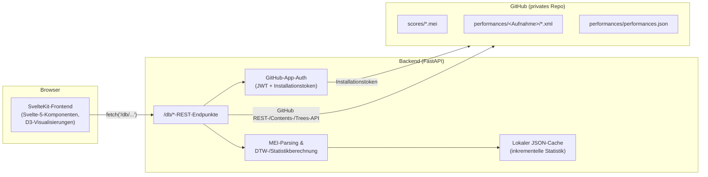
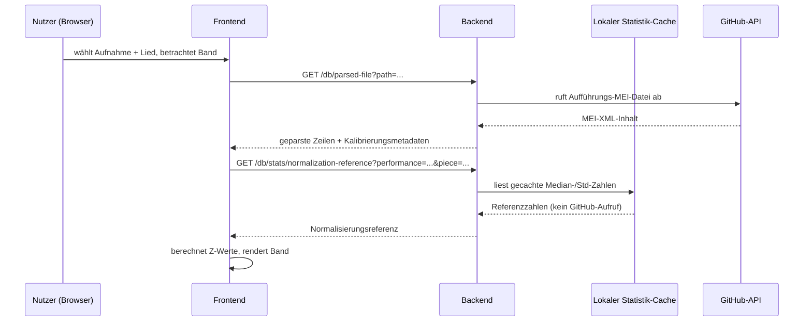

# Winterreise Performance Visualization — Dokumentation

Dieses Dokument beschreibt, was die Anwendung tut, wie sie aufgebaut ist,
auf welche Technologien sie sich stützt und welche Teile davon spezifisch
für den *Winterreise*-Aufnahmenkorpus sind und welche allgemein einsetzbar
wären und für einen anderen Bestand an Aufführungsdaten wiederverwendet
werden könnten. Es ist so geschrieben, dass es sowohl von einer künftigen
Entwicklerin oder einem künftigen Entwickler, die/der sich in die Codebasis
einarbeitet, als auch von einer Musikwissenschaftlerin oder einem
Musikwissenschaftler gelesen werden kann, die/der verstehen möchte, was das
Werkzeug leistet und warum es so gebaut wurde, wie es gebaut wurde, ohne
notwendigerweise den Quellcode zu lesen.

Pseudocode wird durchgängig verwendet, um zu veranschaulichen, wie etwas
konzeptionell funktioniert, ohne den exakten Quellcode wiederzugeben. Wo es
hilfreich ist, die tatsächliche Datei zu kennen, sind die
Pseudocode-Blöcke mit der entsprechenden Datei annotiert.

## Inhaltsverzeichnis

1. [Was diese Anwendung ist](#1-was-diese-anwendung-ist)
2. [Die zugrundeliegenden Daten](#2-die-zugrundeliegenden-daten)
3. [Überblick über die Systemarchitektur](#3-überblick-über-die-systemarchitektur)
4. [Backend: Eine geführte Tour](#4-backend-eine-geführte-tour)
5. [Frontend: Eine geführte Tour](#5-frontend-eine-geführte-tour)
6. [Die Normalisierungs- und Vergleichs-Pipeline](#6-die-normalisierungs--und-vergleichs-pipeline)
7. [Funktionsübersicht](#7-funktionsübersicht)
8. [Technologie-Stack](#8-technologie-stack)
9. [Korpusspezifische vs. generische/wiederverwendbare Teile](#9-korpusspezifische-vs-generischewiederverwendbare-teile)
10. [Bekannte Einschränkungen & Hinweise für künftige Arbeiten](#10-bekannte-einschränkungen--hinweise-für-künftige-arbeiten)
11. [Lokale Entwicklungsumgebung einrichten](#11-lokale-entwicklungsumgebung-einrichten)
12. [Glossar](#12-glossar)
13. [Anhang: Eine vollständige Anfrage, durch jede Schicht verfolgt](#13-anhang-eine-vollständige-anfrage-durch-jede-schicht-verfolgt)
14. [Häufig gestellte Fragen](#14-häufig-gestellte-fragen)

---

## 1. Was diese Anwendung ist

Dies ist eine Webanwendung zur Visualisierung und zum Vergleich vieler
verschiedener *aufgenommener Aufführungen* desselben Musikstücks — konkret
Franz Schuberts Liederzyklus *Winterreise* (D. 911), ein Zyklus von 24
Liedern. Die Grundidee ist einfach: Eine einzelne gedruckte Partitur legt
eine Aufführung nicht vollständig fest. Zwei Pianisten, die von derselben
Notation ausgehen, können sich enorm in Tempo, Dynamik (Lautstärke) und
Klangfarbe unterscheiden — und genau diese Unterschiede machen die
Interpretation eines Interpreten aus. Dieses Werkzeug existiert, um diese
interpretatorischen Unterschiede über viele historische Aufnahmen hinweg
*sichtbar und vergleichbar* zu machen — einige stammen aus den späten
1940er Jahren, andere aus jüngeren Jahrzehnten.

Konkret leistet die Anwendung Folgendes:

- Sie zeigt die Partitur selbst an, gesetzt aus einem digitalen
  Notationsformat (MEI — dazu mehr weiter unten), mit hervorgehobenen
  editorischen Anmerkungen (zum Beispiel Stellen, an denen die Aufführung
  eines bestimmten Sängers von der gedruckten Notation abweicht).
- Sie zeigt für eine einzelne Aufführung, wie sich Tempo, Dynamik und
  Klangfarbe (Timbre) Schlag für Schlag über ein Stück hinweg entwickeln,
  als visuelles "Band" ("ribbon").
- Sie erlaubt den Vergleich mehrerer Aufführungen desselben Stücks
  nebeneinander.
- Sie berechnet und zeigt ein *Ähnlichkeitsnetzwerk*: Für eine gegebene
  Menge von Aufnahmen wird berechnet, wie ähnlich sie sich untereinander
  sind (mittels einer Technik namens Dynamic Time Warping, ausführlich
  erklärt in [Abschnitt 6](#6-die-normalisierungs--und-vergleichs-pipeline)),
  und ein Graph gezeichnet, in dem ähnlichere Aufführungen näher
  zusammengezogen werden.

Keine dieser Daten wurde manuell für diese App erstellt — sie sind das
*Ergebnis* einer separaten Forschungs-Pipeline (außerhalb des Umfangs
dieses Repositories), die Audioaufnahmen nimmt, sie mit der Partitur
abgleicht und Schlag-für-Schlag-Messungen zu Tempo, Dynamik und Klangfarbe
extrahiert, wobei das Ergebnis als annotierte MEI-Dateien gespeichert wird.
Diese Anwendung ist die Präsentations- und Analyseschicht über diesem
bereits vorhandenen Datensatz.

### 1.1 Wer hat das gebaut und warum

Die Anwendung wurde von Clemens von Cramon im Rahmen einer
Masterarbeit in Digital Humanities an der Johannes Gutenberg-Universität
Mainz gebaut. Das zugrundeliegende Forschungsprojekt wird auf der
Startseite der App selbst als "Creating Schubert's Winterreise in
performance with Dietrich Fischer-Dieskau" beschrieben — sämtliche
Aufführungen im aktuellen Datenbestand zeigen den Bariton Dietrich
Fischer-Dieskau, aufgenommen über mehrere Jahrzehnte hinweg mit
unterschiedlichen Pianisten (Gerald Moore, Alfred Brendel, Daniel
Barenboim und anderen) — was selbst ein ungewöhnlich reichhaltiges
Forschungsobjekt darstellt: die sich wandelnde interpretatorische
Beziehung ein und desselben Sängers zu ein und demselben Stück über eine
ganze Karriere hinweg, zusätzlich gebrochen durch die Entscheidungen
unterschiedlicher mitwirkender Pianisten.

Warum gerade *Winterreise* und warum gerade Fischer-Dieskau — das sind
Entscheidungen, die im breiteren musikwissenschaftlichen
Forschungsprojekt wurzeln, dem diese Anwendung dient, und nicht in dieser
Codebasis selbst — es lohnt sich aber, kurz festzuhalten, warum dieses
Repertoire einen ungewöhnlich guten Testfall für die Art des
computergestützten Aufführungsvergleichs abgibt, den dieses Werkzeug
ermöglicht: Schuberts *Winterreise* gehört zu den am häufigsten
aufgenommenen Werken des gesamten Liedgesangsrepertoires überhaupt, was
bedeutet, dass ein wirklich großer und zeitlich weit gespannter Bestand an
Aufnahmen existiert, auf den man zurückgreifen kann; Fischer-Dieskau selbst
hat den Zyklus über rund vier Jahrzehnte seiner Karriere hinweg wiederholt
mit einer Reihe unterschiedlicher pianistischer Partner aufgenommen — eine
seltene Gelegenheit, den Sänger konstant zu halten und dabei sowohl den
jeweils mitwirkenden Musiker als auch die eigene künstlerische Entwicklung
des Sängers über die Zeit hinweg zu variieren — genau die Art von
kontrollierbarem und zugleich reichhaltigem Vergleich, für dessen
Sichtbarmachung ein Werkzeug wie dieses gebaut ist.

### 1.2 Ein Rundgang aus der Vogelperspektive

Auf hoher Ebene sieht die Nutzung der App etwa so aus:

```
Nutzer öffnet die App
  → sieht eine Startseite mit einer Beschreibung des Projekts
  → navigiert zu "Scores", um die notierte Partitur eines der 24 Lieder zu durchsuchen/lesen
  → navigiert zu "Visualizations" und wählt eine der folgenden Optionen:
      - Line graph:       überlagert einen rohen Parameter (Tempo ODER Dynamik ODER Klangfarbe)
                           über mehrere Aufführungen eines Liedes hinweg, als Liniendiagramme
      - Multi-parameter:  zeigt Tempo + Dynamik + Klangfarbe gemeinsam für EINE Aufführung
                           EINES Liedes, als "Band" (Balkenbreite = Tempo, Balkenlänge =
                           Dynamik, Balkenfarbe = Klangfarbe) — anschließend kann optional ein
                           Schlagbereich ausgewählt und zum Vergleich desselben Bereichs über
                           ANDERE Aufführungen hinweg gesprungen werden (weiterhin als Bänder,
                           eines pro Aufführung)
      - DTW network:      wählt einen Geltungsbereich (ein Lied / eine Zyklushälfte / der
                           gesamte Zyklus / ein handverlesener Taktbereich), wählt, welche(r)
                           Parameter einbezogen werden sollen, und erhält einen
                           kraftgerichteten Graphen, in dem sich ähnlicher verhaltende
                           Aufführungen näher beieinander gezeichnet werden
```

Jede dieser Ansichten wird ausführlich in
[Abschnitt 7](#7-funktionsübersicht) beschrieben. Der Rest dieses
Dokuments baut die Konzepte und die Implementierung auf, die nötig sind,
um zu verstehen, wie sie funktionieren.

### 1.3 Gestaltungsphilosophie

Einige wiederkehrende Entscheidungen in dieser Codebasis lassen sich
leichter nachvollziehen, wenn man die Prioritäten kennt, die sie geprägt
haben:

- **Das Backend spiegelt GitHub, statt eine eigene Datenbank zu besitzen.**
  Es gibt nirgendwo in diesem Stack ein PostgreSQL/SQLite/MongoDB. Der
  Datenbestand lebt bereits — versionskontrolliert — in einem
  GitHub-Repository; jede Bearbeitung, jede Ergänzung, jede Korrektur an
  den zugrundeliegenden Forschungsdaten ist ein Git-Commit mit
  vollständiger Historie, was für ein Forschungsprojekt, bei dem
  Datenherkunft und die Möglichkeit, zu prüfen, "was sich wann geändert
  hat", Teil des wissenschaftlichen Nachweises sind, erheblich ins Gewicht
  fällt. Statt diese Daten in ein zweites, separates Speichersystem zu
  duplizieren, das synchron gehalten werden müsste, behandelt das Backend
  GitHub selbst als führendes System und ruft direkt von dort ab. Die eine
  Ausnahme — der Statistik-Cache (Abschnitt 4.6) — ist ebenfalls explizit
  *keine* Datenbank; er ist ein wegwerfbarer, aus den Quelldaten
  rekonstruierbarer lokaler Cache, keine zweite Kopie der Wahrheit.
- **Neuberechnung wird der Speicherung vorgezogen, außer wo Neuberechnung
  wirklich zu teuer ist.** Die Standardhaltung der Anwendung ist es, Daten
  bei jeder Anfrage frisch abzurufen und zu parsen — das hält das System
  einfach (keine Cache-Invalidierungsfehler, weil es meist gar keinen
  Cache gibt, den man invalidieren müsste) und garantiert, dass man immer
  aktuelle Daten sieht. Caching wurde an genau einer Stelle eingeführt (die
  für die Normalisierung benötigten korpusweiten Statistiken), und selbst
  dort ist es so konzipiert, so wenig wie möglich zu speichern — siehe die
  Diskussion in Abschnitt 4.6 dazu, warum nur die rohen Tempo-Werte
  gecacht werden und alles andere aus kleinen laufenden
  Summen-Zusammenfassungen rekonstruiert wird.
- **Minimales, inkrementelles Funktionswachstum, angetrieben durch
  direktes Gespräch mit dem Betreuer/Maintainer.** Die
  DTW-Normalisierungs-Pipeline, der inkrementelle Statistik-Cache, das
  Zustandserhaltungsmuster und die Logik zur Aufnahmen-Disambiguierung
  wurden alle schrittweise hinzugefügt, jeweils ausgelöst durch ein
  konkretes, präzise beschriebenes Bedürfnis (ein in der Praxis
  bemerkter Fehler, eine Frage danach, wie man zwei Parameter fair
  vergleicht, zwei Aufnahmen, die sich unter der bestehenden Logik als
  nicht unterscheidbar herausstellten) statt spekulativem Design im
  Voraus. Das zeigt sich in der Codebasis als eine Reihe kleiner,
  fokussierter Module statt eines einzigen großen, alles umfassenden
  Frameworks.
- **Abwärtskompatibilität wird an API-Grenzen bewusst gewahrt.** Zum
  Beispiel akzeptiert `/db/analysis` weiterhin die ursprüngliche
  Einzelparameter-Abfrage `parameter=...` neben dem neueren
  `parameters=...` (Mehrparameter-)Modus, sodass das Hinzufügen der
  kombinierten Analysefähigkeit nichts anfassen oder brechen musste, was
  bereits auf dem einfacheren Modus aufbaute.

### 1.4 Der Korpus in Zahlen

Um ein konkretes Gefühl für den Umfang zu geben: Der Korpus umfasst zum
Zeitpunkt der Erstellung dieses Dokuments rund zwei Dutzend verschiedene
Aufnahmen, von einer Studioaufnahme aus dem Jahr 1948 (Pianist Klaus
Billing) bis hin zu einer Aufnahme mit Murray Perahia aus dem Jahr 1990,
mit einer besonderen Konzentration an Aufnahmen mit Gerald Moore und
Alfred Brendel — was die langjährige Zusammenarbeit jedes der beiden
Pianisten mit Fischer-Dieskau über mehrere Zeitpunkte ihrer Karrieren
hinweg widerspiegelt. Die Aufnahmekontexte umfassen sowohl
Studiositzungen als auch Live-Konzerte/Radiosendungen und erstrecken sich
über mehrere Länder (Deutschland, Österreich, Italien, die Niederlande,
die Schweiz, das Vereinigte Königreich und die USA, unter anderen, die in
den Metadatenfeldern `City`/`Country` vertreten sind). Jede Aufnahme
enthält wiederum bis zu 24 einzelne Lieddateien (weniger bei Aufnahmen,
die im überlieferten Quellmaterial unvollständig sind) — was bedeutet,
dass ein Vergleich mit Geltungsbereich "ganzer Zyklus" schon über eine
bescheidene Handvoll Aufnahmen hinweg das Abrufen und Parsen mehrerer
Dutzend einzelner MEI-Dateien in einer einzigen Anfrage bedeuten kann
(genau das war die Größenordnung, die die Statistik-Caching-Arbeit
motiviert hat, die in
[Abschnitt 4.6](#46-statscalcpy-der-inkrementelle-statistik-cache)
beschrieben wird — ohne sie müssten die für die Normalisierung benötigten
korpusweiten Zahlen bei jedem einzelnen Vergleich erneut aus diesem
gleichen Datenvolumen abgerufen werden, statt nur einmal).

---

## 2. Die zugrundeliegenden Daten

### 2.1 MEI: Music Encoding Initiative

MEI ist ein XML-basierter Standard zur Kodierung von Musiknotation — man
kann es sich als das Analogon dessen vorstellen, was HTML für Dokumente
ist, nur für Partituren: Es kann Notenköpfe, Balken, Bindebögen,
Dynamikbezeichnungen, Tempoangaben und vieles mehr strukturiert und
maschinenlesbar darstellen, und es existiert bereits ein Ökosystem von
Werkzeugen, die MEI in gesetzte Notenblätter rendern können (diese App
nutzt eines davon, Verovio — siehe
[Abschnitt 5](#5-frontend-eine-geführte-tour)).

Leser, die mit digitaler Musiknotation vertraut sind, kennen vielleicht
auch MusicXML, ein anderes (und weiter verbreitetes, insbesondere in
kommerzieller Notationssoftware) XML-basiertes Musiknotationsformat.
Beide bedienen überlappende, aber unterschiedliche Communities: MusicXML
priorisiert den Austausch zwischen Notationssoftware-Paketen (Finale,
Sibelius, MuseScore und ähnlichen), während MEI — entwickelt und gepflegt
von einer wissenschaftlichen/akademischen Community — von Anfang an mit
musikwissenschaftlichen und philologischen Anwendungsfällen im Blick
entworfen wurde: um nicht nur darzustellen, "wie die fertig gesetzte
Partitur aussieht", sondern auch editorische Schichten, Lesartvarianten,
Unsicherheitsmarkierungen und — wie dieses Projekt direkt zeigt —
beliebige zusätzliche Annotationsschichten wie extrahierte
Aufführungsanalysedaten, ohne das Format über seinen beabsichtigten
Entwurf hinaus missbrauchen oder erweitern zu müssen. Genau deshalb war
MEI, und nicht MusicXML, die naheliegende Wahl für ein Projekt, dessen
Kernbedürfnis genau diese Art von erweiterbarer, wissenschaftlicher
Annotationsschicht über einer Partitur ist.

Zwei *Arten* von MEI-Dateien existieren im Datenbestand dieses Projekts:

1. **Partiturdateien** (im `scores/`-Ordner des Repositories) — eine Datei
   pro Lied, die die Notation selbst enthält: Noten, Pausen, Takte und —
   einzigartig für dieses Projekt — editorische Anmerkungen, die Stellen
   markieren, an denen eine bestimmte historische Ausgabe (die
   "Fischer-Dieskau"-Markierungen) Aufführungsanweisungen (Dynamik,
   Tempowechsel, Bindebögen, Fermaten usw.) hinzugefügt hat, die in
   Schuberts Originalnotation nicht vorhanden sind. Diese werden im
   Partiturbetrachter mit einer eigenen visuellen Gestaltung dargestellt.

2. **Aufführungsdateien** (in den `performances/<Aufnahme>/`-Ordnern des
   Repositories) — eine Datei *pro Lied pro Aufnahme*, strukturell
   ähnlich einer Partiturdatei, jedoch mit einer zusätzlichen
   Datenschicht: für jeden Schlag der Musik ein Satz extrahierter
   Aufführungsmessungen.

### 2.2 Wie ein "Schlag" von Aufführungsdaten aussieht

Innerhalb einer Aufführungsdatei trägt jeder Schlag bis zu drei gemessene
Parameter, ausgedrückt als MEI-Elemente, die an der Position dieses
Schlags in der Partitur angehängt sind:

- **Tempo** (`<tempo>`-Element, Attribut `mm`) — das Tempo des Schlags in
  Schlägen pro Minute, aus dem Audio abgeleitet.
- **Dynamik** (`<dynam>`-Element) — die Lautstärke dieses Schlags. Dies
  hat *zwei* Repräsentationen auf demselben Element: ein numerisches
  Attribut (`n`, derzeit stets eine einfache Dezibel-Zahl, z. B. `-14.2`)
  und eine menschenlesbare, interpretierte Bezeichnung (`label`, z. B.
  `mf+2`, was "zwei Einheiten lauter als mezzo-forte" bedeutet) — der
  numerische Wert ist das, womit die Anwendung tatsächlich rechnet; die
  Bezeichnung existiert zur menschlichen Lesbarkeit und wird *nicht* in
  irgendeiner Berechnung verwendet.
- **Klangfarbe** (ein `<annot>`-Element mit der Bezeichnung "spectral
  centroid (Hz)") — ein akustisches Standardmaß für Klangfarbe/
  Helligkeit, ausgedrückt in Hertz. Höhere Werte entsprechen
  wahrgenommen "helleren" Klängen.

In Pseudocode sieht die Datenzeile eines Schlags so aus:

```
row = {
  measure: "12.3"          # Takt 12, Schlag 3
  tempo: 63.4               # bpm
  dynamics: "-14.2"          # dB, roher, vorzeichenbehafteter Wert
  interpreted_dynamics: "mf+2"   # menschenlesbare Bezeichnung, nur zur Anzeige
  timbre: 812.6              # Hz
}
```

Eine Aufführungsdatei kann Lücken haben: Nicht jeder Schlag hat
notwendigerweise alle drei Messungen (ein Schlag könnte etwa ein
gemessenes Tempo, aber keine eindeutige Dynamikmarkierung haben) — jedes
dieser Felder kann für einen gegebenen Schlag fehlen/null sein, und die
Anwendung muss das durchgängig sauber handhaben.

### 2.3 Der Kalibrierungsblock

Da Lautstärke direkt aus einer Audioaufnahme gemessen wird, wird ihre
absolute Skala von Dingen beeinflusst, die nichts mit der Aufführung
selbst zu tun haben — wie die Aufnahme abgemischt wurde, Mikrofonplatzierung,
Übertragungs-/Digitalisierungsverstärkung und so weiter. Zwei Aufnahmen,
die auf der Bühne gleich laut sind, können nach der Digitalisierung sehr
unterschiedliche absolute Dezibelwerte aufweisen. Jede Aufführungsdatei
trägt deshalb einen kleinen Kalibrierungsblock (ein
`<application xml:id="sv_to_mei">`-Element im MEI-Header), der für diese
spezifische Aufnahme Folgendes festhält:

- `sampleRate` — die während der Analyse verwendete Audio-Abtastrate.
- `mfValue` (auch `mf_dB_calibration`) — der gemessene dB-Pegel, der für
  diese Aufnahme als der *mezzo-forte* ("mf")-Dynamikbezeichnung
  entsprechend beurteilt wurde.
- `dynamicStep` (auch `dB_per_dynamic_level`) — wie viele Dezibel eine
  Standard-Dynamikbezeichnung von der nächsten für diese Aufnahme trennen
  (z. B. der Abstand zwischen "mf" und "f").

Dieser Kalibrierungsblock ist es, der es ermöglicht, Dynamikwerte aus
*verschiedenen Aufnahmen* letztlich auf eine vergleichbare Grundlage zu
stellen — siehe
[Abschnitt 6](#6-die-normalisierungs--und-vergleichs-pipeline) dazu, wie
er verwendet wird (und, wichtig, wie er *nicht* dasselbe ist wie die
neuere statistische Normalisierungs-Pipeline, die ihn größtenteils
abgelöst hat).

Nicht jede Aufführungsdatei im Korpus besitzt diesen Kalibrierungsblock —
eine Handvoll wurde von einer früheren Version der Audio-zu-MEI-Pipeline
erzeugt, die ihn nicht enthielt. Die Anwendung erkennt dies und
überspringt metadatenabhängige Berechnungen für diese spezifischen
Dateien, statt abzustürzen (siehe
[Abschnitt 4.6](#46-statscalcpy-der-inkrementelle-statistik-cache) und
[Abschnitt 10](#10-bekannte-einschränkungen--hinweise-für-künftige-arbeiten)).

### 2.4 `performances.json`: Aufnahmenmetadaten

Neben den MEI-Dateien enthält das Repository eine JSON-Datei
(`performances/performances.json`) mit katalogartigen Metadaten zu jeder
Aufnahme als *Ganzes* (im Gegensatz zu Schlag-für-Schlag-Daten):
Pianistenname, Aufnahmejahr/-monat/-tag, Stadt, Land, Aufnahmekontext
(Studio vs. Live), ein standardisiertes Datumsfeld sowie einige
archivarische/provenienzbezogene Felder (Quell-URL, GND-Normdatennummer
für den Pianisten usw.).

Dies ist es, was der Anwendung erlaubt, eine menschenfreundliche
Bezeichnung wie *"Barenboim 1979, Berlin"* für einen Ordner zu bauen, der
auf der Festplatte eigentlich `1979_Barenboim` heißt — siehe
[Abschnitt 4.4](#44-performancespy-auflisten-von-aufnahmen) für die genaue
Funktionsweise dieses Abgleichs (und, in kniffligen Fällen, der
Disambiguierung).

Konkret sieht eine Zeile von `performances.json` so aus:

```json
{
  "No": 16.0,
  "XML UUID": "dwdfd...",
  "Recording Date": 19,
  "Recording Month": "January",
  "Recording Year": 1979.0,
  "Date - Standardized": "1979-01-19",
  "Pianist": "Barenboim, Daniel",
  "GND number": "118506296",
  "Label": "Deutsche Grammophon",
  "Studio/Institution": "no value",
  "City": "Berlin",
  "Country": "Germany",
  "Recording Context": "Studio",
  "source": "https://...",
  "misc": "no value"
}
```

Zwei Dinge sind bei diesen Daten, wie sie tatsächlich vorliegen,
bemerkenswert: Felder, die für eine gegebene Aufnahme nicht zutrafen oder
nicht bekannt waren, werden als der wörtliche String `"no value"`
festgehalten, statt weggelassen oder auf `null` gesetzt zu werden — die
Abgleichs-/Disambiguierungslogik in `performances.py` behandelt solche
Felder als praktisch nicht vorhanden (z. B. wird ein leerer
Stadt-String nichts fälschlicherweise treffen). Und `"Recording Month"`
ist in der Praxis über die Zeilen hinweg uneinheitlich groß- und
kleingeschrieben/geschrieben (`"January"` vs. `"dec"` wurden beide
beobachtet) — genau deshalb verlässt sich die Anwendung für jede
Berechnung, die Datumsangaben betrifft, auf `"Date - Standardized"` (einen
normalisierten `JJJJ-MM-TT`-String, verlässlich sortierbar und
parsbar), statt zu versuchen, das Freitext-Monatsfeld zu parsen.

### 2.4.1 Eine Anmerkung zur vorgelagerten Forschungs-Pipeline

Auch wenn die Audioanalyse-Pipeline, die diese MEI-Dateien erzeugt,
außerhalb des Umfangs dieses Repositories (und dieses Dokuments) liegt,
ist ein Detail in den Daten selbst sichtbar und für jeden, der dieses
Projekt erweitert, erwähnenswert: Die Element-ID des Kalibrierungsblocks,
`sv_to_mei` ([Abschnitt 2.3](#23-der-kalibrierungsblock)), legt stark
nahe, dass die vorgelagerte Pipeline [Sonic
Visualiser](https://www.sonicvisualiser.org/) verwendet (oder danach
benannt ist), ein weit verbreitetes Open-Source-Werkzeug zur
Audioanalyse und -annotation, mit einem Konvertierungsschritt ("sv to
mei"), der dessen Analyseausgabe in die MEI-Aufführungsannotationsschicht
übersetzt, die diese Anwendung konsumiert. Dies ist eine Schlussfolgerung
aus den Daten, keine in dieser Codebasis dokumentierte Tatsache — aber
ein vernünftiger Ausgangspunkt, falls nachvollzogen werden muss, wie eine
gegebene Messung tatsächlich aus dem Quell-Audio abgeleitet wurde.

### 2.5 Ein durchgearbeitetes Beispiel: Was eine Aufführungsdatei tatsächlich enthält

Es lohnt sich, ein (vereinfachtes, illustratives) Fragment dessen zu
sehen, was eine dieser Aufführungs-MEI-Dateien tatsächlich auf der
Festplatte enthält, um die obigen Abstraktionen an etwas Konkretem zu
verankern. Ein einzelner Takt mit einem aufgeführten Schlag könnte so
aussehen:

```xml
<measure n="12">
  <staff n="1">
    <layer>
      <note xml:id="n1" pname="d" oct="5" dur="4"/>
    </layer>
  </staff>
  <add xml:id="a1" source="#analysis-layer">
    <tempo xml:id="t1" mm="63.4"/>
    <dynam xml:id="d1" n="-14.2" label="mf+2"/>
    <annot xml:id="an1" label="spectral centroid (Hz)">812.6</annot>
  </add>
</measure>
```

Man beachte, dass die Aufführungsanalysedaten (`<add>`, das die
`<tempo>`-, `<dynam>`- und `<annot>`-Elemente enthält) *neben* dem
tatsächlich notierten Inhalt sitzen (der `<note>` innerhalb von
`<staff>`/`<layer>`), statt ihn zu ersetzen — die Aufführungsdatei ist
strukturell *dieselbe Partitur*, mit einer darübergelegten Schicht
gemessener Aufführungsdaten. Das ist es, was es der
Zeilen-Parsing-Logik des Backends
([Abschnitt 4.7](#47-meiparserpy-mei-in-zeilen-umwandeln)) erlaubt,
`<measure>`-Elemente einheitlich zu durchlaufen, egal ob sie eine
einfache Partiturdatei oder eine Aufführungsdatei betrachtet — sie findet
nur mehr (oder andere) Daten, abhängig davon, was tatsächlich innerhalb
des `<add>` für einen gegebenen Takt steckt.

Der Kalibrierungsblock, an anderer Stelle im `<meiHead>` derselben Datei,
sieht ungefähr so aus:

```xml
<application xml:id="sv_to_mei">
  <annot type="sampleRate" value="44100"/>
  <annot type="mf_dB_calibration" value="-20.5"/>
  <annot type="dB_per_dynamic_level" value="6.0"/>
</application>
```

Gegeben diesen Kalibrierungsblock, liegt der obige Schlag (`n="-14.2"`)
`-14.2 - (-20.5) = 6.3` dB über der eigenen "mf"-Referenz dieser
Aufnahme — etwas mehr als ein `dynamicStep` (6,0 dB) lauter als mf, was
mit der interpretierten Bezeichnung `mf+2` übereinstimmt (die
interpretierte Bezeichnung und die rohen Kalibrierungszahlen werden von
der vorgelagerten Analyse-Pipeline unabhängig voneinander erzeugt, sodass
sie nicht immer in perfektem arithmetischem Gleichschritt übereinstimmen
werden, aber sie sollten grob übereinstimmen, was ein nützlicher
Plausibilitätstest ist, wenn man neue Daten betrachtet).

### 2.6 Wo die Daten tatsächlich liegen

Nichts von diesen Daten liegt innerhalb *dieses* Repositories. Es liegt
in einem **separaten, privaten GitHub-Repository** (im Code und in diesem
Dokument durchgängig als "das Datenbank-Repository" bezeichnet), und das
Backend agiert als authentifizierter Proxy davor — es ruft Dateien bei
Bedarf über GitHubs REST-API ab, unter Verwendung einer
GitHub-App-Installation zur Authentifizierung (niemals eines persönlichen
Zugriffstokens). Diese Designentscheidung und ihre Konsequenzen werden in
[Abschnitt 3](#3-überblick-über-die-systemarchitektur) und
[Abschnitt 4.1](#41-github-authentifizierung) erklärt.

---

## 3. Überblick über die Systemarchitektur

Die Anwendung ist eine konventionelle zweischichtige Webanwendung: Ein
SvelteKit-Frontend (die im Browser laufende Single-Page-Application)
spricht mit einem FastAPI-Backend (einem Python-Webserver), und das
Backend ist das *einzige*, was jemals mit GitHub spricht.



Das obige Diagramm zeigt das *strukturelle* Bild — welche Teile es gibt
und wie sie verbunden sind. Es ist außerdem nützlich, die *Abfolge* einer
spezifischen, statistikabhängigen Anfrage zu sehen, da sie mehr
Hin-und-Her beinhaltet als der einfache Durchreichvorgang oben gezeigt:



Man beachte, dass die *eigentlichen Daten* (Schritt 2–3) und die
*Normalisierungsreferenz* (Schritt 5–7) über zwei völlig getrennte
Anfragen abgerufen werden, die zwei unterschiedliche Arten von
Speicherquellen treffen (GitHub live bzw. den lokalen Cache) — das
Frontend muss diese Unterscheidung nicht kennen oder sich darum kümmern;
aus seiner Sicht sind beides nur `fetch()`-Aufrufe an die
`/db/*`-API des Backends.

### 3.1 Warum überhaupt ein Backend-Proxy?

Drei Gründe laufen bei diesem Design zusammen:

1. **Zugangsdaten.** Das Datenbank-Repository ist privat. Es zu lesen
   erfordert Authentifizierung. Eine browserseitige App kann keinen
   privaten GitHub-App-Schlüssel oder ein anderes langlebiges Geheimnis
   halten, ohne es jedem offenzulegen, der die Entwicklertools öffnet —
   *etwas* muss also serverseitig die Zugangsdaten halten und kurzlebige
   Token im Auftrag des Frontends ausstellen.
2. **Berechnung.** Manche Operationen (das Parsen einer ganzen
   Aufführung an MEI-Dateien, das Ausführen von Dynamic Time Warping
   über mehrere Aufführungen hinweg, die Pflege des inkrementellen
   Statistik-Caches) eignen sich für einen Serverprozess deutlich besser
   als für einen Browser-Tab — sie beinhalten echte CPU-Arbeit und
   profitieren davon, Ergebnisse über Nutzer/Sitzungen hinweg cachen zu
   können.
2. **Eine stabile interne API.** Das Frontend spricht mit einer kleinen,
   zweckgebundenen REST-API (`/db/...`) statt direkt mit GitHubs
   allgemeinerer Contents-/Trees-API — was bedeutet, dass sich die Form
   der zugrundeliegenden Datenspeicherung (Pfade, Dateinamen, sogar *ob*
   es überhaupt GitHub ist) ändern kann, ohne dass sich das Frontend
   ändern müsste.

### 3.2 Anfrageablauf, in Pseudocode

Hier ist, was Ende-zu-Ende passiert, wenn ein Nutzer ein Stück zur
Anzeige im Partiturbetrachter auswählt:

```
# Frontend (SvelteKit, Browser)
onUserSelectsFile(file):
    response = fetch("/db/file?path=" + file.path)
    meiContent = await response.text()
    render(meiContent)  # via Verovio

# Backend (FastAPI, Python)
@route("/db/file")
def get_file(path):
    if not is_safe_path(path):           # muss innerhalb von scores/ oder performances/ liegen
        return 400 "Invalid path"
    token = get_installation_token()      # ~1 Std. gecacht, via GitHub-App-JWT erneuert
    content = github_api_get_contents(OWNER, REPO, path, token)
    return decode_base64(content)
```

Wichtig zu bemerken: Jede einzelne "gib mir Daten"-Anfrage vom Frontend
führt dazu, dass das Backend live bei GitHub anfragt (mit Ausnahme des
vorberechneten Statistik-Caches, beschrieben in
[Abschnitt 4.6](#46-statscalcpy-der-inkrementelle-statistik-cache)). Es
gibt keine allgemeine Datenbank vor GitHub — GitHub *ist* die Datenbank.

### 3.3 Lokale Entwicklungstopologie

In der lokalen Entwicklung leitet der SvelteKit-Dev-Server (Vite) jede
Anfrage an `/db/*` an das auf `127.0.0.1:8000` laufende FastAPI-Backend
weiter (siehe `frontend/vite.config.ts`), sodass die API aus Sicht des
Browsers scheinbar auf demselben Ursprung wie das Frontend liegt — keine
CORS-Komplikationen während der Entwicklung. Im aktuellen Zustand ist die
CORS-Richtlinie des Backends explizit auf `localhost`/`127.0.0.1` am
Vite-Dev-Port beschränkt — es gibt noch kein Produktions-Deployment
(siehe
[Abschnitt 10](#10-bekannte-einschränkungen--hinweise-für-künftige-arbeiten)).

### 3.4 Warum nicht einfach eine konventionelle Datenbank verwenden?

Es lohnt sich, explizit auszuführen, warum diese Anwendung keine
"normale" Backend-Datenbank hat, da dies gemessen an den Maßstäben der
meisten Webanwendungen eine ungewöhnliche Wahl ist:

- **Die Daten haben bereits eine natürliche Heimat mit den richtigen
  Eigenschaften.** Ein Git-Repository bietet kostenlose Versionshistorie,
  kostenlose Diffs (man kann genau sehen, was sich zwischen zwei Commits
  an einer Aufführungsdatei geändert hat), kostenloses Branching (eine
  Forscherin könnte eine Reihe von Korrekturen auf einem Branch
  vorbereiten, bevor sie gemergt werden) und eine bereits vorhandene,
  kostenlose Hosting-/Zugriffskontrollschicht (GitHubs eigenes
  Berechtigungsmodell) — alles Eigenschaften, von denen ein
  Forschungsdatensatz profitiert und die eine von Grund auf neu gebaute
  relationale Datenbank bewusst bereitstellen müsste.
- **Die Daten werden weit mehr gelesen als geschrieben.** Abgesehen
  davon, dass die vorgelagerte Audioanalyse-Pipeline gelegentlich eine
  Aufführungsdatei hinzufügt oder korrigiert, ändert sich dieser
  Datensatz selten. Ein System, das für "bediene Lesezugriffe auf einen
  selten wechselnden Datensatz, mit gelegentlichen Massenaktualisierungen"
  optimiert ist, sieht sehr nach "direkt aus der Versionskontrolle
  abrufen" aus und profitiert nicht offensichtlich von der
  Transaktions-Schreibmaschinerie, die eine konventionelle Datenbank
  bereitstellt.
- **Es vermeidet ein Synchronisationsproblem von vornherein.** Würden
  die Daten sowohl in einem Git-Repository (für Provenienz/Versionierung)
  *als auch* in einer separaten Datenbank (damit die App sie abfragen
  kann) liegen, müsste jemand die beiden synchron halten, und die App
  liefe Gefahr, veraltete Daten relativ zur "wahren" Git-Historie
  auszuliefern. GitHub als alleinige Quelle der Wahrheit zu behandeln,
  umgeht dieses Problem konstruktionsbedingt.
- **Der Kompromiss, ehrlich benannt:** Dieses Design ist pro Anfrage
  langsamer, als es eine echte Datenbank wäre (jede Anfrage trifft
  entweder live GitHubs API oder liest aus einer lokal gecachten Datei,
  die selbst durch Anfragen an GitHubs API erstellt wurde) und
  unterstützt nicht die Art von Ad-hoc-Abfragen, die eine SQL-Datenbank
  erlauben würde (z. B. würde "finde jeden Schlag im gesamten Korpus, bei
  dem die Dynamik einen bestimmten Schwellenwert überschritt" derzeit das
  Abrufen und Durchsuchen vieler Dateien erfordern, nicht eine einzige
  indizierte Abfrage). Für den Umfang dieses Projekts (ein paar Dutzend
  Aufnahmen, jeweils ein paar Dutzend kleine XML-Dateien) lohnt sich
  dieser Kompromiss bequem; bei deutlich größerem Umfang wäre das
  möglicherweise nicht mehr der Fall.

---

## 4. Backend: Eine geführte Tour

Das Backend liegt in `backend/` und ist eine FastAPI-Anwendung. Seine
Dateien gliedern sich in drei Gruppen: den App-Einstiegspunkt und die
Konfiguration, eine Reihe von "Routern" (einer pro REST-Ressourcenbereich)
und eine Reihe von "Services" (die eigentliche Logik, getrennt vom
HTTP-Handling-Code in den Routern gehalten).

```
backend/
├── main.py                  # FastAPI-App-Instanz, CORS, Router-Registrierung
├── config.py                 # OWNER/REPO/BRANCH-Konstanten, MEI-Namensraum, Stücktitel
├── github_auth.py            # GitHub-App-JWT + Installationstoken (gecacht)
├── routers/
│   ├── files.py               # Endpunkte für rohe & geparste MEI-Dateien
│   ├── scores.py               # Auflistung des scores/-Ordnerbaums
│   ├── performances.py          # Aufnahmenliste + Stückliste pro Aufnahme
│   ├── analysis.py               # DTW-Ähnlichkeitsanalyse (einzel- & mehrparametrig)
│   └── stats.py                   # Endpunkte für gecachte Median-/Korpusstatistiken
└── services/
    ├── githubClient.py         # dünner Wrapper um die GitHub-Contents-/Trees-API
    ├── pathSafety.py             # Validierung gegen Pfad-Traversal / Ordnernamen
    ├── meiParser.py               # MEI → Zeilen-/Metadaten-Extraktion
    ├── dtwCalc.py                  # DTW-Distanzberechnung (einzeln & kombiniert)
    └── statsCalc.py                 # inkrementelle Berechnung des Median-/Std-Caches
```

### 4.1 GitHub-Authentifizierung

Das Backend authentifiziert sich bei GitHub als **GitHub App**, nicht als
persönlicher Nutzer. Dies ist eine bewusste Entscheidung: Die
Zugangsdaten einer GitHub App können auf genau ein Repository mit genau
den benötigten Rechten beschränkt werden (in diesem Fall
Nur-Lese-Zugriff auf Contents), und — entscheidend für ein
Forschungsprojekt — die Zugangsdaten gehören nicht dem persönlichen
Konto einer einzelnen Person, sodass sie überdauern, wenn diese Person
die Stelle wechselt, den Laptop-Zugriff verliert usw.

Die Mechanik, in Pseudocode:

```
# github_auth.py
PRIVATE_KEY = read_file("<app-name>.private-key.pem")   # einmalig geladen, beim Import

def generate_jwt():
    payload = { issued_at: now - 60s, expires: now + 10min, issuer: APP_ID }
    return sign(payload, PRIVATE_KEY, algorithm="RS256")

def get_installation_token():
    if cached_token exists and not near expiry:
        return cached_token

    jwt = generate_jwt()
    response = POST "https://api.github.com/app/installations/{id}/access_tokens"
               with Authorization: Bearer {jwt}
    cached_token, cached_expiry = response.token, response.expires_at
    return cached_token
```

Zwei Dinge bei diesem Design sind erwähnenswert:

- **Token-Caching.** GitHub-App-Installationstoken sind etwa eine Stunde
  gültig. Ohne Caching würde *jede einzelne API-Anfrage* des Backends
  zunächst ein brandneues Token ausstellen — zusätzliche Latenz und
  unnötiges Verbrennen von GitHubs Rate-Limits. Der Cache ist ein
  einfaches In-Memory-Paar `(token, expires_at)`, das nur erneuert wird,
  wenn es innerhalb von 60 Sekunden vor dem Ablauf steht.
- **Die private Schlüsseldatei selbst verlässt niemals das
  Server-Dateisystem** und ist explizit von der Versionskontrolle
  ausgeschlossen (`.gitignore`) — sie ist das eine wirkliche Geheimnis in
  diesem gesamten System.

### 4.1.1 Warum ein zweistufiger Token-Austausch statt einem einzigen Zugangsdatum?

Es lohnt sich zu erklären, *warum* GitHub Apps auf diese Weise
funktionieren, da es ein leicht ungewöhnliches zweischichtiges Design
ist: Es gibt eine langlebige App-Identität (den privaten Schlüssel, die
App-ID) und ein kurzlebiges, eng begrenztes Zugangsdatum, das daraus
ausgestellt wird (das Installationstoken) — statt einfach den privaten
Schlüssel direkt zu verwenden, um jeden API-Aufruf zu authentifizieren.

- **Das JWT (signiert mit dem privaten Schlüssel) beweist nur "Ich bin
  App #2827092"** — es authentifiziert die *Identität der Anwendung*
  gegenüber GitHub und ist bewusst kurzlebig (ein 10-Minuten-Ablauffenster
  in dieser Implementierung) und wird für genau einen Zweck verwendet:
  sich selbst gegen ein Installationstoken einzutauschen.
- **Das Installationstoken ist es, was tatsächlich API-Aufrufe
  autorisiert** (Dateiinhalte abrufen, einen Ordner auflisten, den Baum
  lesen) — es ist auf eine spezifische Installation beschränkt (d. h. ein
  spezifisches Repository, in diesem Fall), hält etwa eine Stunde und
  wird als Bearer-Zugangsdatum an jede nachfolgende GitHub-API-Anfrage
  angehängt.

Diese Trennung bedeutet, dass der langlebige private Schlüssel so selten
wie möglich verwendet wird (nur um neue Installationstoken auszustellen,
in der Praxis dank des oben beschriebenen Cachings höchstens einmal pro
Stunde) — was reduziert, wie oft das sensibelste Zugangsdatum im
gesamten System überhaupt verwendet werden muss —, während das Token,
das tatsächlich bei jeder einzelnen Anfrage herumgereicht wird, eines
ist, das schnell abläuft und eng begrenzt ist, was den Schaden begrenzt,
falls es jemals irgendwie durchsickern sollte (z. B. durch einen
Logging-Fehler).

### 4.2 `services/githubClient.py`: die GitHub-Zugriffsschicht

Alle tatsächlichen HTTP-Aufrufe an GitHubs API laufen durch drei kleine
Funktionen:

```
fetch_repo_text(path) -> str
    # GET /repos/{owner}/{repo}/contents/{path}, Inhalt base64-dekodiert
    # verwendet für: MEI-Dateien, performances.json

fetch_repo_json(path) -> requests.Response
    # gleicher Endpunkt, gibt aber die rohe Response zurück (Aufrufer
    # entscheidet, wie sie interpretiert wird/Statuscodes behandelt —
    # verwendet, wo ein 404 besondere Behandlung braucht, z. B.
    # "Aufnahme nicht gefunden")

fetch_repo_tree() -> list[dict]
    # GET /repos/{owner}/{repo}/git/trees/{branch}?recursive=1
    # eine vollständige Auflistung jeder Datei im Repo, jede mit ihrem
    # Git-Blob-SHA — dieser SHA ist die Grundlage des inkrementellen
    # Statistik-Caches (Abschnitt 4.6)
```

Jeder dieser Aufrufe hängt ein 10-Sekunden-Timeout und das aktuelle
Installationstoken an (via `get_github_headers()`), und jeder Router in
der Anwendung geht durch diese drei Funktionen, statt `requests` direkt
aufzurufen — das ist es, was GitHub-spezifische Details (Basis-URLs,
Auth-Header, Base64-Dekodierung) an einem einzigen Ort hält.

### 4.3 `services/pathSafety.py`: Anfragen in ihrer Spur halten

Zwei der REST-Endpunkte akzeptieren einen Dateipfad oder einen
Ordnernamen direkt vom Client (`/db/file?path=...` sowie diverse
`performance=...`/`paths=...`-Parameter). Ohne Validierung könnte ein
böswilliger oder einfach fehlerhafter Aufrufer nach
`path=../../some/other/repo/secret.txt` fragen — und damit außerhalb der
beiden Ordner (`scores/`, `performances/`) navigieren, die die gesamte
öffentliche Oberfläche des Datenbank-Repositories sein sollen. Zwei
kleine Validatoren schützen davor:

```
is_safe_repo_path(path):
    return (
        path does not start with "/"
        and no path segment is ".."
        and (path starts with "scores/" or path starts with "performances/")
    )

is_safe_folder_name(name):
    return name is non-empty and contains no "/" and is not "." or ".."
```

Jeder Router, der einen Pfad oder Ordnernamen vom Client akzeptiert,
ruft eine dieser Funktionen auf, bevor er irgendetwas damit tut, und
gibt bei Fehlschlag `400 Bad Request` zurück.

### 4.3.1 Ein konkretes Angriffsszenario, das dies verhindert

Um das Risiko konkret statt abstrakt zu machen: Ohne
`is_safe_repo_path` würde `GET /db/file?path=../../etc/passwd` (oder,
realistischer für dieses Setup, `path=../backend/config.py`, falls das
Datenbank-Repository und das Repository dieser Anwendung selbst
zufällig vorhersagbar zueinander angeordnet wären, oder schlicht
`path=../some-other-private-file-in-the-database-repo`) unbesehen
direkt in die Anfrage-URL der GitHub-Contents-API übergeben. Da die
Aufgabe des Backends spezifisch darin besteht, ein *offener,
unauthentifizierter Proxy* auf ein ansonsten privates Repository zu
sein (per Design — siehe
[Abschnitt 3.1](#31-warum-überhaupt-ein-backend-proxy)), ist dies kein
theoretisches Anliegen: Ohne diese Validierung würde der
`/db/file`-Endpunkt jedem, der das Backend erreichen kann, erlauben,
*jede* Datei im privaten Datenbank-Repository zu lesen, nicht nur den
`scores/`/`performances/`-Inhalt, den die Anwendung tatsächlich
offenlegen soll (einschließlich, bemerkenswerterweise, der Datei, die
dieses Dokument selbst in
[Abschnitt 2.5](#25-ein-durchgearbeitetes-beispiel-was-eine-aufführungsdatei-tatsächlich-enthält)
zitiert — eine legitime Datei, aber es geht darum, dass *nichts*
tabu gewesen wäre ohne diese Prüfung). Die drei Bedingungen von
`is_safe_repo_path` schließen jeweils eine andere Variante davon: Das
Zurückweisen eines führenden `/` stoppt Tricks mit absoluten Pfaden, das
Zurückweisen jedes `..`-Pfadsegments stoppt Verzeichnis-Traversal, und
das Erfordernis, dass der Pfad mit einem der beiden erlaubten Präfixe
beginnt, stoppt Anfragen nach allem außerhalb dieser beiden Ordner
komplett — selbst ein technisch relativer, nicht traversierender Pfad
wie `performances.json` (die Metadatendatei, die eigentlich unter
`performances/performances.json` liegt, nicht bloß `performances.json`)
würde von der Präfixprüfung zurückgewiesen, da über diesen speziellen
Endpunkt nur die Ordner `scores/` und `performances/` erreichbar sein
sollen.

### 4.4 `performances.py`: Auflisten von Aufnahmen

`GET /db/performances` gibt die Liste der Aufnahmen zurück (ein Eintrag
pro Unterordner von `performances/` im Datenbank-Repository), jeweils
mit einer menschenfreundlichen `label` wie `"Barenboim 1979, Berlin"`.

Um diese Bezeichnung zu bauen, muss ein bloßer Ordnername (z. B.
`1979_Barenboim`) mit einer Zeile in `performances.json` abgeglichen
werden (die strukturierte Felder hat: Pianist, Jahr, Stadt,
standardisiertes Datum). Meistens ist dies eindeutig — aber zwei
Situationen erschweren es, und die Disambiguierungslogik existiert genau
dafür, sie zu behandeln:

1. **Derselbe Pianist hat im selben Jahr mehr als einmal aufgenommen, in
   unterschiedlichen Städten.** Der Abgleich engt zunächst nach Jahr +
   Pianisten-Nachname ein, und falls das immer noch mehr als einen
   Kandidaten übrig lässt, engt es weiter ein, indem geprüft wird, ob der
   Stadtname eines dieser Kandidaten im Ordnernamen auftaucht.
2. **Derselbe Pianist, dasselbe Jahr *und* dieselbe Stadt** (z. B. zwei
   Konzerte, die wenige Wochen auseinander während desselben Festivals
   gegeben wurden). Stadtbasierte Disambiguierung hilft hier nicht
   weiter, daher werden Ordner in dieser Situation mit einem
   angehängten `_A`/`_B`/...-Suffix benannt, und die Abgleichslogik
   greift darauf zurück, die verbleibenden Kandidaten nach ihrem
   standardisierten Aufnahmedatum zu sortieren und entsprechend diesem
   Buchstaben auszuwählen (`A` = frühestes). Da zwei so nah
   beieinanderliegende Einträge sonst mit einer *identischen* Bezeichnung
   in der UI dargestellt würden (was den Zweck vereitelt, sie überhaupt
   unterscheiden zu können), wird immer dann, wenn dieser Pfad
   eingeschlagen wird, ein kurzer Datumszusatz an die Bezeichnung
   angehängt, z. B. `"Brendel 1984, Bregenz (Jun 3)"` vs. `"... (Jun 23)"`.

In Pseudocode:

```
function disambiguate_performance(folder_name, candidates):
    if len(candidates) <= 1:
        return candidates[0] if any else {}, needs_date_qualifier=False

    city_candidates = [c for c in candidates if normalize(c.city) in normalize(folder_name)]
    remaining = city_candidates if city_candidates else candidates
    if len(remaining) == 1:
        return remaining[0], needs_date_qualifier=False

    letter_suffix = extract_trailing_letter(folder_name)   # "_A" -> "A", oder keiner
    if letter_suffix:
        sorted_by_date = sort(remaining, key=standardized_date)
        index = letter_suffix - "A"                          # A=0, B=1, ...
        if index is valid:
            return sorted_by_date[index], needs_date_qualifier=True

    return remaining[0], needs_date_qualifier=True   # letzter Rückfall
```

Man beachte die `normalize(...)`-Aufrufe im Stadtabgleich-Schritt:
Pianisten- und Stadtnamen können akzentuierte Zeichen enthalten (z. B.
das deutsche "ö"), und *dasselbe* sichtbare Zeichen kann in Unicode auf
zwei verschiedene Weisen kodiert sein — vorkomponiert (ein Codepoint)
oder zerlegt (ein Grundbuchstabe plus ein kombinierendes Akzentzeichen).
Ein auf macOS umbenannter Ordner und ein anderswo in eine JSON-Datei
eingetippter Name können am Ende unterschiedliche Kodierungen eines auf
dem Bildschirm identisch aussehenden Zeichens verwenden, was einen
einfachen Substring-Abgleich stillschweigend zum Scheitern bringt. Beide
Seiten jedes solchen Vergleichs werden vor dem Vergleich auf NFC
(vorkomponierte Form) normalisiert, spezifisch um dies zu vermeiden.

`GET /db/performance-files?performance=<Ordner>` ist der zugehörige
Endpunkt: Gegeben einen Aufnahmenordner, listet er die einzelnen
Lieddateien darin auf, beschriftet mit den (festen, korpusspezifischen —
siehe
[Abschnitt 9](#9-korpusspezifische-vs-generischewiederverwendbare-teile))
richtigen deutschen Liedtiteln statt dem rohen Dateinamen. Seine Logik,
in Pseudocode:

```
function list_performance_files(performance_folder):
    if not is_safe_folder_name(performance_folder):
        error 400
    items = fetch_repo_json(f"performances/{performance_folder}")
    if items.status == 404:
        error 404 "Recording not found"

    files = []
    for item in items where item.name ends with ".xml":
        piece_number = extract the digits between underscores in the filename
                       (e.g. "..._12_Audio_Data.xml" -> 12)
        title = PIECE_TITLES[piece_number - 1] if valid else the filename itself
        files.append({ name, path, label: f"{piece_number}. {title}", order: piece_number })

    return sort(files, by=order)     # stellt Zyklusreihenfolge sicher, unabhängig von Dateinamensortierung
```

Zwei Details hier spiegeln Muster wider, die anderswo im Backend zu
sehen sind: das explizite erneute Auslösen eines `404` für einen
fehlenden Aufnahmenordner (im Einklang mit der in
[Abschnitt 4.10](#410-fehlerbehandlungsmuster-im-gesamten-backend)
beschriebenen Fehlerbehandlungskonvention) und die explizite Sortierung
nach extrahierter Stücknummer *nach* dem Abrufen (da GitHubs
Verzeichnislistenreihenfolge nicht garantiert mit der
musikalischen/Zyklusreihenfolge übereinstimmt und Dateinamen, die
alphabetisch sortiert würden, Lied "10" vor Lied "2" einordnen würden).

### 4.5 `analysis.py` + `dtwCalc.py`: Aufführungsähnlichkeit

`GET /db/analysis` ist der Endpunkt hinter der
"DTW-Netzwerk"-Visualisierung. Er unterstützt zwei unterschiedliche
Modi, beide konzeptionell erklärt in
[Abschnitt 6](#6-die-normalisierungs--und-vergleichs-pipeline):

- **Einzelparameter-Modus** (`parameter=tempo|dynamics|timbre`) — der
  ursprüngliche, einfachere Modus: die rohe Sequenz eines Parameters für
  jede angeforderte Aufführung abrufen und Dynamic Time Warping (via der
  optimierten Implementierung der `dtaidistance`-Bibliothek) direkt auf
  den rohen Werten ausführen.
- **Kombinierter Modus** (`parameters=tempo&parameters=dynamics&...`) —
  normalisiert zunächst jeden ausgewählten Parameter auf eine
  vergleichbare statistische Skala (unter Verwendung der gecachten
  Korpusstatistiken aus
  [Abschnitt 4.6](#46-statscalcpy-der-inkrementelle-statistik-cache)) und
  führt dann eine eigene Dynamic-Time-Warping-Implementierung aus, die
  mehrere Parameter zu einer Distanz kombinieren kann, wobei entweder
  eine gewichtete euklidische oder eine Mahalanobis-Distanz als
  Kostenfunktion pro Schlag verwendet wird.

Beide Modi unterstützen vier *Geltungsbereiche* — wie viel der
Aufführung analysiert werden soll:

```
scope = "piece"       -> nur das eine ausgewählte Lied
scope = "measures"     -> ein handverlesener Takt-/Schlagbereich innerhalb eines Liedes
scope = "halfCycle"     -> entweder die ersten 12 oder die letzten 12 Lieder, aneinandergereiht
scope = "cycle"          -> alle 24 Lieder, aneinandergereiht
```

Bei den mehrliedrigen Geltungsbereichen enthält nicht notwendigerweise
jede Aufnahme im Korpus jedes Lied (manche historischen Aufnahmen sind
unvollständig) — ein für eine gegebene Aufnahme+Geltungsbereich-Kombination
fehlendes Lied wird für diese Aufnahme stillschweigend übersprungen,
statt die gesamte Anfrage scheitern zu lassen.

### 4.5.1 Die vollständige Anfragebehandlungslogik, in Pseudocode

Um die Teile zusammenzufügen, hier die gesamte Logik des
`/db/analysis`-Handlers, annotiert:

```
function calculate_dtw(paths, parameter=None, parameters=None, metric="euclidean",
                        weights=None, scope="piece", piece=None, half=None,
                        start=None, start_beat=None, end=None, end_beat=None):

    if not parameter and not parameters:
        error 400 "parameter or parameters is required"
    if parameters and weights and len(weights) != len(parameters):
        error 400 "weights must match length of parameters"
    for path in paths:
        if not is_safe_folder_name(path):
            error 400 "Invalid performance path"

    # --- geltungsbereichsspezifische Pflichtparameter validieren ---
    if scope in ("piece", "measures") and piece is None:
        error 400 "piece is required for this scope"
    if scope == "halfCycle" and half not in (1, 2):
        error 400 "half must be 1 or 2 for scope=halfCycle"
    if scope == "measures" and any of (start, start_beat, end, end_beat) is None:
        error 400 "start/start_beat/end/end_beat are required for scope=measures"

    # --- auflösen, welche Liednummern dieser Geltungsbereich tatsächlich umfasst ---
    if scope in ("piece", "measures"):
        pieces_to_fetch = [piece]
    elif scope == "halfCycle":
        pieces_to_fetch = (1..12) if half == 1 else (13..24)
    else:  # "cycle"
        pieces_to_fetch = (1..24)

    skip_missing = scope in ("cycle", "halfCycle")   # unvollständige Aufnahmen nur hier toleriert

    # --- Zeilen für jede Aufführung abrufen + verketten ---
    performances = []
    for path in paths:
        all_rows = []
        for p in pieces_to_fetch:
            try:
                rows, metadata = rows_for_performance(path, p, start, start_beat, end, end_beat)
            except HTTPError as e:
                if skip_missing and e.status == 404:
                    continue     # diese Aufnahme hat dieses Lied einfach nicht — überspringen
                raise
            all_rows.extend(rows)
        performances.append({ data: all_rows, metadata: metadata })

    # --- Verzweigung: kombiniert (normalisiert, mehrparametrig) vs. Legacy-Einzelparameter ---
    if parameters:
        sequences = []
        for path, perf in zip(paths, performances):
            reference = get_normalization_reference(path, piece, scope)
            usable_rows = [r for r in perf.data if every selected parameter is present and numeric]
            per_parameter_columns = [
                normalize_series([r[k] for r in usable_rows], k, reference[k])
                for k in parameters
            ]
            sequences.append(stack columns into a (T, len(parameters)) array)
        result = combined_dtw_matrix(sequences, metric, weights)
        result.parameters, result.metric, result.weights = parameters, metric, weights
    else:
        result = calculate_dtw_matrix(parameter, piece, performances)   # Legacy-Pfad, rohe Werte

    result.scope = scope
    return result
```

Ein paar Dinge sind in diesem Pseudocode bemerkenswert: Der
Geltungsbereichs-Auflösungsschritt und der Zeilen-Abrufschritt werden
zwischen *beiden* Modi (Einzel- und kombinierter Parameter) geteilt —
nur was *nachdem* die Zeilen gesammelt wurden passiert, unterscheidet
sich. Deshalb musste das Hinzufügen des kombinierten Parametermodus die
bestehende Geltungsbereichs- oder Zeilen-Abruflogik überhaupt nicht
anfassen — es war rein additiv und verzweigte erst ganz am Ende.

### 4.6 `statsCalc.py`: der inkrementelle Statistik-Cache

Die kombinierte DTW-Analyse muss für jede Aufführung wissen: "Wie ist
das übliche Dynamik-/Klangfarbenniveau dieser Aufnahme, und wie stark
variiert der *gesamte Korpus* typischerweise um diesen Wert herum?"
Diese Daten bei jeder einzelnen Anfrage von Grund auf zu berechnen würde
bedeuten, jede Aufführungsdatei in der Datenbank bei jeder Anfrage neu
abzurufen und zu parsen — für einen Korpus von ~20 Aufnahmen × je 24
Lieder ist das wirklich langsam (mehrere Minuten).

Stattdessen werden diese Daten **vorberechnet und gecacht**, in einer
lokalen JSON-Datei (`backend/cache/performance_stats.json`, bewusst
*nicht* im GitHub-Datenbank-Repository gespeichert — siehe
[Abschnitt 9](#9-korpusspezifische-vs-generischewiederverwendbare-teile)
für den Grund), neu erstellt durch einen expliziten
`POST /db/stats/recompute`-Aufruf statt automatisch bei jeder Anfrage.
Was dies effizient macht, ist, dass es **inkrementell** ist: GitHubs
Dateibaum-Auflistung enthält einen Git-Blob-SHA für jede Datei, und
dieser SHA ändert sich nur, wenn sich der Inhalt einer Datei tatsächlich
ändert. Der Neuberechnungsschritt vergleicht den aktuellen SHA jeder
Stückdatei mit dem SHA, den er beim letzten Mal gesehen hat, und ruft
nur Dateien, deren SHA sich geändert hat (oder neu ist), erneut ab und
parst sie neu — unberührte Dateien werden vollständig in Ruhe gelassen.

```
function recompute_stats():
    tree = fetch_repo_tree()                     # ein API-Aufruf, holt jede Datei + ihren SHA
    for each performance, for each piece_file in tree:
        if cached_sha_for(piece_file) == piece_file.sha and cache already has this piece's fields:
            skip                                  # nichts geändert, nicht neu abrufen
        else:
            fetch_and_reparse(piece_file)          # nur für geänderte/neue Dateien
            recompute that performance's per-piece and per-performance medians

    recompute_corpus_wide_statistics()             # billig — kombiniert bereits gecachte Zahlen,
                                                     # keine Netzwerkaufrufe
    save_cache_to_disk()
```

Die eine Ausnahme von "niemals rohe Werte speichern" ist der **Tempo**:
Die Berechnung eines exakten *Medians* (im Gegensatz zu
Mittelwert/Standardabweichung) erfordert grundsätzlich Zugriff auf die
tatsächlichen sortierten Werte, nicht nur laufende Summen — daher sind
die rohen Tempowerte jedes Stücks das eine, was wörtlich im Cache
gehalten wird (ein kleiner, begrenzter Kosten, und nur für Tempo, da
Dynamik/Klangfarbe nur Summen/Anzahlen *zentrierter Residuen* benötigen,
um eine Standardabweichung abzuleiten, was sich sehr wohl aus laufenden
Summen ergibt).

Neben dem Cache legt `GET /db/stats/performances` die berechneten
Mediane zur Anzeige offen, `GET /db/stats/corpus` legt die korpusweiten
Statistiken offen, und `GET /db/stats/normalization-reference` legt genau
die Zahlen offen, die eine spezifische Aufführung/ein spezifisches
Stück zur Normalisierung benötigt (dies ist es, was die
Band-Visualisierungen des Frontends aufrufen — siehe
[Abschnitt 5](#5-frontend-eine-geführte-tour)).

### 4.6.1 Das Cache-Schema

Die Struktur der Datei auf der Festplatte, Ebene für Ebene:

```
{
  "performances": {
    "<Aufnahmenordnername>": {
      "pieces": {
        "<Stücknummer>": {
          "fileSha": "...",                    # aktueller Git-Blob-SHA dieses Stücks
          "dynamicsMedian": ...,                # Absolutwert (Legacy-Anzeigemedian)
          "dynamicsMedianSigned": ...,            # vorzeichenbehaftet (für Normalisierungszentrierung)
          "timbreMedian": ...,
          "tempoMedian": ...,
          "tempoValues": [...],                    # ROHE Werte — die eine bewusste Ausnahme
          "dynamicsResidualVsPiece": {count, sum, sumSq},
          "dynamicsResidualVsPerformance": {count, sum, sumSq},
          "timbreResidualVsPiece": {count, sum, sumSq},
          "timbreResidualVsPerformance": {count, sum, sumSq}
        },
        ...
      },
      "overall": {
        "dynamicsMedian": ...,
        "dynamicsMedianSigned": ...,
        "timbreMedian": ...
      }
    },
    ...
  },
  "corpus": {
    "tempo":    { "logMedian": ..., "logStd": ... },
    "dynamics": { "stdVsPiece": ..., "stdVsPerformance": ... },
    "timbre":   { "stdVsPiece": ..., "stdVsPerformance": ... }
  }
}
```

Zwei Einträge müssen erklärt werden:

- **Warum sowohl ein "VsPiece"- als auch ein "VsPerformance"-Residuum/Std
  für Dynamik und Klangfarbe.** Wie in
  [Abschnitt 6.2](#62-die-lösung-konzeptionell-zentrieren-dann-skalieren)
  behandelt, hängt die korrekte Zentrierungsreferenz davon ab, auf
  welchem *Geltungsbereich* ein Vergleich vorgenommen wird — der eigene
  Median eines Liedes (für Geltungsbereich `piece`/`measures`) oder der
  Gesamt-Median der ganzen Aufnahme (für Geltungsbereich
  `cycle`/`halfCycle`). Da diese echt unterschiedliche Residuenwerte
  erzeugen, werden beide Varianten separat verfolgt und aggregiert,
  sodass die korpusweite Standardabweichung für welchen Geltungsbereich
  auch immer eine gegebene Anfrage tatsächlich benötigt, verfügbar ist.
- **Warum `{count, sum, sumSq}` statt einfach direkt eine
  Standardabweichung.** Standardabweichung addiert sich nicht einfach
  über Gruppen hinweg, wie Summen es tun — aber sie kann aus drei
  Zahlen *abgeleitet* werden, die sich addieren: wie viele Werte es gab,
  ihre Summe und die Summe ihrer Quadrate. Indem diese drei laufenden
  Summen pro Stück gespeichert werden statt einer bereits berechneten
  Standardabweichung, kann die korpusweite Zahl durch einfache Addition
  über die gespeicherten Tripel jedes Stücks zusammengesetzt werden (ohne
  jemals wieder rohe Daten anfassen zu müssen), unter Verwendung der
  Identität `Varianz = Mittelwert(x²) − Mittelwert(x)²`:

```
function std_from_running_totals(list_of_triples):
    total_count = sum(t.count for t in list_of_triples)
    total_sum   = sum(t.sum for t in list_of_triples)
    total_sumSq = sum(t.sumSq for t in list_of_triples)
    mean = total_sum / total_count
    variance = (total_sumSq / total_count) - mean^2
    return sqrt(max(variance, 0))   # gegen winzige negative Fließkommafehler abgesichert
```

### 4.6.2 Der zweistufige Neuberechnungsalgorithmus im Detail

Der Pseudocode im Haupttext oben ist eine vereinfachte Skizze; die
tatsächliche Implementierung läuft aus einem bestimmten Grund in zwei
expliziten Durchgängen — zu bestimmen, *was sich geändert hat*, muss für
jedes Stück über jede Aufführung hinweg aufgelöst werden, *bevor*
irgendeine Neuberechnung beginnt, da die Gesamtzahlen (`overall`) einer
Aufführung von *allen* Stücken dieser Aufführung auf einmal abhängen,
einschließlich solcher, die sich einzeln nicht geändert haben:

```
function recompute_stats():
    tree = fetch_repo_tree()
    current_files = group tree's performance-piece blobs by (recording, piece_number)

    # --- Durchgang 1: erkennen, nicht abrufen ---
    touched_performances = set()
    for (recording, piece_number, sha) in current_files:
        cached_entry = cache.performances[recording].pieces.get(piece_number)
        if cached_entry is None or cached_entry.fileSha != sha or cached_entry is missing any newer field:
            touched_performances.add(recording)      # auch Schema-Migrationen erzwingen ein erneutes Anfassen

    # --- Durchgang 2: nur für berührte Aufführungen jedes ihrer Stücke abrufen ---
    for recording in touched_performances:
        fetch and recompute every piece belonging to `recording`
        (nicht nur die einzeln geänderten — nötig, um den `overall`-Median
         dieser Aufnahme über ALLE ihre Stücke korrekt neu aufzubauen)
        recompute `overall` medians and residual triples for `recording`

    # --- Korpusaggregation: billig, kein Abrufen, kombiniert nur gecachte Zahlen ---
    recompute corpus.tempo (concatenating every cached piece's raw tempoValues)
    recompute corpus.dynamics / corpus.timbre (combining every piece's stored residual triples)

    save cache to disk
    return summary: { totalPieces, recomputedPieces, recomputedPerformances, skippedPieces }
```

Man beachte den Klammerzusatz in Durchgang 2: Auch wenn Durchgang 1 nur
*einzelne Stücke* als geändert markiert, wird, sobald *irgendein* Stück
einer Aufführung markiert ist, der *gesamte* Satz an Stücken dieser
Aufführung in Durchgang 2 erneut abgerufen — nicht weil jedes Stück
eigene Zahlen aktualisieren muss, sondern weil die korrekte Neuberechnung
der `overall`-Zahlen dieser Aufführung erfordert, alle Stückdaten
gleichzeitig zur Hand zu haben. Dies ist ein bewusster, kleiner
Kompromiss bei der "Batch-Größe": Es bedeutet, dass ein einziges
geändertes Lied das erneute Abrufen aller ~24 Lieder dieser Aufnahme
erzwingt (nicht nur des geänderten), vermeidet aber die Komplexität, zu
versuchen, einen aggregierten Median inkrementell zu patchen, ohne
jemals wieder den vollständigen zugrundeliegenden Datensatz zu sehen.

Eine Datei, die beim Parsen einen Fehler auslöst (am häufigsten: der
fehlende Kalibrierungsblock, beschrieben in
[Abschnitt 2.3](#23-der-kalibrierungsblock)), wird in einer
`skipped`-Liste festgehalten und einfach aus dem `pieces`-Eintrag dieser
Aufführung für diesen Durchlauf ausgeschlossen — nicht innerhalb
desselben Neuberechnungsaufrufs erneut versucht, aber ganz natürlich
beim *nächsten* Aufruf erneut in Betracht gezogen, da sie in Durchgang 1
weiterhin als "fehlend/geändert" erscheinen wird.

### 4.7 `meiParser.py`: MEI in Zeilen umwandeln

Dies ist die Datei, von der jedes andere Backend-Modul abhängt, das
Aufführungsdaten anfasst. Ihre drei Funktionen:

- `parse_rows(xml, start=None, start_beat=None, end=None, end_beat=None)`
  — durchläuft jedes `<measure>` in einer Aufführungsdatei und erzeugt
  die Liste von Schlag-für-Schlag-Zeilen-Dictionaries, beschrieben in
  [Abschnitt 2.2](#22-wie-ein-schlag-von-aufführungsdaten-aussieht). Wird
  ein Takt-/Schlagbereich angegeben, werden nur Zeilen innerhalb dieses
  Bereichs zurückgegeben (verwendet für den Geltungsbereich "ausgewählte
  Takte" und für die "zeig nur diese Takte"-Funktion des
  Partiturbetrachters).
- `parse_mei_metadata(xml)` — extrahiert den in
  [Abschnitt 2.3](#23-der-kalibrierungsblock) beschriebenen
  Kalibrierungsblock; gibt `None` zurück (statt einen Fehler
  auszulösen), wenn die Datei keinen hat, sodass Aufrufer entscheiden
  können, wie sie sauber degradieren.
- `return_relevant_measures(xml, start, end)` — eine andersartige
  Operation: Gegeben eine *Partitur*-Datei (keine Aufführungsdatei),
  entfernt physisch jeden Takt außerhalb des gegebenen Bereichs und gibt
  das gekürzte MEI-XML zurück, sodass der Partiturbetrachter "nur diesen
  Ausschnitt" statt des ganzen Stücks rendern kann.

### 4.8 `files.py`: die Endpunkte für rohe und geparste Dateien

Dieser Router ist in der Praxis der am stärksten genutzte — er ist die
Endpunktgruppe hinter jeder einzelnen "gib mir die Daten für dieses
Stück/diese Aufführung"-Anfrage in der App. Er stellt vier Endpunkte
bereit, jeder tut zunehmend mehr auf Basis des vorherigen:

```
GET /db/file?path=...
    -> ruft die rohe MEI-Datei (Partitur oder Aufführung) dekodiert, unverändert ab.
       Verwendet von: dem Partiturbetrachter, bevor Verovio sie überhaupt sieht.

GET /db/file-measures?piece=<n>&start=<measure>&end=<measure>
    -> ruft eine PARTITUR-Datei für die gegebene Stücknummer ab und kürzt sie dann
       auf nur den angeforderten Taktbereich (via return_relevant_measures).
       Verwendet von: dem "Partiturtakte anzeigen"-Button der linearen Band-Seite —
       zeigt genau den notierten Ausschnitt, der zu den gerade verglichenen
       Schlägen gehört.

GET /db/parsed-file?path=...
    -> ruft eine AUFFÜHRUNGS-Datei ab, parst sie in Zeilen + Kalibrierungsmetadaten,
       gibt beides als JSON zurück: [{ metadata }, { data: rows }].
       Verwendet von: der Kreisband-Seite (eine Aufführung, ein Stück) und
       der Liniendiagramm-Seite (einmal pro ausgewählter Aufführung abgerufen).

GET /db/parsed-measures?piece=<n>&start=..&start_beat=..&end=..&end_beat=..&paths=[...]
    -> für JEDEN gegebenen Aufführungspfad wird die Datei dieser Aufführung für
       das gegebene Stück abgerufen, geparst und auf den gegebenen Takt-/Schlagbereich
       eingeschränkt. Gibt eine Liste von { performance, data, metadata } zurück —
       ein Eintrag pro angeforderten Pfad.
       Verwendet von: der linearen Band-Seite (Mehrfachaufführung), die die Daten
       aller neu hinzugefügten Vergleichsaufführungen in einer Anfrage abruft.
```

Ein bemerkenswertes Detail: `/db/file-measures` und
`/db/parsed-measures` identifizieren "welches Stück" beide über eine
einfache Ganzzahl (`piece=<n>`, 1–24) statt über einen Dateipfad — das
erlaubt es dem Frontend, den spezifischen Dateinamen einer Aufführung
nicht kennen oder rekonstruieren zu müssen (was, wie in
[Abschnitt 4.4](#44-performancespy-auflisten-von-aufnahmen) angemerkt,
nicht immer über jeden Aufnahmenordner hinweg einem perfekt
vorhersagbaren Muster folgt); die Auflösung von Stücknummer zu
Dateinamen passiert einmal, serverseitig, via `config.TITLES`.

In Pseudocode, der von den stückgebundenen Endpunkten geteilte
Zeilen-Abruf-Helfer:

```
function rows_for_performance(recording_path, piece_number, start=None, start_beat=None, end=None, end_beat=None):
    file_path = f"performances/{recording_path}/{recording_path}_{piece_number}_Audio_Data.xml"
    xml = fetch_repo_text(file_path)
    return parse_rows(xml, start, start_beat, end, end_beat), parse_mei_metadata(xml)
```

Genau dieser Helfer (in einer etwas allgemeineren Form) ist auch das,
was der DTW-Analyse-Endpunkt in `analysis.py` verwendet, um die Daten
jeder Aufführung zu sammeln, bevor irgendein Vergleich ausgeführt wird —
sodass die Logik "wie bekomme ich die Schlag-Zeilen einer Aufführung für
ein Stück" an genau einer Stelle existiert, nicht dupliziert zwischen
den einfachen Anzeige-Endpunkten und dem Analyse-Endpunkt.

### 4.9 `scores.py`: den Partitur-Auswahlbaum bauen

`GET /db/scores-folder` gibt die Liste der 24 im `scores/`-Ordner
verfügbaren Lieder zurück, jeweils mit einer korrekten Anzeigebezeichnung
(via die korpusspezifische `PIECE_TITLES`-Liste — siehe
[Abschnitt 9](#9-korpusspezifische-vs-generischewiederverwendbare-teile))
und einer numerischen `order` (verwendet zur Sortierung des Dropdowns in
die korrekte Liedreihenfolge, da die zugrundeliegenden Dateinamen allein
als reine Strings nicht notwendigerweise korrekt sortieren würden — "10"
würde alphabetisch vor "2" einsortiert).

Obwohl der aktuelle Datensatz zufällig jede Partiturdatei als flache
Liste direkt innerhalb von `scores/` hält (keine Unterordner), ist der
Endpunkt so geschrieben, dass er eine beliebig verschachtelte
Ordnerstruktur unterhalb von `scores/` handhaben kann — er baut einen
Baum aus GitHubs flacher Dateiliste:

```
function build_scores_tree(tree_items):
    root = {}
    for item in tree_items where item.path starts with "scores/":
        relative_path = item.path with "scores/" prefix removed
        parts = relative_path.split("/")
        node = root
        for part in parts[:-1]:               # Zwischenordner durchlaufen/erstellen
            node = node.setdefault(part, {})
        if item.type == "file":
            node[parts[-1]] = { type: "file", label: piece_title_for(parts[-1]), order: ... }
        # (Ordner werden implizit durch die verschachtelte Dict-Struktur repräsentiert)
    return sort_recursively(root)               # Dateien/Ordner nach ihrer "order" sortiert
```

Das bedeutet: Würde der Datensatz jemals in Unterordner umorganisiert
(sagen wir, Gruppierung der Lieder nach "Erste Abtheilung"/"Zweite
Abtheilung" als tatsächliche Verzeichnisse), würde der Endpunkt dies
bereits korrekt handhaben, ohne Änderungen — die
`ScoreSelector`-Komponente des Frontends geht jedoch derzeit von einer
flachen Liste aus/rendert eine solche, sodass ein wirklich
verschachtelter Baum eine entsprechende Frontend-Änderung bräuchte, um
die Verschachtelung tatsächlich anzuzeigen.

### 4.10 Fehlerbehandlungsmuster im gesamten Backend

Einige Konventionen wiederholen sich über jeden Router hinweg und
verdienen es, als Gruppe genannt zu werden, statt für jeden einzelnen
Endpunkt wiederholt zu werden:

- **Eingabevalidierung passiert vor jedem Netzwerkaufruf.** Jeder
  Endpunkt, der einen Pfad oder Ordnernamen vom Client akzeptiert, ruft
  `is_safe_repo_path`/`is_safe_folder_name`
  ([Abschnitt 4.3](#43-servicespathsafetypy-anfragen-in-ihrer-spur-halten))
  als allererste Aktion auf und gibt bei Fehlschlag sofort
  `400 Bad Request` zurück — es wird niemals ein GitHub-API-Aufruf mit
  einem unvalidierten Pfad gemacht.
- **Nicht gefunden wird dort von anderen Fehlern unterschieden, wo es
  sinnvoll ist.** Zum Beispiel prüft `/db/performance-files` explizit auf
  eine `404`-Antwort von GitHubs Contents-API und löst sie erneut als
  `404 Recording not found` aus (statt des generischen `500`, den ein
  ungeprüftes `raise_for_status()` erzeugen würde), da "diese Aufnahme
  existiert nicht" aus Sicht des Frontends eine bedeutungsvoll andere
  Situation ist als "GitHub ist nicht erreichbar".
- **Mehrliedrige Analyse-Geltungsbereiche tolerieren einzelne fehlende
  Dateien.** Wie in
  [Abschnitt 4.5](#45-analysispy--dtwcalcpy-aufführungsähnlichkeit)
  erwähnt, fängt eine `cycle`-/`halfCycle`-geltungsbereichte Anfrage
  spezifisch einen `404` für jede *einzelne* Lieddatei ab und
  überspringt dieses Lied für diese Aufnahme, statt eine einzelne
  unvollständige Aufnahme den gesamten Mehrfachaufführungsvergleich zum
  Scheitern bringen zu lassen.
- **Der Statistik-Cache toleriert fehlende Kalibrierungsdaten pro
  Datei, nicht pro Anfrage.** Wie in
  [Abschnitt 4.6](#46-statscalcpy-der-inkrementelle-statistik-cache)
  beschrieben, wird eine einzelne Aufführungsdatei ohne
  Kalibrierungsblock einzeln übersprungen (und bei der nächsten
  Neuberechnung erneut versucht), statt den gesamten
  Cache-Neuaufbauvorgang abzubrechen.
- **Netzwerk-Timeouts werden einheitlich angewandt.** Jeder ausgehende
  Aufruf an GitHub (via `services/githubClient.py`) trägt ein explizites
  10-Sekunden-Timeout, sodass ein langsamer oder nicht reagierender
  GitHub-API-Aufruf einen Backend-Worker nicht unbegrenzt blockieren
  kann.

### 4.11 Vollständige Endpunktreferenz

| Methode & Pfad | Zweck | Wichtige Parameter |
|---|---|---|
| `GET /favicon.ico` | Statisches Favicon. | — |
| `GET /db/file` | Roher MEI-Dateiinhalt (Partitur oder Aufführung). | `path` |
| `GET /db/file-measures` | Eine Partiturdatei, gekürzt auf einen Taktbereich. | `piece`, `start`, `end` |
| `GET /db/parsed-file` | Eine Aufführungsdatei, geparst in Zeilen + Metadaten. | `path` |
| `GET /db/parsed-measures` | Daten mehrerer Aufführungen für ein Stück, eingeschränkt auf einen Schlagbereich. | `piece`, `start`, `start_beat`, `end`, `end_beat`, `paths[]` |
| `GET /db/scores-folder` | Verschachtelter Baum verfügbarer Partituren. | — |
| `GET /db/performances` | Liste der Aufnahmen mit freundlichen Bezeichnungen. | — |
| `GET /db/performance-files` | Innerhalb einer Aufnahme verfügbare Lieder. | `performance` |
| `GET /db/analysis` | DTW-Ähnlichkeitsmatrix (einzel- oder mehrparametrig). | `parameter` *oder* `parameters[]`, `metric`, `weights[]`, `scope`, `piece`, `half`, `start`, `start_beat`, `end`, `end_beat`, `paths[]` |
| `POST /db/stats/recompute` | Baut den inkrementellen Statistik-Cache neu auf. | — |
| `GET /db/stats/performances` | Gecachte Mediane pro Aufführung/Stück. | — |
| `GET /db/stats/corpus` | Gecachte korpusweite Normalisierungsstatistiken. | — |
| `GET /db/stats/normalization-reference` | Die spezifischen Median-/Std-Zahlen, die zur Normalisierung einer Aufführung+eines Stücks nötig sind. | `performance`, `piece` |

---

## 5. Frontend: Eine geführte Tour

Das Frontend ist eine SvelteKit-Anwendung, die Svelte 5 verwendet. Routen
liegen unter `frontend/src/routes/` und spiegeln die URL-Struktur direkt
wider (SvelteKits dateibasiertes Routing: ein Ordner
`visualizations/dtw-network/` mit einer `+page.svelte` darin wird zur
Seite unter `/visualizations/dtw-network`).

```
frontend/src/
├── routes/
│   ├── +layout.svelte              # Navigationsleiste, Footer, über alle Seiten geteilt
│   ├── +page.svelte                 # Startseite
│   ├── scores/                       # Partiturbetrachter
│   ├── documentation/                 # In-App-Dokumentationsseite (derzeit ein Platzhalter)
│   └── visualizations/
│       ├── +page.svelte                # "Wähle eine Visualisierung"-Startseite
│       ├── line-graph/
│       ├── multi-parameter/               # Kreisband (eine Aufführung)
│       │   └── multi-performance/          # lineares Band (mehrere Aufführungen)
│       └── dtw-network/
└── lib/
    ├── api.ts                       # jeder fetch()-Aufruf ans Backend, an einer Stelle
    ├── types.ts                      # geteilte TypeScript-Typen
    ├── stores/selection.ts             # kleine Svelte-Stores, die Zustand zwischen Seiten tragen
    ├── utils/performanceVisuals.ts       # von den Bändern geteilte Farbskala-/Normalisierungshelfer
    └── components/
        ├── containers/                  # die "großen" Visualisierungskomponenten (D3-getrieben)
        └── partials/                      # kleine wiederverwendbare Formularsteuerelemente (Selektoren, Eingaben)
```

### 5.1 Containers vs. Partials

Die Komponentenbibliothek folgt einer einfachen Aufteilung:

- **`containers/`** enthalten eine tatsächliche Visualisierung und
  besitzen echte Rendering-Logik — `MeiViewer` (Partitursatz via
  Verovio), `MeiCircularRibbon` und `MeiLinearRibbon` (die
  Schlag-für-Schlag-Bänder), `LineGraph` und `DtwNetwork` (D3-getriebene
  Diagramme), `MeiTable` (eine einfache Datentabelle).
- **`partials/`** sind kleine, formularartige Steuerelemente, die
  verwendet werden, um eine Auswahl aufzubauen, bevor eine Visualisierung
  erzeugt wird — `ScoreSelector`, `PerformanceSelector`,
  `MultiplePerformancesSelector`,
  `ParameterSelector`/`ParameterMultiSelector`, `ColorSchemeSelector`,
  `MetricSelector`, `MeasureRangeInput` — plus ein paar rein
  kosmetische (`Logo`, `Footer`, `IntroGallery`, `PageControls`).

Jede Seite unter `visualizations/` folgt derselben Form: eine Sidebar
voller `partials/`-Komponenten zum Aufbau einer Auswahl, ein
"Generieren"-Button und eine `containers/`-Komponente, die rendert,
sobald Daten zurückkommen.

### 5.1.1 Jede Partial-Komponente kurz erklärt

Zur schnellen Referenz, was jede auswahlaufbauende
`partials/`-Komponente tatsächlich tut:

- **`ScoreSelector`** — ein Dropdown von Liedern (aus
  `/db/scores-folder` oder `/db/performance-files`, je nach Seite),
  beschriftet mit korrekten Titeln und Zyklusreihenfolge.
- **`PerformanceSelector`** — ein Einzelauswahl-Dropdown von Aufnahmen,
  verwendet, wo genau eine Aufnahme ausgewählt werden muss (die
  Kreisband-Seite).
- **`MultiplePerformancesSelector`** — eine Checkbox-Liste von Aufnahmen,
  verwendet überall dort, wo mehr als eine Aufführung gleichzeitig
  ausgewählt werden kann (Liniendiagramm, lineares Band,
  DTW-Netzwerk); unterstützt eine optionale `lockedPath`-Prop, die eine
  spezifische Aufführung vorab angehakt und deaktiviert rendert, verwendet
  für das Muster "diese Aufführung kam über Kontext an und kann nicht
  entfernt werden", beschrieben in
  [Abschnitt 7.8](#78-geteilte-konventionen-über-alle-visualisierungsseiten-hinweg).
- **`ParameterSelector`** — ein Einzelauswahl-Dropdown für Tempo/
  Dynamik/Klangfarbe, verwendet auf der Liniendiagramm-Seite.
- **`ParameterMultiSelector`** — eine Checkbox-Gruppe für dieselben drei
  Parameter, verwendet auf der DTW-Netzwerk-Seite, die erzwingt, dass
  mindestens einer angehakt bleibt.
- **`ColorSchemeSelector`** — ein Dropdown, das auswählt, welcher
  D3-Farbinterpolator (Viridis, Inferno, Cividis oder ein einfacher
  Blau-Grün-Rot-Verlauf) die klangfarbenbasierte Färbung eines Bandes
  antreibt; rein eine Anzeigepräferenz, hat keinen Effekt auf
  irgendwelche zugrundeliegenden Daten.
- **`MetricSelector`** — ein Dropdown, das zwischen der euklidischen und
  der Mahalanobis-DTW-Distanzmetrik wählt, verwendet auf der
  DTW-Netzwerk-Seite.
- **`MeasureRangeInput`** — vier einfache Zahleneingaben (Anfangstakt,
  Anfangsschlag, Endtakt, Endschlag), verwendet für den
  Geltungsbereich "Ausgewählte Takte" der DTW-Netzwerk-Seite, wo (anders
  als bei den Band-Seiten, die einen Bereich aus einer interaktiven
  Ziehauswahl ableiten) der Bereich direkt eingegeben werden muss, da es
  auf dieser Seite keine Bandvisualisierung gibt, über die man ziehen
  könnte.
- **`Logo`** — die geteilte Logo-Marke, verwendet sowohl in der
  Navigationsleiste als auch im Footer (einmalig extrahiert, spezifisch
  um zu vermeiden, dieselbe Inline-SVG-Markup an zwei Stellen zu
  duplizieren).
- **`Footer`** — der Seitenfooter (Copyright-Zeile, Logo).
- **`IntroGallery`** — die hover-interaktive Sammlung von
  Visualisierungs-Vorschaukarten auf der "Wähle eine
  Visualisierung"-Startseite (`/visualizations`), jede verlinkt zu einer
  der vier Visualisierungsseiten.
- **`PageControls`** — ein einfaches Vor-/Zurück-Seitensteuerelement,
  verwendet vom Partiturbetrachter für mehrseitige Partituren.

### 5.2 D3 und Svelte zusammen

Keine der Visualisierungen verwendet eine Diagrammbibliothek — sie
verwenden [D3.js](https://d3js.org/) direkt für Skalen,
Layout-Algorithmen (D3s Kraftsimulation für den Netzwerkgraphen, D3s
Kreisdiagramm-Layout für das Kreisband) und das Erzeugen von SVG-Pfaden,
verdrahtet mit Svelte über ein kleines `{@attach ...}`-Muster:

```
function attachGraph(container) {
    $effect(() => {
        // läuft, wann immer sich irgendein reaktiver Wert ändert, den dieser
        // Closure liest
        container.innerHTML = '';
        const svg = createSvgUsingD3(currentData);
        container.appendChild(svg);
    });
}
```
```svelte
<div {@attach attachGraph}></div>
```

Dieses Muster — ein einfaches DOM-Container-Element mit einem
Svelte-5-`$effect` innerhalb eines `{@attach}`-Callbacks, der den
D3-gerenderten Inhalt neu aufbaut, wann immer sich seine reaktiven
Abhängigkeiten ändern — wiederholt sich über jede D3-basierte
Visualisierungskomponente in der Codebasis hinweg und ist der
Haupt-"Klebstoff" zwischen Sveltes Reaktivitätssystem und D3s
imperativer DOM-Manipulation.

### 5.3 `lib/api.ts`: eine Datei, jeder Backend-Aufruf

Jeder `fetch()`-Aufruf an die `/db/*`-API des Backends läuft durch eine
Funktion in `api.ts` — `fetchAllPerformances()`, `fetchPieces()`,
`fetchNormalizationReference()`, `runDtwAnalysis()` usw. — statt verstreut
inline durch Seitenkomponenten. Das hält die genaue
Query-Parameter-Form jedes Endpunkts an einem Ort, und bedeutet, dass
eine Backend-API-Änderung nur eine entsprechende Änderung in einer Datei
benötigt.

### 5.4 Zustand: zwei unterschiedliche Persistenzbedürfnisse, zwei unterschiedliche Mechanismen

Die App hat zwei unterschiedliche Arten von Zustand, die die Lebensdauer
einer einzelnen Komponente überdauern müssen, und verwendet für jede ein
anderes Werkzeug:

**Seitenübergreifende Übergabe** (`lib/stores/selection.ts`) —
traditionelle Svelte-Stores (`writable(...)`), verwendet für den *einen*
spezifischen Fall, in dem eine Auswahl auf einer Seite auf eine *andere*
Seite übertragen werden muss: Die Auswahl eines Taktbereichs auf der
Kreisband-Seite und das Klicken auf "Mit anderen Aufführungen
vergleichen" navigiert zur linearen Band-Seite, die wissen muss, welche
Takte und welches Stück ausgewählt wurden. Eine kleine Anzahl von Stores
(`selectedMeasuresStore`, `selectedPieceStore`, `selectedPiecePath`,
`startMeasure`/`startBeat`/`endMeasure`/`endBeat`) tragen genau diese
Übergabeinformation.

**Seitenspezifische Zustandspersistenz über Navigation hinweg**
(`pageState.svelte.ts`, eine pro Visualisierungsseite) — ein neueres,
anderes Bedürfnis: SvelteKit zerstört und erstellt die
Komponenteninstanz einer Seite bei jeder Navigation neu (einschließlich
Browser-Vorwärts/Zurück), was standardmäßig bedeutet, dass der gesamte
lokale Zustand dieser Seite — Auswahlen, abgerufene Daten, erzeugte
Diagramme — bei jeder Navigation weg und zurück zurückgesetzt wird. Um
dies zu vermeiden, lebt der "sollte Navigation überstehen"-Zustand jeder
Visualisierungsseite in einem kleinen Begleitmodul, das Svelte 5s
Unterstützung für `$state(...)` auf *Modul*-Ebene statt
Komponentenebene nutzt:

```ts
// visualizations/line-graph/pageState.svelte.ts
export const lineGraphPageState = $state({
  selectedPiece: null,
  selectedPerformances: [],
  graphPerformances: [],
  showGraph: false,
  // ...
});
```
```svelte
<!-- +page.svelte -->
<script>
  import { lineGraphPageState as pageState } from "./pageState.svelte";
  // pageState.selectedPiece, pageState.showGraph usw. — liest/schreibt das
  // geteilte Objekt direkt; unbeeinflusst vom Unmounten dieser Komponente
</script>
```

Da dieses Objekt auf Modulebene lebt, ist es ein Singleton — einmal
erstellt, wenn das Modul zum ersten Mal importiert wird, und beim
nächsten Mounten der Komponenteninstanz der Seite immer noch da (mit
welchen Werten auch immer zuletzt hineingeschrieben wurden). Zwei
bewusste Ausnahmen werden auf jeder Seite stattdessen als echter
komponentenlokaler Zustand gehalten: vorübergehende `error`-Meldungen
und `loading`-Flags — keines von beiden sollte veraltet wieder
auftauchen, wenn man später zu einer Seite zurückkehrt, daher werden
beide bei jedem (erneuten) Mounten der Komponente auf ihren Standardwert
zurückgesetzt. Dies ist ein reiner In-Memory-Mechanismus (kein
`localStorage`/`sessionStorage` beteiligt) — er übersteht jede
In-App-Navigation, einschließlich der Vorwärts-/Zurück-Buttons des
Browsers (SvelteKit handhabt diese clientseitig, ohne vollständiges
Neuladen der Seite), setzt sich aber bei einem tatsächlichen harten
Neuladen zurück oder wenn die Seite frisch in einem neuen Tab geöffnet
wird.

### 5.5 `lib/utils/performanceVisuals.ts`: geteilte visuelle Abbildungslogik

Beide Band-Komponenten (`MeiCircularRibbon`, `MeiLinearRibbon`) müssen
den rohen Dynamik-/Klangfarbenwert eines Schlags in etwas Zeichenbares
verwandeln — eine Länge und eine Farbe. Diese Logik (und der
allgemeine Farbskalen-Wrapper um D3s
`interpolateViridis`/`interpolateInferno`/etc.-Funktionen) lebt einmal,
in dieser Datei, und beide Komponenten importieren sie, statt die
Formeln zu duplizieren. Die spezifische Abbildung, die sie
implementiert — Z-Werte, geklammert auf eine konfigurierbare Anzahl von
Standardabweichungen, neu skaliert auf `[0, 1]` — wird konzeptionell in
[Abschnitt 6.5](#65-von-normalisierten-werten-zu-pixeln-die-bänder)
beschrieben.

### 5.6 Der Partiturbetrachter: `MeiViewer.svelte` und Verovio

[Verovio](https://www.verovio.org/) ist eine zu WebAssembly kompilierte
Musiknotationssatz-Bibliothek, was bedeutet, dass sie vollständig
clientseitig im Browser läuft, ohne serverseitigen Rendering-Schritt —
das Backend übergibt dem Frontend rohen MEI-Text, und Verovio verwandelt
diesen Text in ein SVG, das der Browser anzeigen kann, ohne dass ein
Bilderzeugungsdienst oder eine PDF-Pipeline beteiligt wäre. Die
Komponente umschließt Verovios Toolkit-API:

```
onMount:
    module = await load_verovio_wasm_module()
    toolkit = new VerovioToolkit(module)
    load_and_render(src)

function load_and_render(src):
    toolkit.loadData(src)
    toolkit.setOptions({ scale, spacing, pageWidth, pageHeight, ... })
    toolkit.redoLayout()
    svg = toolkit.renderToSVG(currentPage)
```

Zwei Details machen diese Komponente zu mehr als "Verovio aufrufen und
das Ergebnis anzeigen":

- **Klickbare Annotationen.** Jede gerenderte Note/Annotation/Zusatz im
  Ausgabe-SVG trägt dieselbe `xml:id`, die sie im Quell-MEI hatte. Die
  Komponente baut eine `Map` von jeder `xml:id` im *ursprünglichen*
  MEI-Dokument zu ihrem entsprechenden DOM-Element, sodass ein Klick
  irgendwo in der gerenderten Partitur bis zu genau dem MEI-Element
  zurückverfolgt werden kann, aus dem er stammt, und dessen Inhalt
  inspiziert werden kann. Ein Klick auf eine Note zeigt ihre Tonhöhe und
  den enthaltenden Takt; ein Klick auf eines der
  "Fischer-Dieskau-Zusatz"-Elemente durchläuft dessen Kinder, um zu
  klassifizieren, welche *Art* von Zusatz es ist (eine Tempoanweisung,
  eine Dynamikmarkierung, ein Gabelzeichen — und welche Richtung —, ein
  Triller/Mordent, ein Bindebogen, eine Fermate) und zeigt dies zusammen
  mit jeder angehängten editorischen Unsicherheitsannotation in einem
  modalen Dialog an.
- **Adaptive Seitenhöhe.** Da verschiedene Seiten desselben Stücks
  ziemlich unterschiedlich viel vertikalen Platz benötigen können, je
  nachdem, wie viel Musik Verovios automatischer Zeilenumbruch auf
  ihnen platziert, rendert die Komponente jede Seite einmal, off-screen,
  misst die höchste und setzt *erst dann* die Höhe des sichtbaren
  Containers auf dieses gemessene Maximum — was sowohl verschwendeten
  leeren Platz (falls einfach eine feste Höhe verwendet würde) als auch
  Layout-Sprünge zwischen Seiten (falls jede Seite unabhängig
  dimensioniert würde) vermeidet.

### 5.7 Der DTW-Netzwerkgraph: `DtwNetwork.svelte`

Diese Komponente nimmt die von der DTW-Netzwerk-Seite berechneten
`nodes`/`links` (aus der Distanzmatrix des Backends — siehe
[Abschnitt 4.5](#45-analysispy--dtwcalcpy-aufführungsähnlichkeit)) und
legt sie mittels D3s Kraftsimulation an, einem physik-artigen
iterativen Algorithmus:

```
simulation = d3.forceSimulation(nodes)
    .force("link", d3.forceLink(links).distance(d => scale(d.distance)))
    .force("charge", d3.forceManyBody())     # Knoten stoßen sich gegenseitig ab
    .force("x", d3.forceX())                  # sanfter Zug zur Mitte
    .force("y", d3.forceY())

bei jedem Simulationstick:
    aktualisiere jede Linien-Endpunkte auf die aktuellen (x, y) ihrer zwei Knoten
    aktualisiere jeden Kreis-Mittelpunkt auf die aktuellen (x, y) seines Knotens
```

Die `link`-Kraft ist es, die musikalische Ähnlichkeit tatsächlich
visuell kodiert: Sie sagt der Simulation "versuche, die gerenderte Länge
dieser Kante proportional zur zugrundeliegenden DTW-Distanz zu machen" —
sodass zwei Aufführungen, die die DTW-Analyse als nahezu identisch
befunden hat, zu einer kurzen Kante zwischen sich gezogen werden, und die
allgemeine Abstoßung (`forceManyBody`) verhindert, dass sich
unverbundene Knoten überlappen. Das Ergebnis setzt sich interaktiv neu,
wenn man einen Knoten zieht, und der gesamte Graph unterstützt
Verschieben/Zoomen (implementiert via D3s Zoom-Verhalten, gefiltert,
sodass Scrollen zum Zoomen nicht versehentlich während des Ziehens eines
Knotens ausgelöst wird). Ein Klick auf einen Knoten oder eine Kante
zeigt ein kleines Popup — ein Knoten zeigt seine Aufführungsbezeichnung;
eine Kante zeigt beide Endpunktbezeichnungen zusammen mit einem
umgangssprachlichen "relative Ähnlichkeit"-Prozentsatz, berechnet als
`100 - (distance / maxDistance * 100)`, sodass das am wenigsten ähnliche
Paar im aktuellen Graphen als 0 % gelesen wird und identische
Aufführungen als 100 % gelesen würden.

### 5.7.1 Interaktionsdetails, die man kennen sollte

Ein paar Implementierungsdetails lassen den Graphen ansprechbar statt
fummelig in der Benutzung wirken:

- **Ziehen fixiert einen Knoten neu, statt ihn nur einmal zu bewegen.**
  D3s Zieh-Verhalten, so wie es hier verdrahtet ist, setzt die feste
  Position des gezogenen Knotens (`fx`/`fy`) für die Dauer des Ziehens
  und "erhitzt" die Simulation kurz neu (`alphaTarget(0.3)`), sodass sich
  der Rest des Graphen sichtbar dort neu einpendelt, wohin man ihn bewegt
  hat, und löst dann die fixierte Position wieder, sobald man loslässt,
  und lässt die Simulation danach wieder abkühlen — statt entweder zur
  alten Position zurückzuspringen oder für immer fest fixiert zu
  bleiben.
- **Zoom ist gefiltert, um Konflikte mit dem Ziehen von Knoten zu
  vermeiden.** D3s Zoom-Verhalten würde standardmäßig ein
  Zeiger-runter-und-Ziehen auf einem Knoten genauso behandeln wie eine
  Verschiebe-Geste auf dem Hintergrund; der Zoom-Filter dieser Komponente
  schließt explizit jedes Zeiger-Ereignis aus, das auf einem
  `<circle>`-Element begonnen hat, damit es nicht als Verschieben
  interpretiert wird, sodass das Ziehen eines Knotens *diesen Knoten*
  bewegt und das Ziehen von leerem Hintergrundplatz die *gesamte
  Ansicht* verschiebt — die beiden Gesten stören sich nicht gegenseitig.
- **Popups löschen sich selbst bei Zoom/Verschieben**, statt an ihrer
  ursprünglichen Bildschirmposition kleben zu bleiben, während sich der
  zugrundeliegende Graph darunter bewegt — was einen veralteten Tooltip
  vermeidet, der auf nichts zeigt.
- **Knotengröße und Kantenbreite sind live gebunden**, ohne eine frische
  Simulation neu auszulösen — das Anpassen eines der beiden Regler
  aktualisiert die visuellen Attribute der bereits gerenderten
  Kreise/Linien direkt, ohne das aktuelle Layout neu zu starten oder zu
  stören.

### 5.8 Die Bänder im Detail: `MeiCircularRibbon.svelte` / `MeiLinearRibbon.svelte`

Diese zwei Komponenten teilen dieselbe konzeptionelle Aufgabe — eine
Liste von Schlag-Zeilen in eine Sequenz visueller Markierungen zu
verwandeln, deren Winkel/Breite vom Tempo, deren Länge/Dicke von
normalisierter Dynamik und deren Farbe von normalisierter Klangfarbe
kommt — unterscheiden sich aber im Layout: Das Kreisband legt seine
Schläge als Segmente eines halbkreisförmigen Kuchendiagramms an (via
D3s `d3.pie()`- und `d3.arc()`-Generatoren), während das lineare Band sie
von links nach rechts als Reihe von Balken anlegt.

Das Kreisband unterstützt zusätzlich einen interaktiven
Schlagbereichs-Auswahlmodus (`brushEnabled`): Zeigerdruck auf einem
Segment beginnt eine Auswahl, Zeigerbewegung während des Ziehens
erweitert sie auf welches Segment auch immer sich der Zeiger gerade
befindet (indem die zugrundeliegenden Zeilenindizes der beiden Segmente
verglichen und jeder Schlag dazwischen genommen wird), und
Zeiger-Loslassen finalisiert sie. Sobald ein Bereich ausgewählt ist,
werden zwei Aktionen verfügbar: die *aktuelle* Ansicht auf nur diese
Schläge einschränken, oder die Auswahl in die geteilten
`selection.ts`-Stores schieben und zur
Mehrfachaufführungs-Vergleichsseite navigieren (beschrieben in
[Abschnitt 5.4](#54-zustand-zwei-unterschiedliche-persistenzbedürfnisse-zwei-unterschiedliche-mechanismen)).

Beide Komponenten akzeptieren eine optionale
`normalizationReference`-Prop (die in
[Abschnitt 6](#6-die-normalisierungs--und-vergleichs-pipeline)
beschriebenen aufführungs-/stückspezifischen Mediane und korpusweiten
Standardabweichungen); fehlt sie (z. B. wurde der Statistik-Cache noch
nie erstellt), fallen beide darauf zurück, jeden Schlag mit einem
flachen, neutralen Mittelwert zu rendern, statt abzustürzen oder
Unsinn anzuzeigen.

### 5.9 `lib/types.ts`: die Form der Daten, an einer Stelle

Jede Datenform, die eine Komponentengrenze oder einen `fetch()`-Aufruf
überquert, wird einmal in `types.ts` definiert und dort importiert, wo
sie gebraucht wird, statt ad hoc pro Komponente neu definiert zu werden.
Die zentralen Typen:

```ts
type PerformanceRow = { measure: string; tempo: number; dynamics: string; timbre: number };
type PerformanceMetadata = { sampleRate: number; mfValue: number; dynamicStep: number };
type NormalizationReference = {
  dynamics: { median: number | null; std: number | null };
  timbre: { logMedian: number | null; std: number | null };
};
type SongInfo = { path: string; label: string; nbInOrder: number };
type CyclePerformance = {
  path: string; label: string;
  metadata: PerformanceMetadata;
  normalizationReference?: NormalizationReference;
  songPerformances: SongPerformance[];
};
```

`CyclePerformance` ist der Arbeitspferd-Typ des gesamten Frontends — es
ist das, was `MultiplePerformancesSelector` auswählt, was jede
Visualisierungsseite als ihre Liste "derzeit gewählter Aufführungen"
verfolgt, und was die abgerufenen Zeilen/Metadaten/
Normalisierungsreferenz einer Aufführung gemeinsam trägt, während sie
von der Datenabruflogik einer Seite hinunter in welche
Visualisierungskomponente auch immer sie rendert fließt.

### 5.10 Styling: Tailwind, DaisyUI und die Ladespinner-Konvention

Das visuelle Styling wird fast vollständig über TailwindCSS-Utility-Klassen
direkt im Markup gehandhabt, wobei DaisyUI vorgefertigte
Komponentenklassen obendrauf liefert (`btn`, `card`, `select`, `label`
und — durchgängig auf jeder Visualisierungsseite für laufende Anfragen
verwendet — `loading loading-spinner`). Jede Seite, die eine potenziell
langsame Operation auslöst (Abrufen der Daten mehrerer Aufführungen,
Ausführen einer DTW-Analyse, die je nach Geltungsbereich von unter einer
Sekunde bis zu ein paar Minuten dauern kann), folgt derselben kleinen
Konvention:

```
let loading = $state(false);   # lokal, NICHT persistiert — siehe Abschnitt 5.4

async function generate():
    loading = true
    try:
        ... fetch / compute ...
    finally:
        loading = false
```
```svelte
{#if loading}
  <span class="loading loading-spinner loading-lg"></span>
{:else}
  <!-- die tatsächliche Visualisierung -->
{/if}
```

Komponentenbezogene `<style>`-Blöcke werden sparsam verwendet, vor allem
für die Handvoll visueller Effekte, die Tailwind-Utilities nicht direkt
abdecken (D3-Hover-Helligkeitsfilter auf gerenderten SVG-Markierungen,
der 3D-Hover-Kippeffekt auf den Visualisierungs-Galeriekarten der
Startseite).

---

## 6. Die Normalisierungs- und Vergleichs-Pipeline

Dies ist konzeptionell der aufwendigste Teil der Anwendung und es lohnt
sich, ihn in einfachen Worten zu erklären, bevor man sich irgendeinen
Code ansieht.

### 6.1 Das Problem: Dinge vergleichen, die auf unterschiedlichen Skalen gemessen werden

Angenommen, man möchte beantworten: "Spielt dieser Pianist
ausdrucksvoller — mit einem breiteren dynamischen Umfang — als jener?"
Man hat für jeden von ihnen eine Sequenz gemessener dB-Werte über eine
Aufführung hinweg. Zwei Probleme stehen einem direkten Vergleich dieser
Sequenzen im Weg:

1. **Unterschiedliche absolute Ausgangswerte.** Wie in
   [Abschnitt 2.3](#23-der-kalibrierungsblock) erklärt, kann dieselbe
   wahrgenommene Lautstärke bei verschiedenen Aufnahmen als sehr
   unterschiedliche rohe dB-Zahlen registriert werden, rein aufgrund von
   Aufnahme-/Abmischungsumständen, die nichts mit der Aufführung selbst
   zu tun haben. Ein roher Vergleich würde von diesem Rauschen dominiert,
   nicht von tatsächlichen interpretatorischen Unterschieden.
2. **Völlig unterschiedliche Einheiten für unterschiedliche Parameter.**
   Tempo wird in Schlägen pro Minute gemessen, Dynamik in Dezibel,
   Klangfarbe in Hertz. Will man alle drei zu einem Maß dafür
   kombinieren, "wie ähnlich sind diese beiden Aufführungen", kann man
   nicht einfach bpm, dB und Hz zusammen mitteln — welcher Parameter auch
   immer zufällig die größten rohen Zahlen hat, würde das Ergebnis aus
   keinem musikalisch sinnvollen Grund dominieren.

### 6.2 Die Lösung, konzeptionell: zentrieren, dann skalieren

Die Lösung besteht aus zwei getrennten Schritten, und es ist wichtig,
dass sie getrennt sind:

- **Zentrieren** — einen Referenzpunkt subtrahieren, sodass das, was
  übrig bleibt, "wie weit über oder unter der Norm liegt dieser Schlag"
  ist, nicht ein absoluter Wert. Der Referenzpunkt muss *pro Aufnahme*
  gewählt werden (oder sogar pro Lied innerhalb einer Aufnahme), weil er
  spezifisch ein Artefakt auf *Aufnahmen-Ebene* korrigiert.
- **Skalieren** — durch eine Zahl für die "typische Größe der Variation"
  teilen, sodass "eine Einheit" für Tempo, Dynamik und Klangfarbe
  ungefähr dasselbe bedeutet. Diese Zahl wird bewusst *über den gesamten
  Korpus hinweg* berechnet, nicht pro Aufnahme — weil *wie stark eine
  gegebene Aufführung tatsächlich variiert* eine reale, bedeutungsvolle
  Information ist (eine Aufführung, die dynamisch flach ist, unterscheidet
  sich tatsächlich von einer, die dynamisch weitgespannt ist), und ein
  Skalieren nach der *eigenen* Variation einer Aufnahme würde genau
  diesen Unterschied auslöschen.

Anders ausgedrückt: *wo Null liegt* ist eine aufnahmenspezifische
Korrektur; *wie groß eine Einheit ist* ist eine korpusweite Konstante.

Deshalb, konkret:

- **Dynamik und Klangfarbe** werden auf einen *Median* zentriert, der
  spezifisch für die relevante Aufnahme (oder sogar das spezifische Lied,
  abhängig davon, auf welchem Geltungsbereich man vergleicht — siehe
  unten) berechnet wird — was den eigenen Kalibrierungs-Bias dieser
  Aufnahme entfernt — und dann durch eine gemeinsame, korpusweite
  Standardabweichung geteilt.
- **Tempo** wird überhaupt *nicht* pro Aufnahme zentriert — bpm-Werte
  sind bereits direkt über Aufnahmen hinweg vergleichbar (dass eine
  Aufnahme generell schneller oder langsamer ist, ist eine echte
  interpretatorische Information, kein Kalibrierungsartefakt) — wird aber
  weiterhin durch eine korpusweite Streuungszahl geteilt, sodass es auf
  derselben Art Skala landet wie die anderen beiden.
- **Tempo und Klangfarbe werden logarithmiert**, bevor irgendetwas vom
  Obigen geschieht, weil eine Verdopplung von, sagen wir, 60→120 bpm und
  eine Verdopplung von 120→240 bpm perzeptuell/musikalisch ähnlich
  große Veränderungen sind, rohe bpm aber die zweite als doppelt so
  großen Sprung behandeln würden. Zuerst den Logarithmus zu nehmen, macht
  proportionale Veränderungen vergleichbar, egal wo sie beginnen.
  Dynamik braucht keine solche Transformation, weil Dezibel bereits
  konstruktionsbedingt eine logarithmische Skala sind.

Eine weitere Feinheit: Welche *Referenz* für das Zentrieren von
Dynamik/Klangfarbe angemessen ist, hängt davon ab, was man vergleicht:

```
Vergleich auf Geltungsbereich "Lied" oder "handverlesener Taktbereich":
    zentriere auf den EIGENEN Median DIESES LIEDES innerhalb dieser Aufnahme

Vergleich auf Geltungsbereich "Zyklushälfte" oder "ganzer Zyklus":
    zentriere auf den Gesamt-Median DIESER GANZEN AUFNAHME (über all ihre Lieder)
```

Die Intuition: Betrachtet man nur ein Lied, möchte man wissen, wie die
Schläge dieses Liedes von der *eigenen* Norm dieses Liedes in dieser
Aufnahme abweichen; betrachtet man den ganzen Zyklus, ist die
bedeutungsvollere Grundlinie der Gesamtcharakter der ganzen Aufnahme.

### 6.2.1 Warum Median (nicht Mittelwert) und warum Standardabweichung (nicht z. B. Spannweite)

Zwei kleinere statistische Entscheidungen sind erklärungsbedürftig, da
für jede eine vernünftige Alternative existiert:

- **Median statt Mittelwert, für die Zentrierung.** Ein Mittelwert ist
  empfindlich gegenüber Ausreißern — eine Handvoll ungewöhnlich lauter
  oder leiser Schläge (ein einzelner fortissimo-Höhepunkt, ein kaum
  hörbares pianissimo) kann das *Mittelwert*-Dynamikniveau einer Aufnahme
  merklich von dem wegziehen, wie das Stück tatsächlich größtenteils
  klingt. Ein Median ist dagegen weit robuster: Er spiegelt "den
  typischen Schlag" wider, weitgehend unbeeinflusst von einer kleinen
  Anzahl extremer Schläge — genau das Konzept "das normale Niveau dieser
  Aufnahme", das die Zentrierung erfassen soll. Der Kompromiss, an
  mehreren Stellen in diesem Dokument erwähnt (z. B.
  [Abschnitt 4.6.1](#461-das-cache-schema)), ist, dass Mediane sich
  nicht wie Mittelwerte aus einfachen laufenden Summen zusammensetzen
  lassen — genau deshalb braucht der inkrementelle Statistik-Cache sein
  etwas ausgefeilteres zweistufiges Design (exakte Mediane, berechnet und
  gecacht pro Stück/Aufführung, wenn diese Daten berührt werden;
  korpusweite *Streuung*, die sicher die mittelwertbasierte
  Standardabweichungs-Maschinerie nutzen kann, aus billigen laufenden
  Summen zusammengesetzt), statt eines einzigen einfacheren Mechanismus
  durchweg.
- **Standardabweichung statt Spannweite oder Interquartilsabstand, für
  die Skalierung.** Spannweite (Max − Min) leidet unter demselben
  Ausreißerempfindlichkeitsproblem wie der Mittelwert — ein einziger
  extremer Schlag würde im Alleingang die Skala für einen ganzen Korpus
  festlegen. Die Standardabweichung ist robuster als die Spannweite und
  gleichzeitig einfach inkrementell aus laufenden Summen zu berechnen
  (Abschnitt 4.6.1), was sie zur praktischen Wahl machte; eine noch
  robustere Option (z. B. eine mittlere absolute Abweichung vom Median,
  das natürliche Skalierungs-Gegenstück zur Zentrierungsstatistik dieser
  Anwendung) wurde erwogen, aber beiseitegelegt, spezifisch weil sie das
  Speichern roher Werte statt nur laufender Summen erfordert hätte, was
  das Cache-Größen-Anliegen wieder eingeführt hätte, das das aktuelle
  Design ansonsten vermeidet (dieser Kompromiss wird direkt in der
  eigenen Entwicklungsgeschichte des Projekts diskutiert, zusammen mit
  der Entscheidung, die letztlich genau aus diesem Grund die
  Standardabweichung bevorzugte).

### 6.3 Dynamic Time Warping (DTW) in einfachen Worten

Zwei Aufführungen desselben Stücks sind niemals in exaktem rhythmischem
Gleichschritt — die eine mag etwas länger auf einer bestimmten Phrase
verweilen, die andere über eine andere hinweghuschen. Würde man einfach
"Schlag 47 der Aufnahme A" mit "Schlag 47 der Aufnahme B" vergleichen,
würden kleine Timing-Unterschiede jeden echten Vergleich überschwemmen,
weil die beiden Aufnahmen bei Schlag 47 möglicherweise nicht mehr im
Gleichschritt am "selben musikalischen Moment" sind.

Dynamic Time Warping löst dies, indem es die *beste Ausrichtung*
zwischen zwei Sequenzen findet — wobei Schläge lokal gestreckt oder
gestaucht werden dürfen — bevor gemessen wird, wie unterschiedlich sie
sind. Konzeptionell:

```
function dtw_distance(sequence_a, sequence_b):
    # baut ein Gitter, in dem Zelle (i, j) darstellt "die ersten i Schläge
    # von a mit den ersten j Schlägen von b abgeglichen zu haben"
    for i, j in grid:
        cost(i, j) = distance(a[i], b[j]) + billigste von:
            cost(i-1, j)      # "strecken": einen Schlag von b wiederholen
            cost(i, j-1)      # "stauchen": einen Schlag von b überspringen
            cost(i-1, j-1)    # "abgleichen": beide gemeinsam voranschreiten lassen
    return cost(last_i, last_j)   # die gefundenen billigsten Gesamtausrichtungskosten
```

Zwei Aufführungen, die "dieselbe Form" haben, auch wenn nicht perfekt
rhythmisch ausgerichtet, landen bei einer niedrigen DTW-Distanz; zwei
Aufführungen, die sich im Charakter wirklich unterscheiden, landen bei
einer hohen. Dies ist die Ähnlichkeitszahl, die den DTW-Netzwerkgraphen
antreibt — kleinere Distanz ⇒ Knoten näher zusammengezeichnet.

### 6.3.1 Ein winziges konkretes DTW-Beispiel

Es hilft, dies an einem Spielzeugbeispiel durchzuarbeiten. Angenommen,
Sequenz `a = [1, 5, 5, 2]` und Sequenz `b = [1, 5, 2]` (b "fehlt" eine
der wiederholten 5en, die a hat — als ob eine Aufführung eine Note oder
einen Schlag etwas länger gehalten hätte als die andere). Ein naiver
Positions-für-Position-Vergleich würde `a[1]=5` mit `b[1]=5` abgleichen
(passt), dann aber `a[2]=5` mit `b[2]=2` (ein großer, vorgetäuschter
Unterschied) — obwohl intuitiv gilt, "b's `2` entspricht eigentlich a's
*viertem* Element, nicht seinem dritten", weil a seine "5" einfach einen
Schritt länger gehalten hat.

Der Gitterfüllungsprozess von DTW findet genau diese Entsprechung: Es
ist am billigsten, a's zwei 5en mit b's einzelner 5 abzugleichen, indem
man "streckt" — nur durch `a` einen Schritt voranschreitet, ohne ein
neues Element von `b` zu konsumieren — statt die Kosten dafür zu
zahlen, eine `5` direkt mit einer `2` zu vergleichen. Der resultierende
Ausrichtungspfad besagt effektiv "a[0]↔b[0], a[1]↔b[1], a[2]↔b[1]
(erneut), a[3]↔b[2]", was eine Gesamtdistanz ergibt, die nur von den
echten Unterschieden zwischen den Formen der beiden Sequenzen getrieben
wird, nicht davon, dass eine zufällig ein Element länger war.

### 6.3.2 Warum `dtaidistance` für den einen Pfad und eine handgeschriebene Implementierung für den anderen

Das oben beschriebene Gitterfüllungsverfahren ist im allgemeinen Fall
rechnerisch aufwendig: Für zwei Sequenzen der Länge *n* und *m* müssen
grob *n × m* Gitterzellen gefüllt werden, jede ein kleiner konstanter
Aufwand — kein Problem für zwei Aufführungen eines Liedes (zehn bis ein
paar Hundert Schläge je), aber merklich mehr Arbeit für den
`cycle`-Geltungsbereich (potenziell weit über tausend Schläge pro
Aufführung, sobald alle 24 Lieder aneinandergereiht sind), und
multipliziert erneut mit der Anzahl an Aufführungspaaren, die gleichzeitig
verglichen werden.

`dtaidistance`s `distance_matrix_fast` implementiert diese
Gitterfüllung in kompiliertem C statt interpretiertem Python, weshalb es
für den Einzelparameter-Analysepfad verwendet wird — aber es
unterstützt nur einfache Euklidische Kosten pro Dimension, ohne
Anschlussstelle für eine benutzerdefinierte Kostenfunktion (benötigt für
die Mahalanobis-Metrik) oder für die Kombination mehrerer Parameter zu
einer mehrdimensionalen lokalen Kostenfunktion pro Schlag. Der
kombinierte Parameterpfad verwendet deshalb seine eigene
dynamische-Programmierung-Implementierung
(`_dtw_from_cost_matrix` in `dtwCalc.py`), direkt gegen NumPy-Arrays
geschrieben. Die entscheidende Leistungserkenntnis hinter dieser
benutzerdefinierten Implementierung: Der *teure* Teil — die Berechnung
der lokalen Kosten zwischen jedem Schlagpaar im Voraus — kann durch
NumPys Broadcasting vollständig vektorisiert werden (was eine `n × m`
verschachtelte Schleife in eine einzige Array-Operation verwandelt),
sodass nur die vergleichsweise billige Rekurrenz der dynamischen
Programmierung selbst (die grundsätzlich nicht vektorisiert werden
kann, da jede Zelle von ihren bereits berechneten Nachbarn abhängt) als
tatsächliche Schleife auf Python-Ebene übrig bleibt. In der Praxis war
für die realistischen Sequenzlängen dieser Anwendung der eigentliche
Engpass immer die Netzwerk-E/A (das Abrufen von Aufführungsdateien von
GitHub), nicht die DTW-Berechnung selbst — weshalb dieser Kompromiss als
akzeptabel beurteilt wurde, ohne auch für den kombinierten Pfad zu einer
tiefer liegenden Implementierung greifen zu müssen (z. B. eine
kompilierte Erweiterung).

### 6.4 Mehrere Parameter kombinieren: zwei Distanzmetriken

Sobald Tempo/Dynamik/Klangfarbe jeweils auf eine vergleichbare Grundlage
zentriert und skaliert wurden (Abschnitt 6.2), bedeutet der Vergleich
*mehrerer* Parameter gleichzeitig nur, jeden Schlag als kleinen Vektor
zu behandeln (z. B. `[tempo_z, dynamics_z, timbre_z]`) statt als
einzelne Zahl, und zu wählen, wie die "Distanz" zwischen zwei solchen
Vektoren gemessen wird. Die Anwendung bietet zwei Möglichkeiten:

- **Gewichtete euklidische Distanz** — die gewöhnliche geradlinige
  Distanz zwischen zwei Punkten, wobei optional jede Dimension
  (Parameter) danach gewichtet werden kann, wie stark sie zählen soll.
  Mit gleichen Gewichten (Standardeinstellung) tragen alle ausgewählten
  Parameter gleich bei.
- **Mahalanobis-Distanz** — berücksichtigt zusätzlich *Korrelation*
  zwischen den Parametern. Neigen über den Korpus hinweg lautere Schläge
  auch dazu, langsamer zu sein (eine reale musikalische Tendenz, zum
  Beispiel), würde die euklidische Distanz diese Beziehung effektiv
  "doppelt zählen", da Tempo und Dynamik sich nicht unabhängig bewegen
  würden. Die Mahalanobis-Distanz kompensiert dies, indem sie die
  Kovarianzstruktur der Parameter nutzt (geschätzt aus den Daten des
  aktuellen Vergleichs), statt jede Dimension als unabhängig zu
  behandeln.

In Pseudocode, die geteilte Maschinerie:

```
function combined_distance_between_two_beats(beat_a, beat_b, metric, covariance_inverse):
    diff = beat_a - beat_b                       # Vektorsubtraktion, pro ausgewähltem Parameter
    if metric == "euclidean":
        return sqrt(sum(diff[k]^2 for each dimension k))
    if metric == "mahalanobis":
        return sqrt(diff^T * covariance_inverse * diff)
```

Diese Kostenfunktion pro Schlag wird in dasselbe DTW-Gitter eingesetzt,
das in
[Abschnitt 6.3](#63-dynamic-time-warping-dtw-in-einfachen-worten)
beschrieben ist — konzeptionell ändert das Hinzufügen weiterer Parameter
oder das Wechseln der Metrik den *Ausrichtungs*-Algorithmus überhaupt
nicht, sondern nur, was "Distanz zwischen zwei Schlägen" bedeutet.

### 6.4.1 Wie Gewichtung mechanisch tatsächlich funktioniert

Gewichte werden *vor* der Distanzberechnung angewandt, nicht als
separater Multiplikator danach — jede Dimension jedes normalisierten
Vektors wird vorab mit der Quadratwurzel ihres Gewichts skaliert:

```
weighted_vector[k] = normalized_vector[k] * sqrt(weight[k])
```

Rückwärts durch die Euklidische-Distanz-Formel quadriert, zeigt, warum
die Quadratwurzel benötigt wird: `(sqrt(weight) * x)^2 = weight * x^2`,
sodass das Skalieren jeder Dimension mit `sqrt(weight)` *vor* dem
Quadrieren-und-Summieren äquivalent dazu ist, den *quadrierten* Beitrag
jeder Dimension direkt mit `weight` in der finalen Distanz zu gewichten
— was der mathematisch korrekte Standardweg ist, eine gewichtete
euklidische Distanz zu bauen, statt naiv die rohen Werte direkt mit
`weight` zu multiplizieren (was stattdessen den Beitrag jeder Dimension
mit `weight²` gewichten würde, was ihn gegenüber dem tatsächlich
Angeforderten über- oder unterbetont). Bei gleichen Gewichten (z. B.
`[0.5, 0.5]` für zwei ausgewählte Parameter, `[⅓, ⅓, ⅓]` für drei) läuft
dieser Vorskalierungsschritt weiterhin, hat aber keinen differenziellen
Effekt auf das Ergebnis — jede Dimension schrumpft um denselben Faktor,
was sich in einem relativen Vergleich über Paare hinweg aufhebt.
Gewichtung wird erst in den Ergebnissen sichtbar, sobald die Gewichte
ungleich gemacht werden (z. B. `[0.8, 0.2]`, um Dynamik viermal so stark
zählen zu lassen wie Klangfarbe in einem Zweiparameter-Vergleich) — eine
Steuerung, die das Backend bereits über den `weights`-Query-Parameter
unterstützt, wenngleich noch keine Frontend-UI zum parameterweisen
Setzen davon gebaut wurde (vermerkt als natürlicher nächster Schritt in
[Abschnitt 10.7](#107-ideen-für-künftige-funktionen-keine-einschränkungen-aber-natürliche-nächste-schritte)).

Dieser gleiche Vorskalierungsschritt ist es, der es Gewichtung erlaubt,
mit *beiden* Distanzmetriken über einen gemeinsamen Codepfad zu
komponieren: Für euklidisch gehen die skalierten Vektoren direkt in die
einfache Summe-der-Quadrate-Formel; für Mahalanobis wird die
*Kovarianzmatrix selbst* aus den bereits gewichteten Vektoren geschätzt,
sodass die Gewichtung in die Korrelationsstruktur eingebacken ist, die
die Metrik berücksichtigt, statt einen zweiten, separaten
Gewichtungsschritt obendrauf auf die Mahalanobis-Berechnung anwenden zu
müssen.

### 6.5 Von normalisierten Werten zu Pixeln: die Bänder

Die kreisförmigen und linearen "Band"-Visualisierungen
([Abschnitt 7](#7-funktionsübersicht)) verwenden dasselbe
Zentrierungs-/Skalierungskonzept wie die DTW-Pipeline, aber zu einem
anderen Zweck: Statt eine Zahl (eine Distanz) zwischen zwei ganzen
Aufführungen zu berechnen, verwandeln sie *jeden einzelnen Schlag* in
eine visuelle Markierung, sodass man die innere Kontur einer einzelnen
Aufnahme sehen kann — wie sie sich relativ zu ihrer eigenen Norm bewegt
— statt eines Diagramms mit Absolutwerten.

```
für jeden Schlag:
    z = (roher_wert - referenz_median) / referenz_std      # Abschnitt 6.2
    z_geklammert = clamp(z, -2, +2)                             # extreme Ausreißer sprengen die Skala nicht
    unit = (z_geklammert + 2) / 4                                 # geklammerten Bereich auf [0, 1] neu skalieren
    color = color_scale(unit)          # Klangfarbe -> Balkenfarbe
    length = 0.5 + unit * 2             # Dynamik -> Balkenlänge
```

(Tempo ist auch hier die Ausnahme — es treibt die Balken*breite* direkt
aus dem rohen Dauer-Anteil des Schlags, nicht aus einem normalisierten
Wert, da die Balkenbreite ein rein visuelles Layout-Mittel ist — "wie
viel des Gesamtumfangs dieses Stücks nimmt dieser Schlag ein" — statt
ein Vergleich gegen eine Referenz.)

### 6.6 Warum überhaupt die zugrundeliegenden Statistiken cachen?

Jeder der oben beschriebenen Mediane und Standardabweichungen muss im
Prinzip eine große Menge roher Schlag-Level-Daten über den gesamten
Korpus betrachten. Dies live, bei jeder Visualisierungsanfrage zu tun,
ist genau das, was
[Abschnitt 4.6](#46-statscalcpy-der-inkrementelle-statistik-cache)
vermeiden soll — die in diesem Abschnitt konzeptionell beschriebenen
Zahlen werden einmal (und inkrementell aktuell gehalten) durch den
Statistik-Cache des Backends berechnet, und jede
normalisierungskonsumierende Funktion (Bänder, kombiniertes DTW) liest
einfach die jeweils bereits berechnete Zahl, statt sie neu zu berechnen.

### 6.7 Ein vollständig durchgearbeitetes Beispiel mit konkreten Zahlen

Es ist am einfachsten zu sehen, wie all das Obige zusammenpasst, mit
ausgedachten, aber konkreten Zahlen, während man einen Schlag durch die
gesamte Pipeline verfolgt.

**Ausgangslage.** Angenommen, die korpusweiten Statistiken (einmal vom
Statistik-Cache berechnet) sind zufällig:

```
Dynamik: korpusweite Standardabweichung (Lied-Geltungsbereich-Residuen) = 6.2 dB
Klangfarbe:   korpusweite Standardabweichung (Lied-Geltungsbereich-Residuen) = 0.32  (von log-Hz)
Tempo:    korpusweiter Log-Median = 4.06, korpusweite Log-Standardabweichung = 0.53
```

Und angenommen, für eine spezifische Aufnahme ("Barenboim, 1979") und ein
spezifisches Lied ("Gute Nacht") hat der Statistik-Cache bereits berechnet,
dass der eigene Median-Dynamikwert dieses Liedes **−18,0 dB** und der
Median-Klangfarbenwert **780 Hz** ist (d. h. `log(780) ≈ 6.66`).

**Rohe Werte eines Schlags:** Tempo = 68 bpm, Dynamik = −11,8 dB,
Klangfarbe = 910 Hz.

**Schritt 1 — Transformieren** (Logarithmus für Tempo/Klangfarbe, keiner
für Dynamik, da dB bereits log-skaliert ist):

```
log(tempo) = log(68)  ≈ 4.22
log(timbre) = log(910) ≈ 6.81
dynamics stays        = −11.8
```

**Schritt 2 — Zentrieren** (den passenden Median/die passende Referenz
subtrahieren — hier, Lied-Geltungsbereich, also der eigene Median dieses
Liedes innerhalb dieser Aufnahme):

```
dynamics_centered  = −11.8 − (−18.0) = 6.2
log_timbre_centered = 6.81 − 6.66     = 0.15
log_tempo_centered  = 4.22 − 4.06     = 0.16     (Tempos Referenz ist korpusweit, nicht pro Lied)
```

**Schritt 3 — Skalieren** (durch die korpusweite Standardabweichung teilen):

```
dynamics_z = 6.2  / 6.2  = 1.00
timbre_z   = 0.15 / 0.32 ≈ 0.47
tempo_z    = 0.16 / 0.53 ≈ 0.30
```

Dieser Schlag liegt also fast genau eine Standardabweichung *lauter*
als die eigene Norm dieser Aufnahme für dieses Lied, mäßig (etwa eine
halbe Standardabweichung) heller im Klang als üblich, und nur leicht
schneller als das korpusweite Tempozentrum.

**Für die Band-Visualisierung** würde `dynamics_z = 1.00` dann geklammert
(bereits innerhalb von ±2, also unverändert) und auf
`(1.00 + 2) / 4 = 0.75` neu skaliert — drei Viertel des Wegs zum
"lautesten" auf der [0, 1]-Skala, die für Balkenlänge/-farbe verwendet
wird (Abschnitt 6.5).

**Für einen kombinierten DTW-Vergleich** würde dieser Schlag den Vektor
`[tempo_z, dynamics_z, timbre_z] = [0.30, 1.00, 0.47]` beitragen
(angenommen, alle drei Parameter wären ausgewählt), der dann gegen den
entsprechenden Vektor des ausgerichteten Schlags welcher anderen
Aufführung auch immer verglichen wird, gegen die er gemessen wird, unter
Verwendung welcher Metrik (Euklidisch oder Mahalanobis) auch immer
gewählt wurde (Abschnitt 6.4) — dieselben drei Zahlen, nur je nachdem,
welche Funktion sie anfragt, unterschiedlich konsumiert.

---

## 7. Funktionsübersicht

Dieser Abschnitt beschreibt jede nutzerseitige Ansicht in der
Reihenfolge, in der eine Erstnutzerin oder ein Erstnutzer ihnen
wahrscheinlich begegnen würde, mit genug Schritt-für-Schritt-Detail, um
in der laufenden Anwendung tatsächlich mitzugehen.

### 7.1 Startseite (`/`)

Eine kurze Projektbeschreibung ("This project is an interactive web
application for visualizing and comparing performance data from
multiple MEI files of the same musical work..."), gefolgt von einem
Danksagungsabschnitt, der die verwendeten Frontend-/Backend-Frameworks
und Visualisierungsbibliotheken auflistet, einem Hinweis auf die
Nutzung generativer KI während der Entwicklung (mit der Offenlegung,
dass sie beim Bau einiger Frontend-Komponenten und Backend-Routen half
und Pseudocode in funktionierendes Python übersetzte), und einer
Zeile mit der Nennung des Autors und der Institution. Von hier aus
bietet die Navigationsleiste (oben auf jeder Seite fixiert) drei Ziele:
Documentation, Scores und Visualizations.

### 7.2 Scores (`/scores`)

Das Partitur-Auswahl-Dropdown listet alle 24 Lieder in Zyklusreihenfolge
auf, beschriftet mit ihren richtigen Titeln ("1. Gute Nacht", "2. Die
Wetterfahne" und so weiter). Die Auswahl eines Liedes:

1. Ruft das rohe MEI für dieses Lied ab (`/db/file`).
2. Übergibt es an `MeiViewer`, der es in Verovio lädt und die erste
   Seite rendert.
3. Eine Sidebar mit Reglern wird verfügbar, sobald eine Partitur geladen
   ist: Maßstab (Zoom), Abstand, Seitenbreite und Mindestseitenhöhe —
   jeder passt eine Verovio-Layout-Option an und löst ein erneutes
   Layout aus (`doLayout()`), sodass Änderungen sofort sichtbar sind,
   statt ein Neuladen der Seite zu erfordern.
4. Vorwärts-/Zurückblättern-Steuerelemente erscheinen unterhalb der
   Partitur, falls das Stück bei den aktuellen Einstellungen mehr als
   eine gerenderte Seite umfasst.

Innerhalb der gerenderten Partitur sind drei Kategorien von Elementen
anklickbar:

- **Eine Note** — zeigt ihren Tonhöhennamen, ihre Oktave und den
  enthaltenden Taktnummer.
- **Eine einfache Annotation** (`g.annot.score`) — zeigt, welcher
  Freitext-Inhalt auch immer in der MEI daran angehängt ist.
- **Ein editorischer Zusatz** (`g.add`, in einer eigenen Farbe gestaltet
  und beim Hovern weiter hervorgehoben) — zeigt eine klassifizierte
  Beschreibung: welche *Art* von Zusatz es ist (Tempoanweisung,
  Dynamikanweisung, Crescendo-/Diminuendo-Gabel, Triller/Mordent,
  Bindebogen, Fermate oder eine allgemeine "Anweisung zur
  Interpretation"), welche historische Quelle/welches Medium ihn
  hinzugefügt hat (aus einem eingebetteten `<handShift>`-Element, falls
  vorhanden), etwaige `type`/`label`-Qualifikatoren am Zusatz selbst,
  jede weitere daran angehängte Freitext-Annotation, und — falls der
  Zusatz einen editorischen Unsicherheitsmarker trägt — einen Hinweis
  darauf, dass seine Lesart unsicher ist und warum.

All dieser Zustand (ausgewählte Datei, der abgerufene MEI-Inhalt und die
vier Layout-Regler) bleibt erhalten, wenn man wegnavigiert und
zurückkehrt, gemäß dem Zustandserhaltungsmechanismus in
[Abschnitt 5.4](#54-zustand-zwei-unterschiedliche-persistenzbedürfnisse-zwei-unterschiedliche-mechanismen).

### 7.3 Liniendiagramm (`/visualizations/line-graph`)

1. Ein Lied wählen (`ScoreSelector`).
2. Einen Parameter wählen — Tempo, Dynamik oder Klangfarbe
   (`ParameterSelector`; man beachte, dass diese Seite den
   ursprünglichen *Einzel*-Parameter-Selektor verwendet, anders als der
   Mehrfachauswahl-Selektor der DTW-Netzwerk-Seite — siehe die an
   [Abschnitt 9](#9-korpusspezifische-vs-generischewiederverwendbare-teile)
   angrenzende Diskussion in Abschnitt 5.9 zu geteilten Typen dazu, warum
   die zugrundeliegende Zeilenform in beiden Fällen dieselbe ist).
3. Beliebig viele Aufführungen ankreuzen
   (`MultiplePerformancesSelector`).
4. Auf "Generate Graph" klicken — dies ruft die vollständigen geparsten
   Daten jeder ausgewählten Aufführung für das gewählte Lied parallel
   ab, extrahiert den gewählten Parameter als einfache Sequenz und
   übergibt den gesamten Satz an `LineGraph`, der eine D3-Linie pro
   Aufführung gegen eine geteilte x-Achse (nach Takt/Schlag) und
   y-Achse (rohe Parametereinheiten — bpm, dB oder Hz, je nach Auswahl)
   zeichnet.

Dies ist bewusst die "keine Normalisierung, zeig mir einfach die
Zahlen"-Ansicht — nützlich gerade weil sie die wörtlichste, am wenigsten
verarbeitete der Visualisierungen ist, eine Grundlinie, gegen die die
stärker verarbeiteten Ansichten (Bänder, DTW) verstanden werden können.

### 7.4 Multi-Parameter — Kreisband (`/visualizations/multi-parameter`)

1. Eine Aufnahme wählen (`PerformanceSelector`).
2. Ein Lied innerhalb dieser Aufnahme wählen (`ScoreSelector`, gefüllt
   aus `/db/performance-files`, sobald eine Aufnahme gewählt ist).
3. Das Kreisband rendert automatisch, sobald beides gewählt ist — kein
   separater "Generieren"-Schritt, da nur die Daten einer einzigen
   Aufführung abgerufen werden müssen.
4. Ein "Show visualization"/"Show data table"-Umschalter wechselt
   zwischen dem Band und einer einfachen `MeiTable`, die jede rohe
   Zeile auflistet.
5. Ein Farbschema-Dropdown (Viridis standardmäßig, plus Inferno,
   Cividis und einfache Blau-/Grün-/Rot-Verläufe) ändert, wie die
   klangfarbengetriebene Segmentfarbe gerendert wird — rein eine
   Lesbarkeits-/Präferenzoption, ändert keine zugrundeliegenden Daten.
6. "Select single beat"-Modus: Klick auf ein beliebiges Segment zeigt
   ein kleines Panel mit dessen exakten Tempo-/Dynamik-/
   Klangfarbenwerten.
7. "Draw selection of beats"-Modus: Zeigerdruck auf einem Segment und
   Ziehen über andere hinweg wählt einen zusammenhängenden
   Schlagbereich aus; während des Ziehens zeigt ein Panel die Grenzen
   des Bereichs und die Gesamtschlagzahl, plus zwei Aktionen:
   "Visualize only these beats" (schränkt das *aktuelle* Band auf nur
   diesen Bereich ein) und "Compare with other performances" (schiebt
   die Auswahl in die geteilten Stores und navigiert zur
   Mehrfachaufführungs-Ansicht,
   [Abschnitt 7.5](#75-multi-parameter--lineares-band-visualizationsmulti-parametermulti-performance),
   vorgeladen mit genau diesem Bereich).

### 7.5 Multi-Parameter — lineares Band (`/visualizations/multi-parameter/multi-performance`)

Hier anzukommen (normalerweise über die "Compare with other
performances"-Aktion des Kreisbands) fixiert die Aufführung und den
Schlagbereich, von denen man kam — sie werden immer angezeigt, und ihre
Checkbox in der Aufführungsauswahl-Liste ist deaktiviert, damit sie
nicht versehentlich entfernt werden kann. Von dort aus:

1. Beliebig viele *zusätzliche* Aufführungen zum Vergleich ankreuzen;
   jede bekommt ihre eigenen Daten für den Schlagbereich abgerufen
   (eingeschränkt auf denselben Takt-/Schlagbereich wie die fixierte
   Auswahl) und wird als eigenes horizontales Band gerendert, vertikal
   unterhalb des fixierten gestapelt.
2. Ein Umschalter wechselt zwischen "gleicher Takt in jeder Aufführung"
   (das Anklicken eines Schlags in einem Band hebt hervor/wählt dieselbe
   Taktposition über jedes andere gerenderte Band hinweg aus — nützlich,
   um denselben musikalischen Moment über Aufnahmen hinweg zu
   vergleichen) und "jede Aufführung einzeln" (Auswahlen sind pro Band
   unabhängig).
3. "Display score measures" ruft den zugrundeliegenden notierten
   Ausschnitt für den fixierten Bereich/das Stück ab und zeigt ihn
   (`/db/file-measures`), gerendert über dieselbe `MeiViewer`-Komponente,
   die auf der Scores-Seite verwendet wird, neben den Bändern.
4. Das Farbschema-Dropdown hier ist über *alle* gleichzeitig
   gerenderten Bänder hinweg geteilt (ein Dropdown, nicht eines pro
   Aufführung).

Später zu dieser Seite zurückzukehren (via In-App-Navigation oder
Browser-Vorwärts-/Zurück), ohne anderswo eine *neue* "Compare with other
performances"-Auswahl getroffen zu haben, erhält genau die
Vergleichsaufführungen, die man hinzugefügt hatte — dies ist das
spezifische Verhalten, das die
`applySelection()`-Absicherung, beschrieben in
[Abschnitt 5.4](#54-zustand-zwei-unterschiedliche-persistenzbedürfnisse-zwei-unterschiedliche-mechanismen),
schützen soll.

### 7.6 DTW-Netzwerk (`/visualizations/dtw-network`)

Die analytisch aufwendigste Ansicht, mit den meisten Schritten:

1. **Einen Geltungsbereich wählen**: "Whole cycle" (alle 24 Lieder),
   "Half cycle ('Abtheilung')" (Lieder 1–12 oder 13–24 — ein weiterer
   Umschalter erscheint, um zu wählen, welche Hälfte), "Single piece"
   (fügt einen Liedwähler hinzu) oder "Selected measures" (fügt sowohl
   einen Liedwähler als auch einen handeingegebenen Takt-/Schlagbereich
   über vier Zahleneingaben hinzu).
2. **Parameter wählen**: eine beliebige Kombination aus Tempo, Dynamik
   und Klangfarbe ankreuzen (mindestens einer ist erforderlich — die UI
   lässt einen den letzten verbleibenden nicht abwählen).
3. **Eine Distanzmetrik wählen**: Euklidisch (gleiche Gewichtung, die
   Standardeinstellung) oder Mahalanobis (berücksichtigt Korrelation
   zwischen den ausgewählten Parametern — siehe
   [Abschnitt 6.4](#64-mehrere-parameter-kombinieren-zwei-distanzmetriken)).
4. **Aufführungen wählen**, die in den Vergleich einbezogen werden
   sollen (beliebige Anzahl, mindestens zwei für einen aussagekräftigen
   Graphen benötigt).
5. Auf "Generate Network" klicken — dies ist der Schritt, der von unter
   einer Sekunde (ein Lied, wenige Aufführungen) bis zu ein paar Minuten
   (ganzer Zyklus, viele Aufführungen — jedes Lied jeder Aufnahme muss
   abgerufen werden) dauern kann, wobei der Button einen kleinen
   Inline-Spinner zeigt und sich selbst deaktiviert, und der
   Hauptgraph-Bereich einen vollflächigen Spinner anstelle des (noch
   nicht existierenden) Graphen zeigt.
6. Sobald berechnet, ist der kraftgerichtete Graph (Abschnitt 5.7)
   interaktiv: einen Knoten ziehen, um ihn neu zu positionieren (die
   Simulation pendelt sich um die Änderung neu ein), scrollen/pinchen
   zum Zoomen und Verschieben, einen Knoten anklicken für seine
   Bezeichnung, eine Kante anklicken für einen umgangssprachlichen
   relativen Ähnlichkeitsprozentsatz zwischen ihren beiden Endpunkten.
7. Knotengröße und Kantenbreite sind unabhängig über zwei Regler
   einstellbar, rein zur Lesbarkeit (z. B. Knoten zu verkleinern, um
   visuelles Durcheinander bei vielen ausgewählten Aufführungen zu
   reduzieren, oder die Kantenbreite zu übertreiben, um
   Distanzunterschiede auf einen Blick leichter erkennbar zu machen).

### 7.7 Documentation (`/documentation`)

Derzeit eine Platzhalterseite, die den MIT-Lizenztext des Projekts
anzeigt; vorgesehen, irgendwann In-App-Dokumentation zu beherbergen
(dieses Dokument, oder eine daraus abgeleitete Form, wäre ein
naheliegender Kandidat für diesen Inhalt).

### 7.8 Geteilte Konventionen über alle Visualisierungsseiten hinweg

Ein paar Interaktionsmuster wiederholen sich über alle vier
`/visualizations/*`-Seiten hinweg und sind einmal statt pro Seite
erwähnenswert:

- **Sidebar-dann-Hauptbereich-Layout.** Jede Seite platziert ihre
  Auswahlsteuerelemente (`partials/`-Komponenten) in einer Sidebar
  fester Breite links, und die tatsächliche Visualisierung
  (`containers/`-Komponente) im verbleibenden Raum rechts — ein
  konsistentes räumliches Vokabular über ansonsten recht
  unterschiedliche Visualisierungen hinweg.
- **Expliziter "Generieren"-Schritt, kein Live-Update.** Mit der
  alleinigen Ausnahme des Kreisbands (das rendert, sobald eine
  Aufnahme+Lied gewählt sind, da nur eine Datei abgerufen werden muss),
  erfordert jede Visualisierung einen expliziten Button-Klick, bevor
  Daten abgerufen werden und gerendert wird — dies vermeidet das
  Auslösen einer neuen (potenziell langsamen, besonders bei DTW)
  Anfrage bei jeder einzelnen beiläufigen Auswahländerung, während man
  noch entscheidet, was verglichen werden soll.
- **Fehler erscheinen inline, nicht als Popup/Toast.** Jede Seite hält
  einen lokalen `error`-String, der als kleine rote Meldung direkt in
  der Sidebar gerendert wird, falls ein Abruf fehlschlägt, statt eines
  aufdringlichen Modals oder Browser-Alerts.
- **Das Muster fixiert-vs-optional bei Aufführungen.** Sowohl die
  Mehrfachaufführungs-Bandseite als auch (implizit, über ihre einfache
  Mehrfachauswahl) die DTW-Seite verwenden die optionale
  `lockedPath`-Prop von `MultiplePerformancesSelector`, um eine
  Aufführung, die über Kontext ankam (und nicht entfernbar sein sollte),
  von solchen zu unterscheiden, die in der aktuellen Ansicht aktiv
  ausgewählt werden.

---

## 8. Technologie-Stack

### 8.1 Backend

| Technologie | Rolle |
|---|---|
| **Python 3.10+** | Implementierungssprache. |
| **FastAPI** | Web-Framework — Request-Routing, automatische Anfragevalidierung via Type Hints, automatische OpenAPI-Schemagenerierung. |
| **Uvicorn** | ASGI-Server, der die FastAPI-App tatsächlich ausführt. |
| **Pydantic** (via FastAPI) | Validierung von Anfrage-/Antwortdaten. |
| **Requests** | HTTP-Client — jeder Aufruf an die GitHub-API läuft dadurch. |
| **PyJWT** | Signiert die JSON Web Tokens, die bei der GitHub-App-Authentifizierung verwendet werden. |
| **cryptography** | Liegt PyJWTs RS256-Signierung zugrunde (Handhabung des RSA-Private-Keys). |
| **NumPy** | Numerische Array-Operationen — Sequenzen, die in DTW eingespeist werden, die vektorisierte Mahalanobis-/Euklidische-Kostenmatrix-Berechnung. |
| **dtaidistance** | Schnelle (C-optimierte) Dynamic-Time-Warping-Implementierung, verwendet für den Einzelparameter-Analysepfad. |
| **Python-Standardbibliothek** | `xml.etree.ElementTree` (MEI-/XML-Parsing), `statistics` (Mediane/Standardabweichung), `unicodedata` (NFC-Normalisierung), `json`, `re`, `datetime`, `math`. |

Die eigene dynamische-Programmierung-Implementierung des kombinierten
DTW-Modus (nötig, weil `dtaidistance`s schneller Pfad nur einfache
Euklidische Distanz pro Dimension unterstützt) ist direkt in NumPy
geschrieben, statt eine zusätzliche DTW-Bibliothek einzubinden — siehe
`services/dtwCalc.py`.

### 8.1.1 Warum genau diese Entscheidungen, Backend

- **FastAPI statt Flask/Django.** FastAPIs Anfrage-/Antwortvalidierung
  wird über gewöhnliche Python-Type-Hints deklariert (ein
  Query-Parameter vom Typ `piece: int` wird automatisch geparst,
  validiert und mit einem klaren `422` abgewiesen, falls es keine
  Ganzzahl ist, ohne dass manueller Parsing-Code nötig wäre) — eine
  gute Wahl für eine API, deren gesamte Aufgabe darin besteht, "Parameter
  zu validieren und an GitHub und zurück durchzureichen". Die
  automatische OpenAPI-/Swagger-Dokumentationsgenerierung (verfügbar
  unter `/docs` bei jeder laufenden FastAPI-App, ohne zusätzliche
  Konfiguration) ist ebenfalls eine praktische, kostenlose Möglichkeit,
  die API-Oberfläche während der Entwicklung interaktiv zu erkunden.
  Django hätte viel Maschinerie mitgebracht (ein ORM, eine
  Admin-Oberfläche, eine Template-Engine), für die diese Anwendung
  keine Verwendung hat, da sie keine anwendungseigene Datenbank besitzt
  (Abschnitt 3.4); Flask hätte erfordert, Anfragevalidierung und
  Async-Unterstützung von Hand zusammenzubauen.
- **`dtaidistance` für Einzelparameter-DTW.** Speziell wegen seines
  C-optimierten `distance_matrix_fast` gewählt, das eine vollständige
  paarweise Distanzmatrix über viele Sequenzen hinweg erheblich
  schneller berechnet, als es eine reine Python-DTW-Schleife für den
  Einzelparameterfall täte. Der kombinierte Parameterpfad verwendet
  diese Bibliothek bewusst *nicht* (siehe
  [Abschnitt 4.5](#45-analysispy--dtwcalcpy-aufführungsähnlichkeit)),
  weil ihr schneller Pfad fest auf einfache Euklidische Distanz pro
  Dimension kodiert ist und keine Anschlussstelle für eine
  benutzerdefinierte (z. B. Mahalanobis-)Kostenfunktion hat — deshalb
  verwendet der kombinierte Pfad stattdessen eine handgeschriebene
  NumPy-dynamische-Programmierung-Implementierung, die den teuren Teil
  (die Kostenmatrix pro Schlagpaar zwischen jedem Schlag einer
  Aufführung und jedem Schlag einer anderen) via NumPy-Broadcasting
  vektorisiert und nur für die vergleichsweise billige Rekurrenz der
  dynamischen Programmierung selbst eine reine Python-Schleife laufen
  lässt.
- **PyJWT + `cryptography`, kein höherstufiges GitHub-SDK.**
  GitHub-App-Authentifizierung ist ein kleines, wohldefiniertes
  Protokoll (ein JWT signieren, das die Identität der App behauptet, es
  gegen ein Installationstoken eintauschen) — es direkt mit einer
  allgemeinen JWT-Signierungsbibliothek zu implementieren, hält den
  Abhängigkeitsfußabdruck klein und die Logik in einer kurzen Datei
  überprüfbar, statt für das, was in der Praxis zwei HTTP-Aufrufe sind
  (ein Token ausstellen, dann einfache `requests`-Aufrufe an die
  Contents-/Trees-API mit diesem Token als Bearer-Zugangsdatum), ein
  vollständiges GitHub-API-Client-SDK einzubinden.
- **Die Python-Standardbibliothek statt Drittanbieter-Äquivalente** für
  XML-Parsing (`xml.etree.ElementTree`), Statistik
  (`statistics.median`/`pstdev`) und Unicode-Normalisierung
  (`unicodedata.normalize`). Keines dieser Bedürfnisse übersteigt das,
  was die Standardbibliothek bereits gut bereitstellt, und zusätzliche
  Abhängigkeiten für Funktionalität zu vermeiden, die Python bereits
  mitbringt, ist eine bewusste Einfachheitsentscheidung, im Einklang mit
  der "Neuberechnung/Nutzung dessen, was bereits da ist, wird
  gegenüber Maschinerie bevorzugt"-Philosophie, beschrieben in
  [Abschnitt 1.3](#13-gestaltungsphilosophie).

### 8.2 Frontend

| Technologie | Rolle |
|---|---|
| **SvelteKit** | Anwendungsframework — dateibasiertes Routing, Dev-Server, Build-Tooling. |
| **Svelte 5** | UI-Komponentenframework, das durchgängig das neuere "Runes"-Reaktivitätsmodell verwendet (`$state`, `$derived`, `$effect`, `$props`, `$bindable`) — einschließlich modulweitem `$state` für das in [Abschnitt 5.4](#54-zustand-zwei-unterschiedliche-persistenzbedürfnisse-zwei-unterschiedliche-mechanismen) beschriebene Zustandserhaltungsmuster über Navigation hinweg. |
| **TypeScript** | Statische Typisierung im gesamten Frontend-Code. |
| **Vite** | Dev-Server und Bundler (via `@sveltejs/vite-plugin-svelte`); leitet während der Entwicklung außerdem `/db/*`-Anfragen an das Backend weiter. |
| **D3.js** | Sämtliche Diagramm-/Visualisierungslogik — Skalen, Farbinterpolation, die Kraftsimulation hinter dem DTW-Netzwerk, Kreisdiagramm-/Bogengeneratoren für das Kreisband, Zieh-/Zoom-Verhalten. |
| **Verovio** | MEI-zu-SVG-Musiknotationssatz-Engine (zu WebAssembly kompiliert), verwendet vom Partiturbetrachter. |
| **Tailwind CSS 4** | Utility-first-CSS-Styling. |
| **DaisyUI** | Tailwind-basierte Komponentenklassen (Buttons, Karten, Selects, die Ladespinner-Komponente), über Tailwind gelegt. |
| **GSAP** | Animationsbibliothek, in der Technologieliste der Startseite genannt (verwendet für einige UI-Bewegungs-/Hover-Effekte). |
| **ESLint / Prettier** | Linting und Code-Formatierung. |
| **svelte-check** | Prüft die Typen von `.svelte`-Dateien (zusätzlich zu reinen `.ts`-Dateien) im Rahmen des `check`-Skripts des Projekts. |

### 8.2.1 Warum genau diese Entscheidungen, Frontend

- **SvelteKit/Svelte statt React/Vue.** Svelte kompiliert Komponenten
  zur Build-Zeit zu kleinem, abhängigkeitsfreiem Vanilla-JavaScript herunter,
  statt dem Browser ein Laufzeit-Framework auszuliefern — eine gute
  Wahl für eine visualisierungslastige App, bei der der Großteil der
  tatsächlichen Rendering-Arbeit (SVG-Erzeugung, Kraftsimulationen)
  ohnehin von D3 übernommen wird; Sveltes Aufgabe besteht größtenteils
  darin, Zustand zu verwalten und die D3-Rendering-Funktionen erneut
  auszuführen, wenn sich dieser Zustand ändert, was sein
  Reaktivitätsmodell mit sehr wenig Boilerplate leistet. Svelte 5
  speziell (im Gegensatz zu Svelte 4) wurde wegen seiner "Runes"
  (`$state`, `$derived`, `$effect`) gewählt — ein expliziteres,
  komponierbareres Reaktivitätsmodell als Svelte 4s implizite,
  `let`-basierte Reaktivität, und eines, das sich (wie in
  [Abschnitt 5.4](#54-zustand-zwei-unterschiedliche-persistenzbedürfnisse-zwei-unterschiedliche-mechanismen)
  beschrieben) natürlich zu geteiltem Zustand auf Modulebene erstreckt,
  was das Zustandserhaltungsmuster über Navigation hinweg ohne eine
  separate Zustandsbibliothek ermöglicht.
- **D3.js direkt, statt einer höherstufigen
  Diagrammbibliothek** (z. B. Chart.js, ECharts oder ein
  Svelte-spezifischer Diagramm-Wrapper). Keine der Visualisierungen
  dieser App ist ein Standard-Diagrammtyp von der Stange — ein
  halbkreisförmiges Schlag-für-Schlag-Band, ein kraftgerichteter
  Ähnlichkeitsgraph mit benutzerdefiniertem Klick-/Zieh-/Zoom-Verhalten,
  ein Liniendiagramm mit einer benutzerdefinierten geteilten
  kategorialen x-Achse, die nach Takt-und-Schlag-Bezeichnungen indiziert
  ist — und D3 ist die Standardwahl, wenn man diesen Grad an Kontrolle
  darüber braucht, wie genau Markierungen gezeichnet werden und wie sich
  Interaktion verhält, auf Kosten dessen, mehr der Rendering-Logik von
  Hand zu schreiben, als eine vorgefertigte Diagrammkomponente
  erfordern würde.
- **Verovio für den Partitursatz.** Verovio ist eine von sehr wenigen
  ausgereiften, aktiv gepflegten MEI-Rendering-Engines und — entscheidend
  für diese Anwendung — läuft vollständig clientseitig via WebAssembly,
  sodass das Backend niemals irgendeine Notationssatz-Arbeit erledigen
  oder einen serverseitigen Rendering-Dienst betreiben muss; es
  übergibt dem Frontend nur je rohen MEI-Text.
- **Tailwind CSS + DaisyUI, statt handgeschriebenem CSS oder einer
  schwereren Komponentenbibliothek.** Utility-Klassen halten Styling
  zusammen mit dem Markup (kein separates Stylesheet, das synchron
  gehalten werden müsste, während sich Komponenten ändern), und DaisyUIs
  kleiner Satz vorgestylter Komponentenklassen (Buttons, Karten,
  Formularsteuerelemente, der Ladespinner) deckt den bescheidenen Satz an
  "generischem UI-Beiwerk" ab, den diese App tatsächlich braucht —
  Selektoren, Buttons, Karten —, ohne eine vollständige
  Designsystem-Bibliothek für eine Anwendung zu benötigen, die visuell
  recht einfach ist und deren echte Komplexität in den
  D3-Visualisierungen liegt, nicht in der umgebenden UI.
- **TypeScript durchgängig.** Angesichts dessen, wie viele kleine,
  präzise geformte Datenstrukturen zwischen Backend und Frontend
  fließen (`PerformanceRow`, `CyclePerformance`,
  `NormalizationReference`, DTW-Anfrage-/Antwortformen), fängt
  statische Typisierung eine bedeutende Klasse von "ich habe die
  falsche Form eines Objekts an diese Komponente übergeben"-Fehlern zur
  Build-/Bearbeitungszeit ab, statt als Laufzeitfehler tief in einer
  D3-Rendering-Funktion.

### 8.3 Eine Anmerkung zur Versionsfixierung von Abhängigkeiten

Backend und Frontend verfolgen leicht unterschiedliche Ansätze bei der
Fixierung von Abhängigkeitsversionen, erwähnenswert bei der
Aktualisierung eines der beiden: Die `requirements.txt` des Backends
fixiert die meisten Abhängigkeiten auf eine exakte Version (z. B.
`fastapi==0.128.3`) — angemessen für einen Python-Dienst, bei dem eine
unerwartete transitive Abhängigkeits-Aktualisierung das Verhalten subtil
ändern (oder komplett brechen) kann, ohne dass es eine
Kompilierzeit-Prüfung gäbe, die dies abfangen würde. Die `package.json`
des Frontends verwendet dagegen Caret-Bereichs-Versionsbeschränkungen
(z. B. `"svelte": "^5.48.2"`, was jede 5.x-Version ab dieser erlaubt) —
typischer für ein TypeScript-/npm-Projekt, wo `svelte-check` und der
Build-Schritt selbst ein Sicherheitsnetz gegen die meisten
brechenden Abhängigkeitsänderungen bieten, und wo die
Semantic-Versioning-Konventionen des npm-Ökosystems konsistenter
befolgt werden, als es im Python-Paketierungs-Ökosystem typisch ist.
Zwei Backend-Abhängigkeiten (`numpy`, `dtaidistance`) sind derzeit in
`requirements.txt` *ohne* eine exakte Versionsfixierung aufgeführt —
eine kleine Inkonsistenz zum Rest dieser Datei, die es zu bereinigen
lohnt, falls der Abhängigkeitssatz des Backends erneut überarbeitet
wird (sie wurden ursprünglich direkt in die
Entwicklungs-virtuelle-Umgebung installiert und erst später zur
`requirements.txt` hinzugefügt, um zu dokumentieren, dass sie überhaupt
benötigt werden, statt von Anfang an bewusst fixiert worden zu sein).

---

## 9. Korpusspezifische vs. generische/wiederverwendbare Teile

Dieser Abschnitt zielt speziell darauf ab, zu beantworten: *Wollte jemand
diese Anwendung auf einen anderen Bestand an Aufnahmen ausrichten — ein
anderes Stück, eine andere Menge an Aufführungen, einen anders
strukturierten Datensatz — wie viel müsste sich ändern?*

### 9.1 Korpusspezifisch (müsste sich für einen anderen Korpus ändern)

- **Die `TITLES`/`PIECE_TITLES`-Listen in `backend/config.py`** — die
  24 festen Dateipfade und richtigen Anzeigetitel für die Lieder der
  *Winterreise*. Jedes andere Stück/jeder andere Zyklus bräuchte seine
  eigene Liste (und, falls das neue Stück überhaupt nicht als Zyklus
  einzelner Lieder organisiert ist, müsste die gesamte
  "stückindizierte" Rahmung der Geltungsbereichsauswahl überdacht
  werden).
- **Die `OWNER`/`REPO`/`BRANCH`-Konstanten** (`config.py`) — fest
  auf das spezifische GitHub-Repository codiert, das die Daten dieses
  Projekts hält.
- **Der 12/12-Split des "Half cycle"-(`halfCycle`)-Geltungsbereichs** —
  festgelegt als "Lieder 1–12" vs. "Lieder 13–24", in der UI mit den
  *Winterreise*-spezifischen Begriffen "Erste Abtheilung"/"Zweite
  Abtheilung" beschriftet. Sowohl der Trennpunkt als auch die
  Terminologie sind spezifisch für die überlieferte
  Aufführungspraxis-Tradition dieses Stücks, kein generisches Konzept.
- **Die Details der Disambiguierungslogik von `performances.py`** — der
  *allgemeine Mechanismus* (Stadt-dann-Datum-Disambiguierung,
  Unicode-Normalisierung) ist wiederverwendbar, aber er ist auf die
  spezifischen Benennungseigenheiten dieses Korpus abgestimmt (die
  `_A`/`_B`-Suffixkonvention, die exakten Spaltennamen von
  `performances.json`, die er liest).
- **Das spezifische MEI-Annotationsvokabular, nach dem `meiParser.py`
  sucht** — die `sv_to_mei`-Kalibrierungsblock-ID, die
  `"spectral centroid (Hz)"`-Annot-Bezeichnung und die Annahme, dass
  Dynamik auf `<dynam n="...">` liegt, sind alles Konventionen der
  Audio-zu-MEI-Pipeline *dieses Projekts* (nicht Teil des MEI-Standards
  selbst). Ein anders erzeugter Datensatz mit anderen
  Annotationskonventionen bräuchte einen anderen (oder konfigurierbaren)
  Parser.
- **Die Logik zur Klassifizierung editorischer Anmerkungen in
  `MeiViewer.svelte`** (die Zusatztyp-Erkennung von `handleClick`:
  Gabelzeichen, Tempo-/Dynamikanweisungen, Triller, Bindebögen,
  Fermaten) ist spezifisch für die Arten editorischer Zusätze, die in
  *diesem* Partiturkodierungsprojekt vorhanden sind (Fischer-Dieskaus
  spezifische Aufführungsmarkierungen).
- **Der Inhalt der Startseite und des Footers** — Projektbeschreibung,
  Danksagungen und der Lizenztext auf der Dokumentationsseite sind
  offensichtlich spezifisch für dieses Forschungsprojekt.

### 9.2 Generisch / unverändert wiederverwendbar (oder nur mit Konfigurationsänderungen)

- **Die gesamte Architektur "Backend-Proxy vor einem
  GitHub-Repository"**, einschließlich des GitHub-App-Authentifizierungsmoduls
  (`github_auth.py`), des dünnen API-Wrappers (`githubClient.py`) und
  der Pfadsicherheits-Validatoren (`pathSafety.py`) — nichts davon
  enthält irgendeine korpusspezifische Logik. Es auf ein anderes
  Repository auszurichten, ist eine Konfigurationsänderung
  (`OWNER`/`REPO`/`BRANCH`), keine Codeänderung.
- **Die statistische Normalisierungs-Pipeline als *Mechanismus***
  (Median-Zentrierung, korpusweite Standardabweichungs-Skalierung,
  Log-Transformationen, inkrementelle SHA-basierte Cache-Invalidierung)
  — alles im allgemeinen Ansatz von `statsCalc.py` und den Funktionen
  `normalize_series`/`combined_dtw_matrix` von `dtwCalc.py` operiert auf
  generischen numerischen Schlag-Zeilen und würde unverändert auf einem
  anders kodierten Datensatz funktionieren, *vorausgesetzt*, dass der
  Parser dieses Datensatzes Zeilen erzeugt, die wie die in
  [Abschnitt 2.2](#22-wie-ein-schlag-von-aufführungsdaten-aussieht)
  beschriebenen geformt sind.
- **Die DTW-Analyse-Engine** (`analysis.py`, `dtwCalc.py`) —
  Parameterauswahl, Geltungsbereichshandhabung (abgesehen von den oben
  erwähnten Stückzahl-Annahmen) und die Auswahl der Euklidisch-/
  Mahalanobis-Metrik sind alle datenunabhängig.
- **Jede Frontend-Visualisierungskomponente** (`LineGraph`,
  `MeiCircularRibbon`, `MeiLinearRibbon`, `DtwNetwork`, `MeiTable`) —
  jede nimmt Zeilen/Metadaten als Props und hat keine eingebackene
  korpusspezifische Logik; sie würden einen anders bezogenen Datensatz
  mit derselben Zeilenform ohne Änderung rendern.
- **Das Zustandserhaltungsmuster** (`pageState.svelte.ts`-Module) und
  die allgemeine Seiten-/Komponentenarchitektur (Containers vs.
  Partials, das `{@attach}`-basierte D3-Integrationsmuster) sind reine
  Frontend-Architekturentscheidungen, unabhängig davon, welche Daten
  angezeigt werden.
- **Die Partitur-Rendering-Pipeline selbst** (Verovio-basierter
  Notensatz) ist vollständig generisch — MEI ist ein Standardformat,
  und Verovio weiß nicht, welches Stück es gerade rendert.

### 9.2.1 Ein narratives Beispiel: Anpassung für einen anderen Liederzyklus

Um die Klassifizierung aus 9.1–9.2 konkret zu machen, stelle man sich
vor, diese Anwendung für einen anderen, vergleichbar großen Zyklus
anzupassen — sagen wir, Schumanns *Dichterliebe* (16 Lieder, ebenfalls
für Gesang und Klavier, ebenfalls häufig mehrfach aufgenommen) —
angenommen, ein Forschungsteam hätte einen analogen Datensatz erstellt
(MEI-Partituren plus Schlag-für-Schlag-Aufführungsannotationen, die
denselben Konventionen folgen, die die Pipeline dieses Projekts
verwendet).

**Was sich ändern würde:** `config.py`s `OWNER`/`REPO` würde auf das
Repository des neuen Datensatzes zeigen; `TITLES`/`PIECE_TITLES` würde
eine 16-Einträge-Liste der Liedtitel der *Dichterliebe* in der
richtigen Reihenfolge werden; der "Half cycle"-Geltungsbereich würde
entweder ganz fallen gelassen (16 lässt sich nicht so ordentlich oder so
traditionell in zwei benannte Hälften aufteilen, wie es die 24 Lieder
der *Winterreise* tun) oder um welche strukturelle Gruppierung auch
immer für dieses Stück traditionell ist neu definiert, mit
entsprechend angepassten UI-Bezeichnungen. Die Disambiguierungslogik von
`performances.py` müsste neu auf das ausgerichtet werden, wonach das
tatsächliche Aufnahmenmetadaten-Format des neuen Datensatzes tatsächlich
aussieht — plausibel fast unverändert wiederverwendbar, falls das
Metadatenschema des neuen Datensatzes zufällig dem von
`performances.json` ähnelt, aber nicht garantiert.

**Was sich nicht ändern würde:** die gesamte
Normalisierungs-/DTW-Pipeline (Abschnitte 4.5–4.6, 6), jede
Visualisierungskomponente, der Zustandserhaltungsmechanismus, die
GitHub-Proxy-Architektur und die Partitur-Rendering-Pipeline. Eine
Entwicklerin oder ein Entwickler, die/der diese Änderung vornimmt, würde
den überwiegenden Teil ihrer/seiner Anstrengung in genau der Handvoll
Dateien verbringen, die in Abschnitt 9.1 identifiziert werden, und könnte
vernünftigerweise erwarten, dass alles andere, das in diesem Dokument
beschrieben wird, ohne Änderung beim ersten Versuch funktioniert — ein
recht überzeugender praktischer Test für die
"korpusspezifisch-vs-generisch"-Klassifizierung, die dieser Abschnitt
beansprucht, da er direkt gegen die Dateiliste in
[Abschnitt 9.3](#93-datei-für-datei-klassifizierung) überprüft werden
kann.

### 9.3 Datei-für-Datei-Klassifizierung

Zur schnellen Referenz, jede nichttriviale Backend- und Frontend-Datei,
klassifiziert. "Generisch" bedeutet, die Logik der Datei ist
datenunabhängig; "Korpus-Konfiguration" bedeutet, sie ist generische
Logik, parametrisiert durch eine kleine Anzahl von Konstanten, die
einfach aktualisiert werden müssten; "korpusspezifisch" bedeutet, die
tatsächliche Logik der Datei (nicht nur ihre Konstanten) nimmt etwas
über diesen speziellen Datensatz an.

| Datei | Klassifizierung | Anmerkungen |
|---|---|---|
| `backend/main.py` | Generisch | App-Verdrahtung, CORS — keine Datenannahmen. |
| `backend/config.py` | Korpus-Konfiguration | `OWNER`/`REPO`/`BRANCH`, `TITLES`, `PIECE_TITLES` sind alle korpusspezifische Werte; der Konstanten-Mechanismus selbst ist generisch. |
| `backend/github_auth.py` | Generisch | GitHub-App-Auth ist datensatzunabhängig. |
| `backend/services/githubClient.py` | Generisch | Dünner GitHub-API-Wrapper. |
| `backend/services/pathSafety.py` | Generisch | Validierung gegen Pfad-Traversal, datensatzunabhängig. |
| `backend/services/meiParser.py` | Korpusspezifisch | Die spezifischen Element-/Attributnamen, nach denen gesucht wird (`sv_to_mei`, `"spectral centroid (Hz)"`, `<dynam n=...>`), sind Konventionen der Audio-zu-MEI-Pipeline dieses Projekts, nicht des MEI-Standards. |
| `backend/services/dtwCalc.py` | Generisch | Operiert auf generischen numerischen Sequenzen/Zeilen. |
| `backend/services/statsCalc.py` | Generisch | Operiert auf generischen numerischen Zeilen; setzt die von `meiParser.py` erzeugte Zeilenform voraus, aber nichts Korpusspezifisches darüber hinaus. |
| `backend/routers/files.py` | Größtenteils generisch | Endpunktlogik ist generisch; die Dateinamensannahme `{path}_{piece}_Audio_Data.xml` ist eine Korpuskonvention. |
| `backend/routers/scores.py` | Größtenteils generisch | Baumbau-Logik ist generisch; verlässt sich auf die Korpus-Konfiguration `PIECE_TITLES` für Bezeichnungen. |
| `backend/routers/performances.py` | Korpusspezifisch | Disambiguierungsmechanismus ist generisch in der *Form*, aber auf die spezifischen Benennungseigenheiten dieses Korpus und das `performances.json`-Schema abgestimmt. |
| `backend/routers/analysis.py` | Größtenteils generisch | Geltungsbereichshandhabung nimmt eine 24-Stück-Struktur mit zwei Zyklushälften an (korpusspezifisch); Parameter-/Metrikauswahl ist generisch. |
| `backend/routers/stats.py` | Generisch | Dünne Routing-Schicht über `statsCalc.py`. |
| `frontend/src/lib/components/containers/*` | Generisch | Jeder Container nimmt Zeilen/Metadaten als Props; keine korpusspezifische Logik, *außer* der Logik von `MeiViewer.svelte` (siehe unten). |
| `frontend/src/lib/components/containers/MeiViewer.svelte` | Teilweise korpusspezifisch | Kern-Verovio-Integration ist generisch; die Zusatztyp-Klassifizierungslogik von `handleClick` nimmt das spezifische editorische Annotationsvokabular dieses Projekts an. |
| `frontend/src/lib/components/partials/*` | Generisch | Generische Formularsteuerelemente, keine Datenannahmen. |
| `frontend/src/lib/utils/performanceVisuals.ts` | Generisch | Reine Mathematik auf generischen Zeilen. |
| `frontend/src/lib/api.ts` | Generisch | Passt zur (generisch geformten) Backend-API. |
| `frontend/src/lib/stores/selection.ts` | Generisch | Seitenübergreifender Übergabemechanismus, datensatzunabhängig. |
| `frontend/src/routes/*/pageState.svelte.ts` | Generisch | Zustandserhaltungsmechanismus, datensatzunabhängig. |
| `frontend/src/routes/+page.svelte` (Startseite) | Korpusspezifisch | Projektbeschreibung/Danksagungstext. |
| `frontend/src/routes/documentation/+page.svelte` | Korpusspezifisch | Derzeit nur Lizenztext; korpusspezifisch aufgrund davon, ein Platzhalter zu sein, statt irgendeiner inhärenten Einschränkung. |

### 9.4 Ein grober Leitfaden zur Anpassung für einen anderen Korpus

1. `config.py` auf das neue Datenrepository ausrichten und die
   Stück-/Titelliste aktualisieren (oder das feste
   24-Lieder-Zyklus-Modell durch etwas Allgemeineres ersetzen, falls
   der neue Korpus nicht als diskreter Liederzyklus organisiert ist).
2. Die Element-/Attributnachschlagevorgänge von `meiParser.py`
   aktualisieren oder verallgemeinern, damit sie zu den tatsächlichen
   MEI-Annotationskonventionen des neuen Datensatzes passen (falls
   dieser nicht von derselben Audio-zu-MEI-Pipeline wie die Daten
   dieses Projekts erzeugt wurde).
3. Die Metadatenabgleichslogik von `performances.py` gegen welches
   Katalogmetadatenformat auch immer der neue Korpus tatsächlich hat
   überarbeiten (es muss keine `performances.json` mit genau diesen
   Spaltennamen sein — das *Konzept*, "einen Ordnernamen mit einer
   Katalogzeile abzugleichen", ist wiederverwendbar, die spezifischen
   Feldnamen sind es nicht).
4. Den "Half cycle"-Geltungsbereich (und seine Bezeichnungen)
   überdenken, falls das neue Stück nicht natürlich als zwei
   12-Lieder-Hälften strukturiert ist.
5. Alles andere — die Normalisierungs-Pipeline, die DTW-Engine, die
   Caching-Schicht, jede Visualisierungskomponente, das
   Zustandserhaltungsmuster — sollte mit wenig bis keiner Änderung
   funktionieren, da nichts davon irgendetwas über *Winterreise*
   speziell annimmt.

---

## 10. Bekannte Einschränkungen & Hinweise für künftige Arbeiten

### 10.1 Noch kein Produktions-Deployment

CORS ist derzeit ausschließlich auf den lokalen Vite-Dev-Server
beschränkt (`http://localhost:5173` / `http://127.0.0.1:5173` — siehe
`backend/main.py`). Dies öffentlich zu deployen, würde mindestens
benötigen: eine echte CORS-Richtlinie, beschränkt auf den tatsächlichen
Produktions-Frontend-Ursprung, eine Entscheidung darüber, ob die
`/db/*`-API vollständig offen bleiben oder eine Form von
Zugriffskontrolle erhalten soll (sie proxied derzeit ein privates
GitHub-Repository für *jeden* Aufrufer, der das Backend erreichen kann —
siehe die Diskussion in der Sicherheitsüberprüfungshistorie dieses
Projekts für die Begründung des aktuellen
Nur-Pfad-Einschränkungs-Ansatzes,
[Abschnitt 4.3](#43-servicespathsafetypy-anfragen-in-ihrer-spur-halten)),
und eine Entscheidung darüber, wo das Backend selbst laufen würde (es
erwartet derzeit, als einzelner `uvicorn`-Prozess auf dem Rechner einer
Entwicklerin/eines Entwicklers gestartet zu werden).

### 10.2 Keine automatisierten Tests

Alle bisherigen Überprüfungen waren manuell: direkte `curl`-Aufrufe
gegen laufende Backend-Endpunkte, um Verhalten zu bestätigen
(einschließlich absichtlicher Prüfung zuvor verwundbarer Pfade, um
Fixes zu bestätigen), `svelte-check` für die Typkorrektheit des
Frontends, und manuelle Browser-Stichproben für alles, was
`svelte-check` nicht abfangen kann (visuelles Rendering,
Interaktionsverhalten). Es gibt keine automatisierte Testsuite (Unit,
Integration oder Ende-zu-Ende) für Backend oder Frontend. Gute
Kandidaten für eine erste Testsuite, grob nach Wert-pro-Aufwand
geordnet:

- Die Validatoren von `services/pathSafety.py` — reine Funktionen, keine
  E/A, trivial erschöpfend zu unit-testen
  (Traversal-Versuche, absolute Pfade, Randfälle wie leere Strings).
- `normalize_series` und die DTW-Distanzfunktionen von
  `services/dtwCalc.py` — reine numerische Funktionen mit klaren
  erwarteten Ausgaben bei bekannten Eingaben.
- Die Disambiguierungslogik von `routers/performances.py` — hat bereits
  einen konkreten Fall aus der Praxis (die Brendel/Bregenz-A/B-Aufnahmen),
  der direkt zu einem Regressionstest werden könnte.
- Ein Ende-zu-Ende-Smoke-Test, der das Backend startet,
  `/db/stats/recompute` aufruft und bestätigt, dass die Cache-Datei die
  erwartete Form hat, würde die Art von modulübergreifender Regression
  (z. B. der unten beschriebene `metadata is None`-Absturz) abfangen,
  die isolierte Unit-Tests möglicherweise übersehen würden.

### 10.3 Einer Handvoll Aufführungsdateien fehlt der Kalibrierungsblock

Beschrieben in [Abschnitt 2.3](#23-der-kalibrierungsblock): Eine kleine
Anzahl von Aufführungsdateien wurde von einer früheren Version der
vorgelagerten Audio-zu-MEI-Pipeline erzeugt, die den
`sv_to_mei`-Kalibrierungsblock nicht enthielt. `parse_mei_metadata`
gibt für diese `None` zurück, statt einen Fehler auszulösen, und der
Statistik-Cache (`statsCalc.py`) überspringt sie einzeln — aber sie
haben schlicht keine normalisierten Dynamik-/Klangfarbendaten
verfügbar, und werden bei jedem künftigen
`/db/stats/recompute`-Aufruf erneut versucht (erneut abgerufen und
erneut übersprungen), bis die zugrundeliegenden Dateien mit
Kalibrierungsblock neu erzeugt werden. Dies wurde durch einen
diagnostischen Durchlauf über jede Aufführungsdatei im Korpus
entdeckt, wobei die resultierenden Parse-Fehler abgefangen wurden — eine
nützliche Technik, die sich zu wiederholen lohnt, falls ähnliche
"manche Dateien unterscheiden sich subtil von den übrigen"-Probleme in
Zukunft vermutet werden:

```python
for every piece file in the repo tree:
    try:
        fetch and parse_mei_metadata(it)
    except Exception as e:
        record (file_path, error)
# then inspect which files failed and why
```

### 10.4 Der Statistik-Cache ist eine lokale Datei, keine geteilte Infrastruktur

`backend/cache/performance_stats.json` liegt auf welchem Rechner auch
immer den Backend-Prozess ausführt, ist von der Versionskontrolle
ausgeschlossen und müsste bei jedem neuen Deployment oder frischen
Checkout von Grund auf neu aufgebaut werden (ein
`POST /db/stats/recompute`-Aufruf, der — für einen komplett leeren
Cache — jede Aufführungsdatei im Korpus anfasst und ein paar Minuten
dauern kann). Würde diese Anwendung jemals über mehrere
Backend-Instanzen hinweg laufen (etwa zur horizontalen Skalierung),
würde jede Instanz ihre eigene, potenziell inkonsistente Kopie dieses
Caches führen, sofern er nicht in einen geteilten Speicher verschoben
würde.

### 10.5 Die Kovarianzschätzung der Mahalanobis-Metrik ist anfragebezogen

So wie sie implementiert ist, wird die Kovarianzmatrix, die von der
Mahalanobis-Distanzmetrik verwendet wird
([Abschnitt 6.4](#64-mehrere-parameter-kombinieren-zwei-distanzmetriken)),
aus den gepoolten, normalisierten Schlagdaten der *aktuellen
Vergleichsanfrage selbst* geschätzt — nicht aus dem gesamten Korpus.
Das bedeutet, die geschätzte Korrelationsstruktur zwischen Parametern
(z. B. "wie sehr neigen Tempo und Dynamik dazu, sich gemeinsam zu
bewegen") kann sich je nach genau welchen Aufführungen zufällig in einem
gegebenen Vergleich ausgewählt sind etwas verschieben, statt eine
einzige, stabile, korpusweite Beziehung widerzuspiegeln. Diese
Kovarianz stattdessen aus dem gesamten Korpus zu schätzen (analog dazu,
wie die korpusweiten Standardabweichungen bereits berechnet werden),
wäre eine naheliegende Verfeinerung, auf Kosten des Hinzufügens von
Kovarianz-/Kreuztermen zum inkrementellen Statistik-Cache.

### 10.6 Die In-App-Seite `/documentation` ist ein Platzhalter

Sie zeigt derzeit nur den MIT-Lizenztext des Projekts an — dieses
Dokument (`docs/DOCUMENTATION.md`, bzw. seine deutsche Übersetzung
`docs/DOKUMENTATION.md`) könnte künftig durchaus zum Inhalt dieser
Seite umgestaltet werden, entweder direkt gerendert (dem Frontend
müsste dafür ein Markdown-zu-HTML-Renderer hinzugefügt werden, da
derzeit keiner existiert) oder in eine navigierbarere,
in-App-angemessenere Form umstrukturiert.

### 10.7 Ideen für künftige Funktionen (keine Einschränkungen, aber natürliche nächste Schritte)

Ein paar Erweiterungen kamen im Laufe der Entwicklung dieses Projekts
zur Sprache, die nicht verfolgt wurden, aber natürlich in die
bestehende Architektur passen würden:

- **Die normalisierten Werte in den Band-Visualisierungen direkt für den
  aufnahmenübergreifenden Vergleich wiederverwenden** (statt nur
  innerhalb der eigenen internen Kontur einer Aufführung) — z. B.
  die normalisierten Dynamikkurven zweier Aufführungen auf derselben
  Achse überlagern.
- **Steuerelemente für parameterweise Gewichte** in der
  DTW-Netzwerk-UI freilegen (der `/db/analysis`-Endpunkt des Backends
  akzeptiert bereits einen `weights`-Parameter; nur das
  Frontend-Steuerelement, um ihn parameterweise zu setzen, wurde
  bewusst für einen späteren Durchgang zurückgestellt).
- **Ein dediziertes korpusweites Statistik-Dashboard**, das
  `/db/stats/corpus` und `/db/stats/performances` direkt in der UI
  offenlegt, statt sie nur indirekt über die Normalisierungs-Pipeline
  zu konsumieren — nützlich für eine Forscherin oder einen Forscher, die/der
  die zugrundeliegenden Statistiken selbst inspizieren möchte, nicht nur
  ihre visuellen Effekte.
- **Echte, per GitHub-Webhook ausgelöste Neuberechnung** des
  Statistik-Caches (statt des derzeit manuell ausgelösten
  `/db/stats/recompute`) — bewusst zurückgestellt, weil dies ein
  öffentlich erreichbares Backend erfordert, um den Webhook zu
  empfangen, was noch nicht existiert (Abschnitt 10.1).

---

## 11. Lokale Entwicklungsumgebung einrichten

Dieser Abschnitt ist eine praktische Anleitung von Grund auf, um beide
Hälften der Anwendung lokal zum Laufen zu bringen.

### 11.1 Voraussetzungen

- **Python 3.10+** mit `pip` und der Möglichkeit, eine virtuelle
  Umgebung zu erstellen.
- **Node.js** (eine einigermaßen aktuelle LTS-Version) mit `npm`.
- **Eine bereits registrierte und im Datenbank-Repository installierte
  GitHub App**, mit:
  - Ihrem privaten Schlüssel, heruntergeladen als `.pem`-Datei.
  - Ihrer App-ID und Installations-ID, notiert.
  - Contents-Berechtigung, mindestens Nur-Lesen, auf das
    Ziel-Repository gesetzt.
- **Lesezugriff auf das Datenbank-Repository selbst**, über diese
  GitHub-App-Installation.

### 11.2 Backend einrichten

```bash
cd backend
python -m venv venv
source venv/bin/activate        # unter Windows: venv\Scripts\activate
pip install -r requirements.txt
```

Die private Schlüsseldatei der GitHub App im `backend/`-Verzeichnis
ablegen, benannt passend zu dem, was `github_auth.py` erwartet (siehe
diese Datei für den exakt erwarteten Dateinamen — er wird über einen an
den Speicherort der Datei selbst verankerten Pfad gelesen, muss also
neben dem Python-Quellcode des Backends liegen, nicht an einem
beliebigen Ort). `config.py`s `OWNER`/`REPO`/`BRANCH`-Konstanten und
`github_auth.py`s `APP_ID`/`INSTALLATION_ID` aktualisieren, damit sie
zur eigenen GitHub App und zum Ziel-Repository passen, falls nicht die
des ursprünglichen Projekts verwendet werden.

Das Backend starten:

```bash
uvicorn main:app --reload
```

Standardmäßig wird dies unter `http://127.0.0.1:8000` bereitgestellt.
Die `--reload`-Flag lässt uvicorn automatisch neu starten, wann immer
sich eine Backend-Quelldatei ändert — praktisch während der
Entwicklung, aber zu beachten ist, dass dies *nicht* rückwirkend etwas
korrigiert, das bereits auf die Festplatte in den Statistik-Cache
geschrieben wurde, falls das Schema des Caches geändert wird; eine
Schema-Änderung ist so konzipiert, dass sie sich beim nächsten
`/db/stats/recompute`-Aufruf ohnehin selbst migriert (siehe die
Diskussion des `NEW_PIECE_FIELDS`-Migrationsmechanismus in
[Abschnitt 4.6](#46-statscalcpy-der-inkrementelle-statistik-cache)),
aber es lohnt sich zu wissen, dass dies nicht automatisch beim
Prozessneustart allein geschieht.

### 11.3 Frontend einrichten

```bash
cd frontend
npm install
npm run dev
```

Standardmäßig wird dies unter `http://localhost:5173` bereitgestellt,
wobei `/db/*`-Anfragen automatisch an das Backend auf Port 8000
weitergeleitet werden (konfiguriert in `vite.config.ts`) — solange also
beide Prozesse laufen, öffnet `http://localhost:5173` in einem Browser
die vollständig funktionierende Anwendung.

### 11.4 Nützliche Befehle

```bash
# Frontend
npm run check       # jede .ts- und .svelte-Datei typprüfen (svelte-check)
npm run lint         # Prettier-Formatierungsprüfung + ESLint
npm run format        # automatisch mit Prettier formatieren
npm run build          # Produktions-Build

# Backend
python -m py_compile <file.py>       # schnelle Syntax-/Import-Plausibilitätsprüfung für eine Datei
```

### 11.5 Den Statistik-Cache befüllen

Die Normalisierungs-Pipeline (Bänder, kombiniertes DTW) hängt vom
Statistik-Cache ab, beschrieben in
[Abschnitt 4.6](#46-statscalcpy-der-inkrementelle-statistik-cache) —
bis er mindestens einmal aufgebaut wurde, degradiert jede
normalisierungskonsumierende Funktion sauber auf flache/neutrale Werte,
zeigt aber keine *bedeutungsvolle* normalisierte Ausgabe. Ihn aufbauen
mit:

```bash
curl -X POST http://127.0.0.1:8000/db/stats/recompute
```

Für einen vollständig frischen Korpus (jede Aufführungsdatei muss zum
ersten Mal abgerufen und geparst werden) sollte man mit einer
Größenordnung von ein bis ein paar Minuten rechnen, je nach
Korpusgröße und GitHub-API-Latenz. Nachfolgende Aufrufe, nachdem sich
die Git-Historie des Korpus nicht geändert hat, sind fast sofort
abgeschlossen (der Cache erkennt, dass nichts neu berechnet werden
muss — siehe den inkrementellen Neuberechnungsmechanismus in Abschnitt
4.6). Um zu inspizieren, was im Cache steckt, ohne ihn neu aufzubauen:

```bash
curl http://127.0.0.1:8000/db/stats/performances | python3 -m json.tool
curl http://127.0.0.1:8000/db/stats/corpus | python3 -m json.tool
```

### 11.6 Wo man anfangen sollte, den Code zu lesen

Wer diese Codebasis zum ersten Mal übernimmt, findet hier eine
vorgeschlagene Lesereihenfolge, die derselben Abhängigkeitsrichtung
folgt wie der Code selbst (jede Datei hängt größtenteils nur von
Dateien weiter oben in dieser Liste ab):

1. **`backend/config.py`** — die kleinste Datei und der Ausgangspunkt
   von allem anderen: Repository-Ort, MEI-Namensraum, die
   korpusspezifischen Stücktitel-Listen.
2. **`backend/services/meiParser.py`** — die Grundlage, auf der jedes
   andere Backend-Modul aufbaut, das Aufführungsdaten anfasst
   ([Abschnitt 4.7](#47-meiparserpy-mei-in-zeilen-umwandeln)).
3. **`backend/services/githubClient.py`** und **`backend/github_auth.py`**
   — wie Daten tatsächlich abgerufen werden.
4. **`backend/routers/files.py`** — der einfachste Router, eine gute
   Vorlage dafür, wie ein Router die obigen Services verwendet.
5. **`backend/routers/performances.py`** — führt die
   Disambiguierungslogik ein, das aufwendigste Stück korpusspezifischer
   Logik im Backend.
6. **`backend/services/statsCalc.py`** und **`backend/services/dtwCalc.py`**
   zusammen — die Normalisierungs-/DTW-Maschinerie, am besten
   verstanden zusammen mit
   [Abschnitt 6](#6-die-normalisierungs--und-vergleichs-pipeline)
   dieses Dokuments.
7. **`backend/routers/analysis.py`** — bindet die beiden vorherigen
   zusammen zum eigentlichen `/db/analysis`-Endpunkt.
8. **`frontend/src/lib/types.ts`** — die Form jedes Datenstücks, das
   das Frontend handhabt, erwähnenswert zu kennen, bevor man
   irgendeine Komponente liest.
9. **`frontend/src/lib/api.ts`** — jeder Backend-Aufruf, den das
   Frontend macht, an einer Stelle.
10. **Eine vollständige Visualisierungsseite Ende-zu-Ende** — die
    Liniendiagramm-Seite
    (`frontend/src/routes/visualizations/line-graph/+page.svelte` plus
    ihre `pageState.svelte.ts` und die `LineGraph.svelte`-Container-
    Komponente, die sie rendert) ist das einfachste vollständige
    Beispiel des Musters Seite → Zustand → Container, dem jede andere
    Visualisierungsseite folgt, und eine gute Vorlage, bevor man sich
    an die aufwendigeren Band- oder DTW-Netzwerk-Seiten heranwagt.
11. **`frontend/src/lib/utils/performanceVisuals.ts`** und die zwei
    Band-Komponenten — das frontendseitige Gegenstück der
    Normalisierungs-Pipeline zu Schritt 6 oben.

---

## 12. Glossar

**MEI (Music Encoding Initiative)** — ein XML-basierter Standard zur
Darstellung von Musiknotation in maschinenlesbarer Form; siehe
[Abschnitt 2.1](#21-mei-music-encoding-initiative).

**Verovio** — eine Open-Source-Musiknotationssatz-Engine, die MEI (und
mehrere andere Formate) in SVG rendert; für dieses Projekt zu
WebAssembly kompiliert, sodass sie vollständig im Browser läuft. Siehe
[Abschnitt 5.6](#56-der-partiturbetrachter-meiviewersvelte-und-verovio).

**Spectral centroid (spektraler Schwerpunkt)** — ein akustisches
Standardmaß, das beschreibt, wo der "Schwerpunkt" des
Frequenzspektrums eines Klangs liegt; ein gängiges Näherungsmaß für
wahrgenommene Helligkeit/Klangfarbe — ein höherer spektraler
Schwerpunkt entspricht im Allgemeinen einem wahrgenommen helleren oder
"schärferen" Ton. In dieser Anwendung als numerisches Näherungsmaß für
"Klangfarbe" verwendet. Siehe
[Abschnitt 2.2](#22-wie-ein-schlag-von-aufführungsdaten-aussieht).

**Schlag (Beat, in diesem Datenmodell der Anwendung)** — die kleinste
Einheit der Aufführungsmessung: eine Zeile von `{measure, tempo,
dynamics, interpreted_dynamics, timbre}`-Daten, die nicht notwendigerweise
einem einzelnen notierten rhythmischen Schlag im traditionellen
musiktheoretischen Sinn entspricht, sondern welcher Granularität auch
immer die vorgelagerte Audioanalyse-Pipeline Messungen entnommen hat.

**Kalibrierungsblock** — die mit `sv_to_mei` bezeichneten
Metadaten pro Aufnahme (Abtastrate, mf-Kalibrierungs-dB-Wert,
dB pro Dynamikstufe), die es erlauben, roh gemessene Dezibelwerte
relativ zum eigenen Referenzpegel dieser spezifischen Aufnahme zu
interpretieren. Siehe
[Abschnitt 2.3](#23-der-kalibrierungsblock).

**Zentrierung (Centering)** — das Subtrahieren eines Referenzwerts
(eines Medians) von rohen Daten, sodass das, was übrig bleibt, eine
Abweichung von dieser Referenz darstellt, statt eines absoluten Werts.
Siehe
[Abschnitt 6.2](#62-die-lösung-konzeptionell-zentrieren-dann-skalieren).

**Skalierung (Scaling)** — das Teilen zentrierter Daten durch eine
Zahl für die "typische Größe der Variation" (eine Standardabweichung),
sodass unterschiedliche Parameter/Datensätze am Ende auf einer
vergleichbaren numerischen Skala liegen. Siehe
[Abschnitt 6.2](#62-die-lösung-konzeptionell-zentrieren-dann-skalieren).

**Z-Wert (Z-score)** — ein Wert, ausgedrückt als "wie viele
Standardabweichungen entfernt von der Referenz (Median/Mittelwert)
liegt dies", die statistische Standardtechnik, die der
Zentrieren-dann-Skalieren-Herangehensweise zugrunde liegt, die
durchgängig in der Normalisierungs-Pipeline dieser Anwendung verwendet
wird.

**Dynamic Time Warping (DTW)** — ein Algorithmus zur Messung der
Ähnlichkeit zwischen zwei zeitlich geordneten Sequenzen, die nicht
perfekt zeitlich ausgerichtet sein müssen, indem er den kostengünstigsten
Weg findet, die Zeitachse der einen Sequenz zu "verzerren", um sie an
die der anderen anzupassen, bevor sie verglichen werden. Siehe
[Abschnitt 6.3](#63-dynamic-time-warping-dtw-in-einfachen-worten).

**Mahalanobis-Distanz** — eine Distanzmetrik zwischen zwei Punkten,
die Korrelation zwischen den verglichenen Dimensionen berücksichtigt
(im Gegensatz zur euklidischen Distanz, die jede Dimension als
unabhängig behandelt). Siehe
[Abschnitt 6.4](#64-mehrere-parameter-kombinieren-zwei-distanzmetriken).

**Korpus** — in diesem Dokument der gesamte gesammelte Bestand an
Aufführungsaufnahmen und ihren extrahierten Daten als Ganzes (im
Gegensatz zu einer einzelnen Aufnahme oder einem einzelnen Lied).

**Geltungsbereich (Scope, im DTW-Analysekontext)** — wie viel
musikalisches Material ein gegebener Vergleich umfasst: ein einzelnes
Lied ("piece"), ein handverlesener Taktbereich ("measures"), eine
Zyklushälfte ("halfCycle") oder der ganze Zyklus ("cycle"). Siehe
[Abschnitt 4.5](#45-analysispy--dtwcalcpy-aufführungsähnlichkeit).

**GitHub App** — ein GitHub-Authentifizierungs-/Integrationsmechanismus,
der sich von persönlichen Zugriffstoken unterscheidet und es einer
Anwendung erlaubt, sich als installierbare "App" mit eng begrenzten
Berechtigungen auf spezifischen Repositories zu authentifizieren,
unabhängig von jedem individuellen GitHub-Nutzerkonto. Siehe
[Abschnitt 4.1](#41-github-authentifizierung).

**Git-Blob-SHA** — der inhaltsadressierte Hash, den Git dem exakten
Inhalt einer Datei zuweist; zwei Dateien (oder dieselbe Datei zu zwei
Zeitpunkten) haben denselben Blob-SHA genau dann, wenn ihr Inhalt Byte
für Byte identisch ist. In dieser Anwendung als Grundlage verwendet,
um zu erkennen, welche Dateien sich geändert haben, ohne ihren Inhalt
direkt abrufen und vergleichen zu müssen. Siehe
[Abschnitt 4.6](#46-statscalcpy-der-inkrementelle-statistik-cache).

**Svelte-"Runes"** — Svelte 5s Reaktivitätsprimitive (`$state`,
`$derived`, `$effect`, `$props`, `$bindable`), die Svelte 4s
implizitere, `let`-basierte Reaktivität durch explizite,
funktionsartige Markierungen ersetzen. Siehe
[Abschnitt 5.4](#54-zustand-zwei-unterschiedliche-persistenzbedürfnisse-zwei-unterschiedliche-mechanismen).

**`{@attach ...}`** — eine Svelte-5-Template-Direktive zum Ausführen
imperativer Logik (in dieser Anwendung: D3-Rendering-Code) gegen ein
DOM-Element, sobald es gemountet wird, und zum Aufräumen, wenn es
entfernt wird. Siehe
[Abschnitt 5.2](#52-d3-und-svelte-zusammen).

**"Band" ("Ribbon", als Visualisierungsbegriff in dieser Anwendung)**
— entweder eine der beiden Schlag-für-Schlag-visuellen Kodierungen von
Tempo/Dynamik/Klangfarbe für eine einzelne Aufführung: das Kreisband
(halbkreisförmige Segmente) oder das lineare Band (eine horizontale
Balkenreihe). Siehe
[Abschnitt 6.5](#65-von-normalisierten-werten-zu-pixeln-die-bänder) und
[Abschnitt 7.4](#74-multi-parameter--kreisband-visualizationsmulti-parameter)–[7.5](#75-multi-parameter--lineares-band-visualizationsmulti-parametermulti-performance).

**"Erste/Zweite Abtheilung"** — die traditionelle Zweiteilung der 24
Lieder der *Winterreise* (1–12 und 13–24), reflektiert im
"halfCycle"-DTW-Analysegeltungsbereich dieser Anwendung. Siehe
[Abschnitt 9.1](#91-korpusspezifisch-müsste-sich-für-einen-anderen-korpus-ändern).

**Kraftgerichteter Graph (Force-directed graph)** — eine Möglichkeit,
ein Netzwerk (Knoten und Kanten) visuell anzuordnen, indem physische
Kräfte simuliert werden — typischerweise gegenseitige Abstoßung
zwischen allen Knoten und Anziehung entlang der Kanten — und das
Layout sich in einer stabilen Konfiguration einpendeln zu lassen,
statt Knoten nach irgendeiner festen geometrischen Regel zu
positionieren. Dies treibt das Layout des DTW-Ähnlichkeitsnetzwerks
an. Siehe
[Abschnitt 5.7](#57-der-dtw-netzwerkgraph-dtwnetworksvelte).

**Inkrementeller Cache / inkrementelle Neuberechnung** — eine
Caching-Strategie, die vermeidet, Arbeit für unveränderte Eingaben zu
wiederholen, indem genug Information verfolgt wird (in dieser
Anwendung: Git-Blob-SHAs), um genau zu erkennen, welche Eingaben sich
*tatsächlich* seit der letzten Berechnung geändert haben, und nur für
diese neu zu berechnen. Siehe
[Abschnitt 4.6](#46-statscalcpy-der-inkrementelle-statistik-cache).

**Residuum** — im hier durchgängig verwendeten statistischen Sinn, die
verbleibende Differenz nach Subtraktion eines Referenzwerts (eines
Medians) von einem rohen Messwert — d. h. das, was von einem Wert übrig
bleibt, sobald seine "erwartete" oder "typische" Komponente entfernt
wurde. Siehe
[Abschnitt 6.2](#62-die-lösung-konzeptionell-zentrieren-dann-skalieren).

**WebAssembly (WASM)** — ein binäres Anweisungsformat, das es
erlaubt, in anderen Sprachen als JavaScript geschriebenen Code (im
Fall dieser Anwendung: Verovio, geschrieben in C++) mit nahezu
nativer Geschwindigkeit in einem Webbrowser laufen zu lassen. Dies ist
es, was clientseitigen Notensatz ohne serverseitigen
Rendering-Schritt möglich macht. Siehe
[Abschnitt 5.6](#56-der-partiturbetrachter-meiviewersvelte-und-verovio).

---

## 13. Anhang: Eine vollständige Anfrage, durch jede Schicht verfolgt

Um alles in diesem Dokument zusammenzubinden, verfolgt dieser Anhang
eine spezifische, mäßig aufwendige Nutzerhandlung — das Erzeugen eines
kombinierten DTW-Netzwerks für zwei Aufführungen von "Gute Nacht",
unter Verwendung von Dynamik und Klangfarbe mit der euklidischen
Metrik — den ganzen Weg von einem Button-Klick bis hinunter zu GitHub
und zurück.

**1. Nutzerhandlung (`dtw-network/+page.svelte`).** Die Nutzerin hat
den Geltungsbereich `"piece"` gewählt, das Lied "Gute Nacht"
(`nbInOrder = 1`) ausgewählt, `dynamics` und `timbre` in
`ParameterMultiSelector` angekreuzt, die Metrik auf `euclidean`
belassen und zwei Aufführungen in `MultiplePerformancesSelector`
angekreuzt. Ein Klick auf "Generate Network" ruft
`generateNetwork()` auf.

**2. Aufbau der Frontend-Anfrage (`generateNetwork`, `lib/api.ts`).**

```ts
const result = await runDtwAnalysis({
  parameters: ["dynamics", "timbre"],
  metric: "euclidean",
  paths: ["1979_Barenboim", "1948_Billing"],
  scope: "piece",
  piece: 1,
});
```

`runDtwAnalysis` serialisiert dies in einen Query-String und stellt aus:

```
GET /db/analysis?parameters=dynamics&parameters=timbre&metric=euclidean&scope=piece&piece=1&paths=1979_Barenboim&paths=1948_Billing
```

**3. Vites Dev-Proxy** leitet dies transparent an
`http://127.0.0.1:8000/db/analysis` weiter (in Produktion würde diese
Anfrage stattdessen direkt an den Ort gehen, an dem auch immer das
Backend tatsächlich deployt ist).

**4. FastAPI-Anfragevalidierung (`routers/analysis.py`).** FastAPI
parst den Query-String gegen die typangehefteten Parameter von
`calculate_dtw`; sowohl `parameter` als auch `parameters` sind
optional, aber die eigene Validierung des Handlers verlangt, dass
mindestens eines vorhanden ist, was zutrifft. `paths` werden jeweils
über `is_safe_folder_name` geprüft — beide bestehen.

**5. Zeilen-Abruf, pro Aufführung.** Für Geltungsbereich `"piece"` ist
`pieces = [1]`. Für jeden der beiden Aufführungspfade konstruiert
`_rows_for_performance` den erwarteten Dateipfad
(`performances/1979_Barenboim/1979_Barenboim_1_Audio_Data.xml` und
ähnlich für die andere), ruft ihn über `fetch_repo_text` ab (was selbst
`get_github_headers()` → `get_installation_token()` aufruft — ein
gecachtes Token ist an diesem Punkt in einem laufenden Backend sehr
wahrscheinlich bereits verfügbar, sodass kein neuer
GitHub-App-JWT-Austausch stattfindet) und parst es via
`parse_rows`/`parse_mei_metadata`.

**6. Nachschlagen der Normalisierungsreferenz.** Da `parameters`
(Plural) gegeben wurde, läuft der kombinierte-Modus-Zweig: Für jeden
Aufführungspfad wird `get_normalization_reference(path, piece=1,
scope="piece")` gegen den bereits aufgebauten Statistik-Cache
aufgerufen (kein GitHub-Aufruf an diesem Punkt — rein ein lokaler
JSON-Datei-Lesevorgang), was den eigenen Dynamik-Median dieser
spezifischen Aufführung für Stück 1 sowie die korpusweiten
Standardabweichungen für Dynamik/Klangfarbe zurückgibt.

**7. Normalisierung pro Schlag.** Für jede Aufführung werden Zeilen,
denen entweder ein Dynamik- oder ein Klangfarbenwert fehlt,
herausgefiltert (sodass beide ausgewählten Parameter für jeden
verbleibenden Schlag immer vorhanden sind), dann werden die rohen
Dynamik-/Klangfarbenwerte jedes verbleibenden Schlags via
`normalize_series` in normalisierte Z-Werte transformiert, was ein
`(T, 2)`-NumPy-Array pro Aufführung erzeugt (T = Anzahl der
verwendbaren Schläge).

**8. Kombiniertes DTW.** `combined_dtw_matrix` wird mit den beiden
`(T, 2)`-Arrays, `metric="euclidean"` und ohne explizite Gewichte
aufgerufen (was auf gleiche Gewichtung zurückfällt, `[0.5, 0.5]` für
zwei Parameter). Da nur zwei Aufführungen angefordert wurden, wird
genau eine paarweise Distanz berechnet: Die Dimensionen der beiden
Arrays werden jeweils mit `sqrt(0.5)` skaliert, eine vollständige
paarweise euklidische Kostenmatrix zwischen jedem Schlag der
Aufführung A und jedem Schlag der Aufführung B wird via
NumPy-Broadcasting berechnet, und die DTW-Rekurrenz der dynamischen
Programmierung läuft über diese Kostenmatrix, um eine finale
Distanzzahl zu erzeugen.

**9. Antwort.** Das Backend gibt zurück:

```json
{
  "n": 2,
  "matrix": [[0.0, 41.49], [41.49, 0.0]],
  "parameters": ["dynamics", "timbre"],
  "metric": "euclidean",
  "weights": null,
  "piece": 1,
  "scope": "piece"
}
```

**10. Frontend-Graphaufbau.** Zurück in `generateNetwork()` wird
dieses Ergebnis in `nodes` (eine pro Aufführung, mit ihrer
Anzeigebezeichnung) und `links` (eine Kante, da `n=2` genau ein
außerdiagonales Paar ergibt, mit dem Distanzwert `41.49`) verwandelt
und in den persistierten Zustand der Seite geschrieben.

**11. Rendering (`DtwNetwork.svelte`).** Der `$effect` der Komponente
(innerhalb ihres `{@attach attachGraph}`-Callbacks —
[Abschnitt 5.2](#52-d3-und-svelte-zusammen)) läuft erneut, weil sich
`nodes`/`links` geändert haben, reißt jede vorherige D3-Simulation ab
und baut eine frische auf: zwei Kreise, eine Linie zwischen ihnen, die
Kraftsimulation pendelt sich in ein stabiles Layout ein (mit nur zwei
Knoten und einer Kante pendelt sich dies fast sofort auf den
Zieldistanzabstand der Kante ein), gerendert als ein SVG, das in den
Container-`<div>` der Komponente eingehängt wird.

Bei jedem Schritt dieser Verfolgung hält das Muster, das dieses
Dokument durchgängig beschreibt: Das Frontend spricht niemals direkt
mit GitHub, Pfad-/Ordnereingaben werden validiert, bevor irgendein
externer Aufruf gemacht wird, die Normalisierungsmathematik ist genau
das Zentrieren-dann-Skalieren-Verfahren, das numerisch in
[Abschnitt 6.7](#67-ein-vollständig-durchgearbeitetes-beispiel-mit-konkreten-zahlen)
durchgearbeitet wurde, und das einzige, was in dieser gesamten Anfrage
irgendwo gecacht wird, sind die vorberechneten Statistiken, die in
Schritt 6 verwendet werden — alles andere (die tatsächlichen
Aufführungsdaten, die DTW-Berechnung selbst) wird für diese spezifische
Anfrage frisch abgerufen und frisch berechnet.

---

## 14. Häufig gestellte Fragen

**F: Warum speichert die App nicht einfach alle Aufführungsdaten in
einer eigenen Datenbank, statt bei jeder Anfrage GitHub anzufragen?**

Ausführlich behandelt in
[Abschnitt 3.4](#34-warum-nicht-einfach-eine-konventionelle-datenbank-verwenden),
aber kurz gesagt: Der Datensatz lebt bereits in Git, mit all den
Versionshistorie-/Provenienz-Vorteilen, die das für ein
Forschungsprojekt bringt, und ihn in ein zweites Speichersystem zu
duplizieren, würde ein Synchronisationsproblem schaffen, ohne einen
entsprechend großen Vorteil bei der Größenordnung dieses Projekts zu
bringen.

**F: Wenn ich dem Datenbank-Repository eine neue Aufnahme hinzufüge,
muss ich dann irgendeinen Code ändern?**

Nein — Aufnahmen werden dynamisch entdeckt, indem der `performances/`-Ordner
bei jeder `/db/performances`-Anfrage aufgelistet wird; es gibt nirgendwo
eine fest kodierte Liste von Aufnahmen. Man müsste jedoch eine
entsprechende Zeile zu `performances.json` hinzufügen, damit die
Metadaten/Bezeichnung der neuen Aufnahme korrekt befüllt werden (fehlt
eine passende Zeile, fällt die Disambiguierungslogik darauf zurück,
eine Bezeichnung direkt aus dem Ordnernamen abzuleiten), und man würde
anschließend `/db/stats/recompute` ausführen wollen, damit die Daten
der neuen Aufnahme in den Normalisierungsstatistiken enthalten sind
(bis dahin würden die Bänder der neuen Aufnahme mit einem flachen,
neutralen Wert rendern, und sie wäre auch schlicht nicht in der
korpusweiten Statistikberechnung enthalten, auf die sich andere,
bereits gecachte Aufnahmen für ihre *eigene* Normalisierung verlassen,
da der Korpus-Aggregationsschritt über das läuft, was gerade im Cache
steht).

**F: Was passiert, wenn ich ein neues *Lied* statt einer neuen
Aufnahme hinzufüge — wird das unterstützt?**

Nicht direkt — die Anzahl der Lieder (24) und ihre Identitäten sind
fest in `config.py`s `TITLES`/`PIECE_TITLES`-Listen und den 12/12-Split
des "Half cycle"-Geltungsbereichs eingebacken, weil die gesamte
Anwendung um einen spezifischen, festen Liederzyklus herum modelliert
ist. Lieder hinzuzufügen, oder ein völlig anderes Stück zu
unterstützen, ist genau das "Anpassung an einen anderen
Korpus"-Szenario, das in
[Abschnitt 9.4](#94-ein-grober-leitfaden-zur-anpassung-für-einen-anderen-korpus)
behandelt wird.

**F: Warum verwendet Dynamik jetzt einen rohen numerischen Wert, wenn
der Code (`convert_dynamics` in `dtwCalc.py`) immer noch Logik zum
Parsen kategorialer Markierungen wie `"mp"`/`"f"` hat?**

Die Darstellung der Dynamik im Datensatz hat sich im Laufe der
Entwicklung dieses Projekts geändert — ursprünglich war die
interpretierte Kategorie (z. B. `"mf+2"`) der einzige im
`n`-Attribut verfügbare Wert, was eine Umrechnung über den
Kalibrierungsblock der Aufnahme erforderte, um einen numerischen
dB-Wert zu erhalten; irgendwann begann die zugrundeliegende Pipeline,
zusätzlich auch den bereits numerischen dB-Wert direkt in `n`
auszugeben, wobei die Kategorie in das separate `label`-Attribut
verschoben wurde (wie in
[Abschnitt 2.2](#22-wie-ein-schlag-von-aufführungsdaten-aussieht)
beschrieben). Der kategoriale Parsing-Zweig in `convert_dynamics` wurde
bewusst als Rückfall belassen statt entfernt, falls ältere oder anders
bezogene Daten ihn jemals wieder brauchen — aber für aktuelle Daten ist
er effektiv toter Code, da `n` jetzt immer numerisch ist.

**F: Warum gibt es zwei unterschiedlich aussehende
"Dynamik-Konvertierungs"-Funktionen — eine im Backend
(`convert_dynamics`) und eine, die früher pro Frontend-Komponente
existierte?**

Es gab zu verschiedenen Zeitpunkten tatsächlich *drei* separate
Dynamik-Handhabungs-Implementierungen allein im Frontend (jeweils eine
im Kreisband, im linearen Band und im Liniendiagramm) plus die des
Backends — eine Duplikation, die im Laufe der Entwicklung dieses
Projekts zu einer einzigen geteilten Frontend-Utility konsolidiert
wurde
(`performanceVisuals.ts`,
[Abschnitt 5.5](#55-libutilsperformancevisualsts-geteilte-visuelle-abbildungslogik))
für die beiden Band-Komponenten speziell. Das `convert_dynamics` des
Backends und die Normalisierungslogik der Bänder sind *nicht* dieselbe
Berechnung — sie dienen unterschiedlichen Zwecken (eine absolute,
relativ-zur-Kalibrierung-dB-Größe für DTW-/Statistik-Anzeigezwecke,
versus ein korpusnormalisierter Z-Wert für die visuelle Kodierung) und
sollen für denselben Eingabewert bewusst unterschiedliche Zahlen
liefern.

**F: Wie wird der "relative Ähnlichkeit"-Prozentsatz berechnet, der
beim Anklicken einer Kante im DTW-Netzwerk angezeigt wird?**

`100 - (Distanz_dieser_Kante / größte_Distanz_im_aktuellen_Graphen * 100)`
— rein relativ zu welcher Menge von Aufführungen auch immer sich
gerade im aktuellen Graphen befinden, keine absolute oder korpusweite
Skala. Das Hinzufügen einer sehr unähnlichen Aufführung zum Vergleich
würde den angezeigten Prozentsatz jeder anderen Kante verschieben,
auch wenn sich deren zugrundeliegende DTW-Distanzen nicht geändert
haben, da sich der Nenner (die aktuelle Maximaldistanz des Graphen)
ändert.

**F: Können zwei verschiedene Visualisierungen nebeneinander
betrachtet werden, oder verliert man beim Navigieren zur einen die
andere?**

Derzeit nicht — jede `/visualizations/*`-Route ist eine separate
Seite, und nur eine ist zu jeder Zeit sichtbar/gemountet (Standard-
Single-Page-App-Routing-Verhalten). Der Zustandserhaltungsmechanismus
([Abschnitt 5.4](#54-zustand-zwei-unterschiedliche-persistenzbedürfnisse-zwei-unterschiedliche-mechanismen))
bedeutet, dass das Wechseln zwischen ihnen und zurück den eigenen
Zustand jeder Seite bewahrt, erlaubt aber nicht, zwei gleichzeitig
nebeneinander zu betrachten. Das Layout so aufzuteilen, dass mehrere
Visualisierungen gleichzeitig angezeigt werden, wäre eine bedeutend
andere UI-Architektur, keine kleine Änderung.

**F: Gibt es eine Möglichkeit, eine Visualisierung (als Bild oder die
zugrundeliegenden Daten) aus der App zu exportieren?**

Derzeit nicht — jede Visualisierung rendert live in ein SVG im
Browser, aber es gibt keine explizite "Als PNG/SVG herunterladen"-
oder "Zugrundeliegende Daten als CSV/JSON herunterladen"-Funktion
eingebaut. (Eine Nutzerin oder ein Nutzer könnte natürlich die
eigenen "Bild speichern unter"-/"Quelltext anzeigen"-Fähigkeiten des
Browsers auf dem gerenderten SVG verwenden, oder die jeweilige
`/db/*`-Endpunkt-URL direkt öffnen, um ihre rohe JSON-Antwort zu sehen
— aber keines von beidem ist eine erstklassige, für diesen Zweck
entworfene Funktion der Anwendung.)

**F: Warum zeigen manche Aufnahmen ein Datum in ihrer Bezeichnung
(z. B. "Brendel 1984, Bregenz (Jun 3)"), während die meisten das nicht
tun?**

Nur Aufnahmen, die ansonsten nach Pianist, Jahr *und* Stadt nicht
unterscheidbar sind, erhalten diese Behandlung — siehe die Diskussion
des `_A`/`_B`-Disambiguierungsmechanismus in
[Abschnitt 4.4](#44-performancespy-auflisten-von-aufnahmen). Für die
überwiegende Mehrheit der Aufnahmen im Korpus reicht Pianist + Jahr
(+ Stadt, falls nötig) bereits aus, um eine eindeutige Bezeichnung zu
erzeugen, sodass kein Datumszusatz hinzugefügt wird.

**F: Die App zeigt einen Ladespinner, aber auf der DTW-Netzwerk-Seite
scheint lange nichts zu passieren — hängt sie?**

Wahrscheinlich nicht — die Geltungsbereiche `cycle`/`halfCycle`,
kombiniert mit mehreren ausgewählten Aufführungen, erfordern, dass
jede Lieddatei jeder ausgewählten Aufnahme abgerufen wird (bis zu 24
Dateien je), bevor überhaupt eine Berechnung beginnen kann, was
abhängig von den Netzwerkbedingungen und wie viele Aufführungen
ausgewählt sind, durchaus in der Größenordnung von ein bis zwei
Minuten dauern kann. Dies ist ein echter Kostenpunkt der aktuellen
Architektur (kein serverseitiges Caching roher Aufführungsdaten, nur
der abgeleiteten Statistiken —
[Abschnitt 3.4](#34-warum-nicht-einfach-eine-konventionelle-datenbank-verwenden)),
kein Fehler, auch wenn es sich lohnt, dies zu überdenken, falls dies zu
einem häufigen Frustrationspunkt für Nutzer wird (siehe den
Zukunftsarbeit-Hinweis dazu in
[Abschnitt 10.7](#107-ideen-für-künftige-funktionen-keine-einschränkungen-aber-natürliche-nächste-schritte)
zur Erweiterung des Caching-Ansatzes).

**F: Verändert die Anwendung irgendetwas im Datenbank-Repository?**

Nein — jeder Backend-Endpunkt, der das Datenbank-Repo anfasst, ist ein
Lesevorgang (`GET` gegen GitHubs Contents-/Trees-API). Die
Berechtigungen der GitHub App sind entsprechend auf reinen
Nur-Lese-Zugriff auf Contents konfiguriert; nichts in dieser Anwendung
schreibt zurück zu GitHub. Der einzige Zustand, den diese Anwendung
tatsächlich *schreibt*, ist der lokale Statistik-Cache
(`backend/cache/performance_stats.json`), und das ist eine einfache
lokale Datei auf welchem Rechner auch immer das Backend ausführt,
nichts, das in das Repository gespeichert oder dorthin
zurücksynchronisiert würde.

**F: Ich habe etwas im Datenbank-Repository geändert — warum spiegelt
die App das nicht sofort wider?**

Die meisten Daten (Partituren, rohe Aufführungsdateien, die
Aufnahmenliste) werden *tatsächlich* bei jeder Anfrage frisch
abgerufen, sodass eine Änderung beim allernächsten Seitenaufruf oder
"Generieren"-Klick sichtbar sein sollte, ohne jegliches Caching
beteiligt. Die eine Ausnahme ist alles, was von den
Normalisierungsstatistiken abhängt (Bandfarben/-längen, kombiniertes
DTW) — diese hängen vom Statistik-Cache ab, der sich nur aktualisiert,
wenn man explizit `POST /db/stats/recompute` aufruft
([Abschnitt 4.6](#46-statscalcpy-der-inkrementelle-statistik-cache)).
Hat man eine Aufführungsdatei bearbeitet oder hinzugefügt und sieht
den Effekt auf einer normalisierten Visualisierung nicht, ist das
sehr wahrscheinlich der Grund.

**F: Was ist der Unterschied zwischen diesem Dokument und den
Code-Kommentaren im Repository selbst?**

Dieses Dokument ist bewusst deutlich ausführlicher als die
Code-Kommentare — der eigene Kommentierungsstil der Codebasis
bevorzugt es, das Offensichtliche *nicht* zu kommentieren (gemäß den
eigenen erklärten Konventionen des Projekts sind Kommentare dem
nichtoffensichtlichen "Warum" vorbehalten, nicht dem Wiederholen von
"Was" bereits gut benannter Code bereits sagt) — während dieses
Dokument spezifisch existiert, um das vollere narrative,
architektonische und konzeptionelle Bild zu geben, das nicht verstreut
über einzelne Code-Kommentare gehören würde. Falls die beiden jemals in
einem sachlichen Punkt darüber uneinig sind, wie etwas derzeit
funktioniert, den Code als maßgeblich behandeln und dieses Dokument als
möglicherweise veraltet (siehe
["Über dieses Dokument"](#über-dieses-dokument) unten dazu, wie es
aktuell gehalten wird).

**F: Was sind die "editorischen Zusätze" in der Partitur eigentlich,
in genauerem musikwissenschaftlichem Detail?**

Sie repräsentieren Stellen, an denen eine spezifische historische
Quelle — in der Codebasis und diesem Dokument als die
"Fischer-Dieskau-Markierungen" bezeichnet — Aufführungsanweisungen zu
Schuberts originaler Notation hinzugefügt hat: ein Gabelzeichen
(allmähliches Crescendo oder Diminuendo, als `<`/`>`-Formen in der
Partitur dargestellt), eine explizite Tempoanweisung über das
hinaus, was Schubert schrieb, eine Dynamikmarkierung, ein Triller
oder Mordent (ornamentale Figuren), ein Bindebogen (eine
Phrasierungsmarkierung) oder eine Fermate (eine gehaltene Pause).
Manche dieser Zusätze sind in der zugrundeliegenden MEI als textlich
*unsicher* markiert — was bedeutet, dass sich die editorische Quelle
selbst bei der korrekten Lesart nicht ganz sicher war — und wo
vorhanden, wird diese Unsicherheit und ihr angegebener Grund direkt im
Klick-zum-Inspizieren-Panel des Partiturbetrachters offengelegt
([Abschnitt 7.2](#72-scores-scores)), statt stillschweigend
geglättet zu werden. Diese Art geschichteter, quellenkritischer
Annotation — die nicht nur "die Noten" darstellt, sondern *wessen*
editorisches Urteil was hinzugefügt hat und wie sicher dieses Urteil
war — ist genau die Kategorie von Anwendungsfall, für deren gute
Unterstützung MEI entworfen wurde, wie in
[Abschnitt 2.1](#21-mei-music-encoding-initiative) besprochen.

**F: Beeinflusst die Reihenfolge, in der Aufführungen im
`MultiplePerformancesSelector` angekreuzt werden, den
DTW-Netzwerkgraphen oder die Linienfarben des Liniendiagramms?**

Beim Liniendiagramm ja, indirekt — `LineGraph.svelte` weist der Linie
jeder Aufführung eine Farbe aus einer festen Palette in
Auswahlreihenfolge zu, sodass das Ankreuzen von Aufführungen in
anderer Reihenfolge ändert, welche Farbe jede erhält (wenngleich nicht
die zugrundeliegenden Daten). Beim DTW-Netzwerk bestimmt die
Auswahlreihenfolge die interne Knotenindizierung, aber der
kraftgerichtete Layout-Algorithmus selbst hat kein Konzept von
"Reihenfolge" — das resultierende Layout hängt nur von den berechneten
paarweisen Distanzen ab, nicht davon, in welcher Reihenfolge
Aufführungen ausgewählt wurden, sodass eine erneute Auswahl derselben
Menge an Aufführungen in anderer Reihenfolge einen Graphen erzeugt, der
nur aufgrund der inhärenten Zufälligkeit der Kraftsimulation bei der
anfänglichen Knotenplatzierung anders aussieht, nicht aufgrund der
Auswahlreihenfolge selbst.

---

## Über dieses Dokument

Dieses Dokument wurde mit KI-Unterstützung erstellt, direkt aus der
Codebasis heraus und aus einem ausführlichen Gespräch mit dem Autor der
Anwendung, das dessen Designgeschichte, die Beweggründe hinter
spezifischen Implementierungsentscheidungen und Klärungen zu Punkten
abdeckte, die der Code allein nicht vollständig vermittelt. Es
spiegelt den Zustand der Anwendung zum Zeitpunkt seiner Erstellung
wider. Angesichts dessen, wie aktiv sich diese Codebasis im Laufe
ihrer Entwicklung weiterentwickelt hat — mehrere der hier
beschriebenen Funktionen (die DTW-Normalisierungs-Pipeline, der
inkrementelle Statistik-Cache, der seitenübergreifende
Zustandserhaltungsmechanismus, die Aufnahmen-Disambiguierungslogik)
wurden selbst während derselben Gesprächsfolge hinzugefügt oder
wesentlich überarbeitet, die dieses Dokument hervorgebracht hat —
sollte man erwarten, dass künftige Änderungen an der Anwendung
irgendwann Teile dieses Dokuments veraltet zurücklassen, und es lohnt
sich, jedes spezifische hier beschriebene Implementierungsdetail als
Momentaufnahme statt als dauerhafte Garantie zu behandeln, und es
gegen den tatsächlichen Quellcode für alles gegenzuprüfen, worauf es
wirklich ankommt. Abschnitts- und Dateiverweise verwenden durchgehend
Markdown-Anker, sodass dieses Dokument mit einem funktionierenden
Inhaltsverzeichnis und internen Querverweisen in jedem
Standard-Markdown-Betrachter (einschließlich GitHubs eigenem
Datei-Betrachter) dargestellt werden sollte.

Dieses Dokument ist die deutsche Übersetzung von
`docs/DOCUMENTATION.md`; im Zweifelsfall über eine Nuance der
Formulierung gilt die englische Fassung als Referenz.
